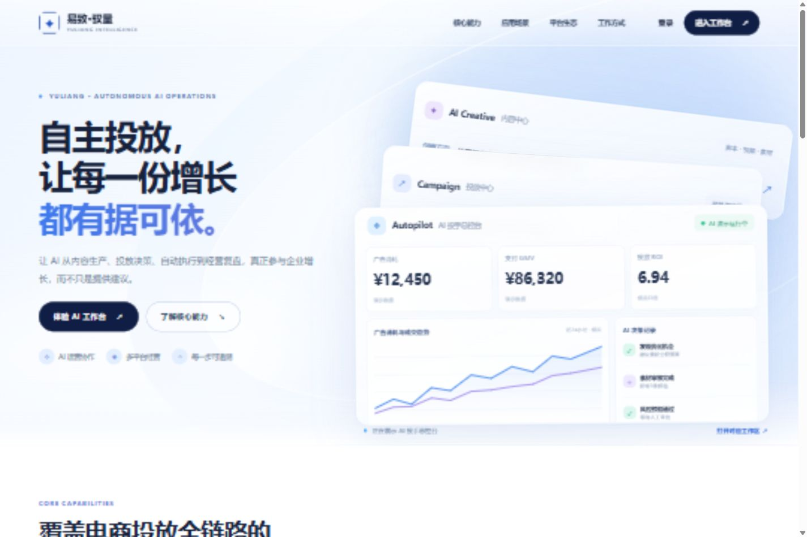
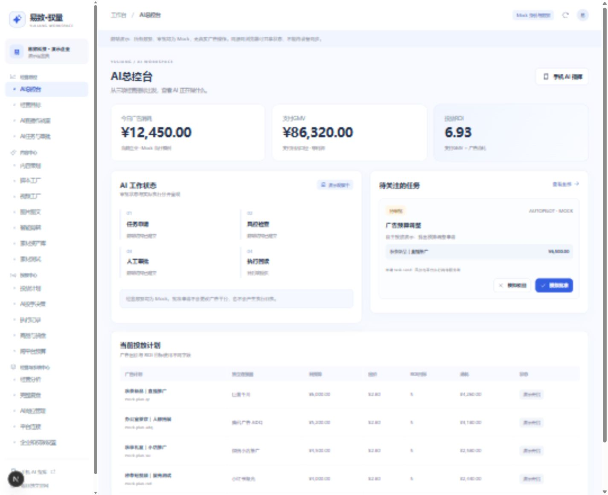
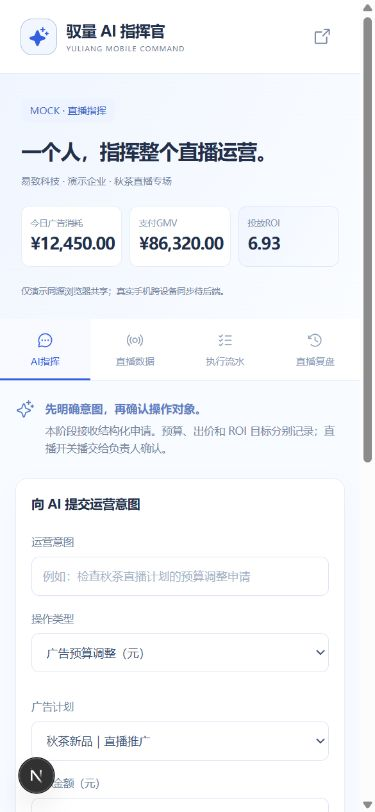

# 易致·驭量 G1-A 验收记录

日期：2026-10-21（Asia/Shanghai）。范围：前端工程基础；等待用户验收，尚未进入 G1-B。

## 1. 实际运行

- 工作目录：`D:\易致-驭量`。
- 分支：`feat/g1a-frontend`，基于本地 `main/c9af5ae`。
- 实际开发地址：`http://127.0.0.1:3000/`，由 Next.js 16.2.6 webpack 开发服务提供。
- PC：`http://127.0.0.1:3000/app/overview`；手机：`http://127.0.0.1:3000/mobile`。
- Mock 演示账号：`demo@yuliang.local`；演示密码：`demo123`。不接收真实凭据。
- 项目内 `.runtime/node.exe`：v24.19.0；系统默认 `node --version` 仍为 v20.11.0。没有修改系统全局 Node 或 PATH。
- 没有开发业务 Route Handler、数据库、平台适配器、执行器或策略引擎；没有调用真实广告写接口、push 或部署。

## 2. 冻结官网与根路径

原型来源：`C:\Users\loser\Downloads\V11.1\完整版_解压后打开index.html`。

| 原始文件 | 迁入文件 | 原文件与迁入文件 SHA-256 | 结果 |
|---|---|---|---|
| index.html | public/index.html | 5841a01138fa82ab6d9b018409f7fe23c81053f8a916c07290e6a2c1ddd92c88 | 一致 |
| assets/styles.css | public/assets/styles.css | 6281438a8b2c363c4a9fe5486727f3f996fa4fc7de95f351ea792e083263a5ed | 一致 |
| assets/site.js | public/assets/site.js | c03c34b14868d84acaac3038b62a45f532c3e47d0d29862a677cbf4d664f230e | 一致 |

`next.config.ts` 使用 beforeFiles rewrite 将 `/` 映射到 `/index.html`。HTTP 测试实际请求了运行中的根路径，响应文本与冻结 HTML 逐字节一致；同时检查运行服务提供的三项文件哈希。不是仅将文件放入 public 后推定可用。`.gitattributes` 为三项冻结文件关闭文本换行转换。

浏览器确认浅蓝官网、三层卡包、口号保持原样；点击 AI Creative、Campaign 可更新提示和入口，Campaign 的历史 `next=campaigns` 在新登录页映射为 plans。浏览器测试使用可见的卡片标题，避免重叠卡片中被其他层遮挡的区域。

## 3. 路由、登录与页面

| 检查项 | 结果 |
|---|---|
| 四大工作区 | 经营总控、内容中心、投放中心、经营与系统中心，4 组 |
| 21 个业务 ID | HTTP 均 200；登录后浏览器逐页渲染标题均与路由匹配，21/21 |
| 总控台 KPI | 仅今日广告消耗、支付GMV、投放ROI，3 项 |
| 未登录 `/app/reports` | 跳转 `/login?next=%2Fapp%2Freports`，保留目标 |
| `/login.html?next=campaigns` | 307 到新登录页；Mock 登录后进入 `/app/plans` |
| `/app.html#/reports` | 恢复到 `/app/reports` |
| `/mobile.html` | 307 到 `/mobile`，未登录时保留手机目标 |
| 非法 next（外部 URL） | 回退 `/app/overview`，未发生外跳 |
| 刷新 | 保留演示身份，原工作区可继续访问 |
| 退出 | 当前 PC 和同源手机页均返回各自带目标的登录页 |
| 未知页面 ID | `/app/not-a-page` 返回 404 |
| 业务 API | `/api/v1/frontend/snapshot` 返回 404，没有伪造后端接口 |

21 页清单：overview、goals、monitor、tasks、planning、scripts、videos、graphics、editing、assets、experiments、plans、decisions、executions、products、budgets、analytics、reports、agents、connections、settings。

对应浏览器逐页结果保存在 `evidence/browser-routes.json`。这些页面是组件化基础结构，尚未一次性实现全部业务功能。

## 4. 手机、共享任务与边界

- AI指挥、直播数据、执行流水、直播复盘四个标签均可切换。
- 390px 手机视口及 1440px PC 视口检查无页面级横向溢出；商品表在自己的容器内滚动。
- 手机填写结构化申请：`G1-A验收：手机ROI目标调整6.2`，动作是 `AD_SET_ROI_TARGET`，字段是无货币单位的 targetRoi。
- PC 无需刷新收到相同任务；PC 模拟批准后，手机同步显示“已批准 · 未执行”。
- 计划预算、出价和 ROI 目标保持原值，没有生成平台执行回执。原有 AUTOPILOT 样例与新手机任务使用同一 TaskList、CommandTask、Approval 和标准状态。
- 直播开关播是独立人工交接类型，单元测试确认不改变广告状态或模拟直播状态。
- 存储只共享同源、同浏览器配置下的演示状态，**不提供真实跨设备同步**，也没有分布式并发保证。

## 5. Mock/API 与共享实体

统一 Service 的实际类型与实现见：`src/services/contracts.ts`、`mock-adapter.ts`、`mock-identity.ts`、`api-client.ts`。

所有登录后页面通过 WorkspaceProvider 使用 Service 数据。Mock 身份与快照使用独立命名空间；API 模式没有后端地址或契约不符时明确显示错误，不回退 Mock。前端具备加载、错误、无权限、无数据与运行错误边界。设置页的错误/无权限预览完成浏览器检查，执行回执空态可实际查看。

共享实体见 `src/lib/domain.ts`：Tenant、Shop、AdAccount、LiveSession、AdPlan、Product、Material、CommandTask、RiskPolicy、RiskCheck、Approval、ExecutionReceipt、ReplaySegment、ReplayReport、Connector。

广告预算、出价和 ROI 目标是三种不同的判别联合类型。金额使用整数分，ROI 无货币单位。8 类连接器独立保留，均 UNKNOWN，无已授权宣称。完整复盘保留 8 个经营章节和 6 类直播复盘标签；回放片段明确为无视频的模拟文本。

## 6. 检查结果

| 检查 | 结果 | 证据 |
|---|---|---|
| TypeScript | PASS，退出码 0 | `evidence/typecheck.txt`，记录无诊断输出的成功结果 |
| ESLint | PASS，零 warning，退出码 0 | `evidence/lint.txt`，记录无诊断输出的成功结果 |
| 基础测试 | PASS，12/12 | `evidence/tests.txt` |
| Next.js 生产 Build | PASS | `evidence/build.txt`；仅本地构建，未部署 |
| 实际 HTTP 路由 | PASS | `evidence/http-routes.txt` |
| 冻结官网哈希 | PASS，3/3 | `evidence/homepage-hashes.txt` |
| 浏览器路由渲染 | PASS，21/21 | `evidence/browser-routes.json` |
| 最终浏览器运行时 | 最终版本独立验收页的 21 页遍历未记录 console error | 浏览器工具检查 |
| Git 空白检查 | PASS | `git diff --check` |
| 关联项目保护 | PASS | 三个原始工作树的 porcelain 状态与 G0 记录一致 |

本轮对历史 Hash 恢复、RSC/客户端图标边界及未知路由 HTTP 状态进行了修复与复核，最终结果以本表和最终检查文件为准。加载界面由前端状态组件提供，不额外使用会提前流式返回 200 的通用 loading 路由。

## 7. Git 修改范围与未完成事项

完整文件清单见 `G1-A文件清单.txt`。修改已有 `.gitignore` 与 README；新增前端配置、源码、测试、冻结官网、证据、API 初稿及换行保护规则。AGENTS.md 未修改。运行时、依赖、.next 和真实环境文件不纳入 Git。

待后续批准：

1. 陆文龙确认正式会话、租户权限、CSRF 与 API 契约后再联调。
2. 21 页完整业务、模型调用、自然语言/语音、真实上传/视频服务尚未开发。
3. 正式跨设备同步、服务端风控、审批、执行和回读均由后端提供，当前前端不作已实现声明。
4. 真实连接器授权、Scope、录像与订单退款数据尚未接入。
5. Git 远程推送和生产部署均未执行；当前只进行本地交付。

给陆文龙的《API契约需求初稿》已保存于同目录，包含候选路径、请求/响应、实体、错误、金额、动作、状态和待确认事项。本阶段完成后停止，等待用户验收再进入 G1-B。
