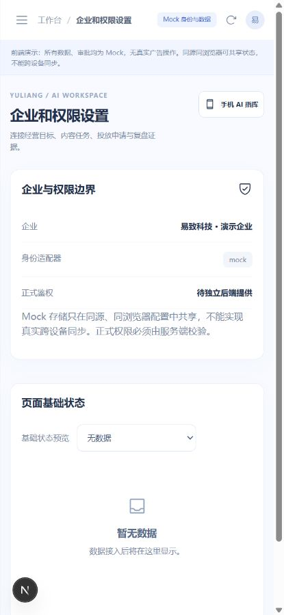
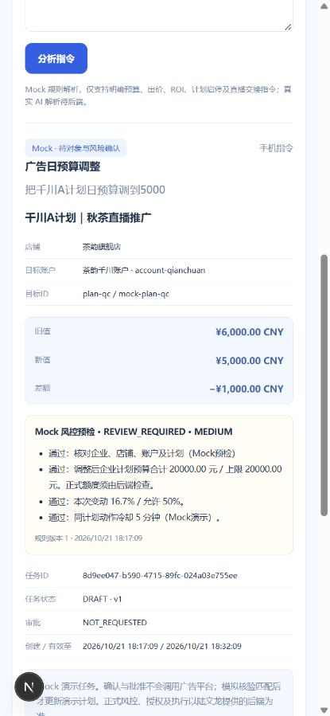
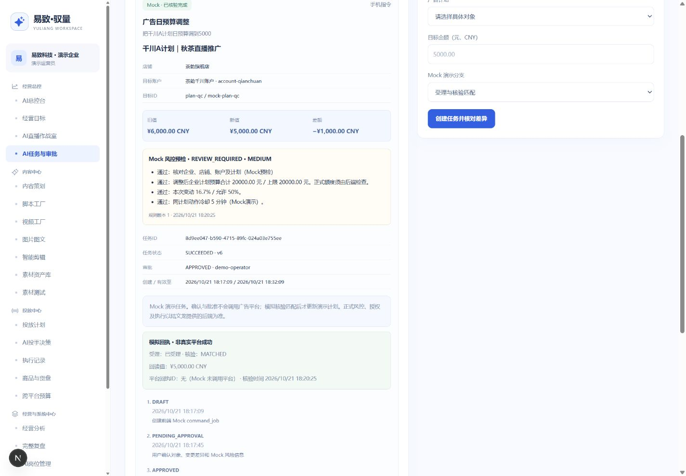
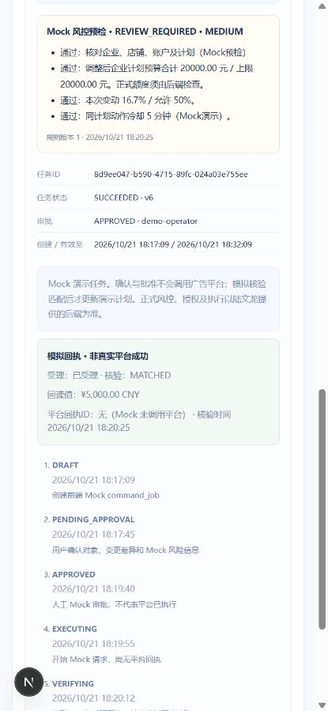

# 易致·驭量 G1-B1 验收记录

2026-10-21 · Asia/Shanghai · 前端交付，待用户验收。本阶段停止于 G1-B1，不自动进入下一阶段。

## 实际运行及范围

- 工作目录 `D:\易致-驭量`，分支 `feat/g1a-frontend`，开发基线 `2a71a15`；开始时工作树无未提交改动。
- 实际运行的 Next.js 开发服务：[PC 总控台](http://127.0.0.1:3000/app/overview)、[任务与审批](http://127.0.0.1:3000/app/tasks)、[手机AI指挥](http://127.0.0.1:3000/mobile)。本地服务继续保留供验收。
- 本项目 Node `.runtime/node.exe` v24.19.0，Next.js 16.2.6 / React 19.2.6 / TypeScript 5.9.3；没有安装新依赖或修改系统 Node。
- 仅扩展 PC overview/goals/monitor/tasks 和手机交互。四大工作区、21 ID 保留；其余页只随共享任务契约更新类型/回执展示，保持 G1-A 功能边界。直播作战室、货盘、回放、话术和完整复盘入口保留。
- 复用 G1-A Service、Provider、状态组件、金额和指标工具。无数据库、业务 Route Handler、第三方平台 SDK/适配器、真实执行或 AI 策略引擎；没有修改关联工程工作树，没有 push 或部署。

## 核心场景

真实浏览器在同源同浏览器配置中的两个页面进行操作；完整记录见 [browser-results.json](evidence/g1-b1/browser-results.json)。自动化测试从独立内存 Mock 存储起步，浏览器同时验证了既有 G1-A 演示存储的兼容迁移。

| # | 操作及实际结果 | 结论 |
|---|---|---|
| 1 | 手机“看看现在直播间情况”：秋茶专场，在线1284、点击367，显示2026/10/21 14:35:00 Asia/Shanghai更新时间，固定样例标识 | 通过 |
| 2 | “把千川A计划日预算调到5000”：明确plan-qc及account-qianchuan；旧6000元→新5000元，差额−1000元，逐项Mock风险 | 通过 |
| 3 | 创建标准DRAFT，用户确认后同一job_id进入PENDING_APPROVAL | 通过 |
| 4 | PC审批列表出现手机任务，ID与手机完全一致 | 通过 |
| 5 | PC批准，手机变为APPROVED；仍未执行，无成功回执 | 通过 |
| 6 | 分步EXECUTING→VERIFYING→SUCCEEDED；MATCHED且回读500000分后投影演示预算；手机执行流水显示相同ID与核验结果 | 通过 |
| 7 | 新预算9000元，企业合计24000元超过20000元上限：BLOCKED，无可批准/执行操作；明确只是Mock预检 | 通过 |
| 8 | 暂停A计划核验后，计划状态暂停；两端历史消耗仍¥12,570.00，支付GMV仍¥87,040.00，投放ROI仍6.92；A历史消耗¥4,260.00不变 | 通过 |
| 9 | ROI目标5→6；出价仍¥2.80，预算仍¥5,000.00，动作SET_ROI_TARGET独立 | 通过 |
| 10 | 请求失败、超时、核验不匹配均FAILED且不误报成功；驳回REJECTED、过期EXPIRED；PC操作后手机同步相同状态 | 通过 |

主流程任务ID：`8d9ee047-b590-4715-89fc-024a03e755ee`。模拟回执 source=MOCK，platform_receipt_id=null，verification=MATCHED；不代表任何真实平台成功。验收期间临时设置冷却期0分钟用于连续演示，结束后已通过经营目标页面恢复5分钟，默认种子也为5分钟。浏览器沿用的G1-A旧预算与全新种子可不同，均按当前存储旧值和规则重新检查。

额外验证：泛指“把预算调到5000”列出多个计划且创建按钮禁用，要求明确对象；切换山海好物/live-mountain后，两端均为消耗¥180.00、支付GMV¥1,260.00、ROI7.00。恢复茶韵/秋茶/全部平台后，范围与数值再次一致。自主投放种子与PC/手机均使用同一模型和状态，工作模式不自行批准。

## 检查与证据

| 检查 | 结果 / 日志 |
|---|---|
| TypeScript | 通过，`--noEmit`，exit 0；[typecheck.txt](evidence/g1-b1/typecheck.txt) |
| ESLint | 通过，0 error / 0 warning；[lint.txt](evidence/g1-b1/lint.txt) |
| 单元/集成测试 | 27/27，通过主流程、金额、权限、并发版本、迁移、规则变更、过期、API错误等；[unit-tests.txt](evidence/g1-b1/unit-tests.txt) |
| Next.js Build | 通过，webpack编译、类型检查、页面生成完成；[build.txt](evidence/g1-b1/build.txt) |
| HTTP路由回归 | 21业务页及根路径/login/mobile均200；历史入口307，campaigns→plans；非法页面和不存在业务API为404；[routes.txt](evidence/g1-b1/routes.txt) |
| 浏览器回归 | 从实际导航逐页打开21个路由并检查h1，21/21；记录时控制台error为0；[browser-results.json](evidence/g1-b1/browser-results.json) |
| 登录目标白名单 | 自动化覆盖合法深链、campaigns映射和外链/编码/路径穿越等拒绝；登录页及身份机制复用G1-A |
| AI总控台KPI | 实际DOM中仅3项：今日广告消耗、支付GMV、投放ROI；AI状态和待办采用普通内容与入口 |
| 冻结官网 | HTML/CSS/JS与原始源文件SHA-256全部一致；实际Next根路径响应内容和哈希通过；[homepage-hashes.txt](evidence/g1-b1/homepage-hashes.txt) |
| Git空白检查 | `git diff --check`通过；[实际文件清单](G1-B1文件清单.txt) |

冻结SHA-256：

```text
index.html       5841a01138fa82ab6d9b018409f7fe23c81053f8a916c07290e6a2c1ddd92c88
assets/styles.css 6281438a8b2c363c4a9fe5486727f3f996fa4fc7de95f351ea792e083263a5ed
assets/site.js    c03c34b14868d84acaac3038b62a45f532c3e47d0d29862a677cbf4d664f230e
```

以下截图均来自真实运行的 Next.js 页面：









## 契约、同步与未完成事项

已输出 [command_job前后端契约V1.0](command_job前后端契约V1.0.md)，包括全部字段、金额单位、独立动作、状态、风险、审批、受理与核验、候选接口及待确认事项。文档供陆文龙确认，本轮没有向他发送消息。

Mock存储新键`yuliang:command-jobs:v1`；G1-A键保留为只读迁移来源，不继承旧审批。同浏览器标签页用storage/custom event通知后通过Service重读。localStorage没有真实跨设备实时同步、分布式锁、正式权限或服务端持久化。过期在读取时判定，执行中不按未执行申请的有效期自动过期。

待后端：正式身份/权限/CSRF/CORS、AI解析、持久化及跨设备同步、服务端风控与额度占用、策略授权、真实平台执行/回执/核验、超时未知结果对账；实时订阅、分页及接口联调需后续批准与契约确认。API模式仅提供客户端声明和错误处理，当前没有可用正式后端，手动刷新读取快照，不宣称实时联调完成。其他17个PC页面没有全面业务化，语音指令和真实直播控制也未实现。

全部成果仅保留本地；不推送GitHub、不部署、不进入下一阶段，等待G1-B1验收。
