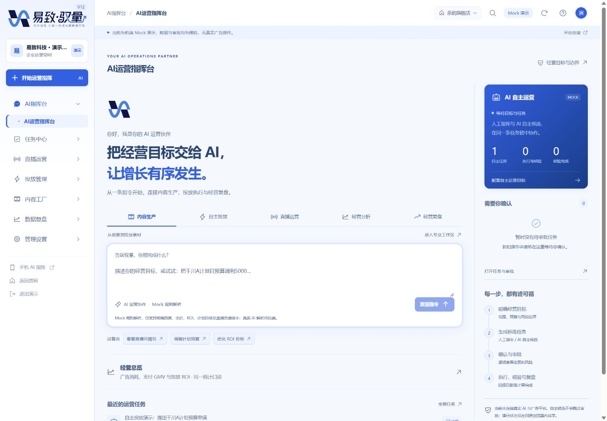
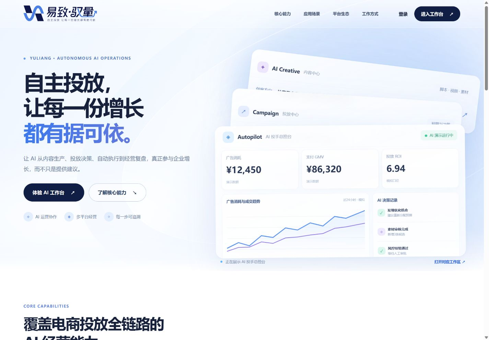
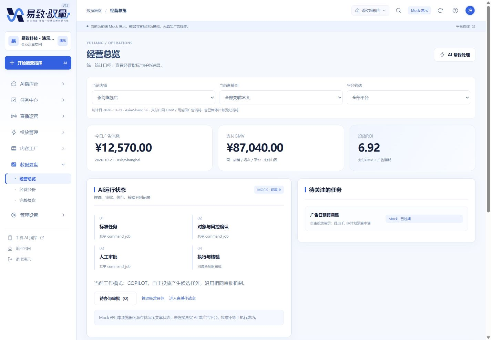
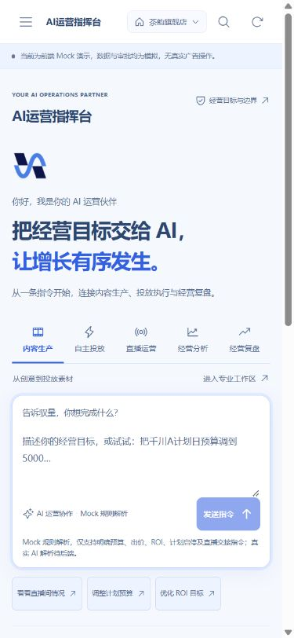

# V12 R1 验收记录

2026-10-22 · Asia/Shanghai。完成 R0 基线保护及 R1 应用外壳、主题和导航。本轮按用户最新指令在 R1 停止，不自动进入 R2—R5。

## 运行与启动

- 正式工程：`D:\易致-驭量`；本地分支 `feat/v12-frontend-rebuild`，基于 `22e12a6`。
- 实际验收入口：[AI运营指挥台](http://127.0.0.1:3002/app/command)、[经营总览](http://127.0.0.1:3002/app/overview)、[官网](http://127.0.0.1:3002/)、[手机入口](http://127.0.0.1:3002/mobile)。3002 是 Next.js 生产构建的本地服务，没有部署。
- 演示账号：`demo@yuliang.local / demo123`，可一键填入；请勿输入真实凭据。
- 项目 Node `.runtime/node.exe` v24.19.0；Next.js 16.2.6 / React 19.2.6 / TypeScript 5.9.3。无新增依赖，无全局 Node/PATH 修改。
- 原 3000 开发入口同样保留，验收构建使用独立目录，避免重写开发服务的产物。

可复现命令（PowerShell，工作目录为正式工程）：

```powershell
.\.runtime\node.exe scripts/run.mjs typecheck
.\.runtime\node.exe scripts/run.mjs lint
.\.runtime\node.exe scripts/run.mjs test
$env:YULIANG_BUILD_DIR = '.runtime/v12-build'
.\.runtime\node.exe scripts/run.mjs build
.\.runtime\node.exe node_modules/next/dist/bin/next start --hostname 127.0.0.1 --port 3002
```

另一终端验收 HTTP：

```powershell
$env:FRONTEND_TEST_URL = 'http://127.0.0.1:3002'
.\.runtime\node.exe scripts/run.mjs routes
.\.runtime\node.exe scripts/verify-homepage.mjs
```

开发仍使用 `npm run dev`（3000）。自定义构建目录可能令 Next 临时添加 tsconfig include；本轮已恢复原 tsconfig 字节内容，未提交生成文件或构建目录。

## 实际交付

- 新 `/app/command` 欢迎界面：品牌蓝自然输入、五类运营入口、快捷填充、Enter 发送、Shift+Enter 换行、新指令清空当前输入及解析结果。接原有 CommandPanel / Service，没有新增 AI 解析后端或自主调度器。
- 七组导航可展开/折叠、当前页高亮、工作区搜索和跳转；顶栏复用店铺/直播/平台上下文；窄屏采用抽屉，支持遮罩、关闭和 Escape，关闭后导航不可聚焦。
- 21 个旧业务 ID 全部保留，新增指挥台后共 22 个入口。overview 改称经营总览，顶层仅“今日广告消耗、支付GMV、投放ROI”。
- 默认登录与 `/app` 进入 command；冻结官网原有 `next=overview` 默认 CTA 同样进入 command。显式 `/app/overview`、旧 Hash、campaigns 和 mobile 深链继续保留。
- 统一官网品牌蓝 Token、白色编辑/表格、淡蓝画布和局部深蓝运行状态；登录、PC 和手机沿用同一色系。
- 自主任务、待审批、执行核验和历史任务使用原有快照，人工与 AUTOPILOT 来源仍分开。当前均为明确标识的 Mock；没有真实生成、广告写入、直播控制或正式授权。

## 检查结果

| 检查 | 结果 | 证据 |
| --- | --- | --- |
| TypeScript | PASS，exit 0 | `../evidence/v12/r1/typecheck.txt` |
| ESLint | PASS，零 warning | `../evidence/v12/r1/lint.txt` |
| 单元/集成 | PASS，30/30：原 27 项＋新增 3 项 | `../evidence/v12/r1/unit-tests.txt` |
| 生产构建 | PASS，webpack 编译、类型检查、页面生成完成 | `../evidence/v12/r1/build.txt` |
| HTTP | 根路径、login/mobile、新 command、21 旧页均 200；历史入口 307；未知页面与不存在的业务 API 404 | `../evidence/v12/r1/http-routes-production.json` |
| 浏览器路由 | 实际生产构建 22/22 标题、菜单高亮正常 | `../evidence/v12/r1/browser-routes-production.json` |
| 浏览器交互 | 默认登录、退出、深链登录恢复、刷新、官网 CTA、Hash/campaigns、非法外链回退、搜索、上下文、新指令、预算对象解析、手机菜单与 Escape | `../evidence/v12/r1/browser-interactions.json` |
| 四种宽度 | 1440 / 1920 / 390 / 375，指挥台无页面级横向溢出；手机入口 390 同样通过 | 同上及截图 |
| 运行时控制台 | 最终独立验收页记录 error 为 0 | `../evidence/v12/r1/browser-console.json` |
| 官网冻结例外 | 仅用户获批 Logo；其余 HTML 逐字节相同，原 CSS/JS SHA 相同 | 新增测试、`homepage-hashes.txt`、`homepage-current-sha.json` |
| Git 空白与保护 | diff --check 通过；其他任务文档及 AGENTS 修改保留 | R0 保护记录及最终状态 |

预算 UI 验收仅解析和核对候选计划，没有创建或执行真实广告。原 G1-B1 单元测试仍覆盖标准任务、确认/审批、模拟执行、回读核验、失败/超时、歧义、预算/出价/ROI 独立值、暂停保留历史消耗、权限、幂等与迁移。

## 官网与并发 Logo 处理

用户在本聊天明确批准“允许仅 Logo 作为官网冻结例外”。保留另一项已完成 Logo 接入的 BrandLogo/BrandMark、图片、图标及其获批哈希配置；不回滚其他任务的成果。

| 文件 | R0 原 SHA-256 | 最终 SHA-256 |
| --- | --- | --- |
| index.html | `5841a01138fa82ab6d9b018409f7fe23c81053f8a916c07290e6a2c1ddd92c88` | `12bcd9b51a75267522240986003cc91e03b202e71fd922ef8c7f247a87a2713b`（仅 Logo） |
| assets/styles.css | `6281438a8b2c363c4a9fe5486727f3f996fa4fc7de95f351ea792e083263a5ed` | 相同 |
| assets/site.js | `c03c34b14868d84acaac3038b62a45f532c3e47d0d29862a677cbf4d664f230e` | 相同 |

独立测试将两处获批 Logo 图片及其 CSS/favicon 引用还原后，对照固定原始 HTML 哈希。因此改动哈希配置本身不能放行其他官网改动。正式口号、主页正文、三层卡包源码与交互脚本保留。

原未跟踪后台规划文档 SHA 不变。并发出现的架构文档、AGENTS.md、其他任务的 Logo 截图和集成 patch 保留，不纳入 R1 提交。没有修改其他项目；本任务不推送、不部署，也未发送外部消息。

## 前端功能状态矩阵

| 能力 | 已完成前端 / Mock | API 与后续阶段 |
| --- | --- | --- |
| 外壳/主题/7 组导航/22 路由 | R1 已完成，真实页面可用 | 正式身份仍待后端 |
| 指挥欢迎态、快捷入口与旧指令解析 | R1 可交互；预算对象解析等复用 G1-B1 Mock | R2 完整会话、附件/语音、历史检索与重命名、结构化跨模块成果 |
| 任务/审批/核验 | 原 G1-B1 能力与同源共享状态保留 | 真实权限、风控、持久化、跨设备及平台回执待后端 |
| 21 旧业务页 | 均可访问，应用新 Shell 与主题 | 完整业务功能继续分阶段实施，骨架页不宣称闭环完成 |
| ADQ/小店推广/微信豆 | 原入口与 8 独立连接器保留、权限仍待核验 | R3 专业列表、子路由与独立向导未实施 |
| 内容生产与投放闭环 | 本轮仅新导航与已有页面入口 | R4 预览/编辑/真实文件下载/素材入库/关联投放未实施 |
| 直播/复盘/手机 | 原有功能和新品牌 Token 保留；响应式外壳通过 | R5 深度直播、复盘与手机工作流未实施 |

关联文档：[信息架构](内部信息架构V12.md)、[UI Token 与模块配色](UI-Token与模块配色表.md)、[API 补充清单](API契约补充清单-R1.md)、[基线与风险](R0-基线与风险摘要.md)。

## 真实浏览器截图

下列均为实际运行的 Next.js 生产构建。手机截图区分新指挥台的响应式外壳与保留的 /mobile 页面；不把它们当作已完成 R5。









另有 1920/375、导航抽屉、登录、预算对象解析和原手机入口截图，均保存在 `docs/evidence/v12/r1/`。R2—R5 尚未实施，不提供冒充完成的专业平台或内容生成截图。
