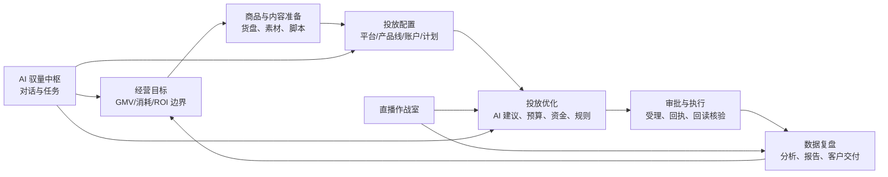
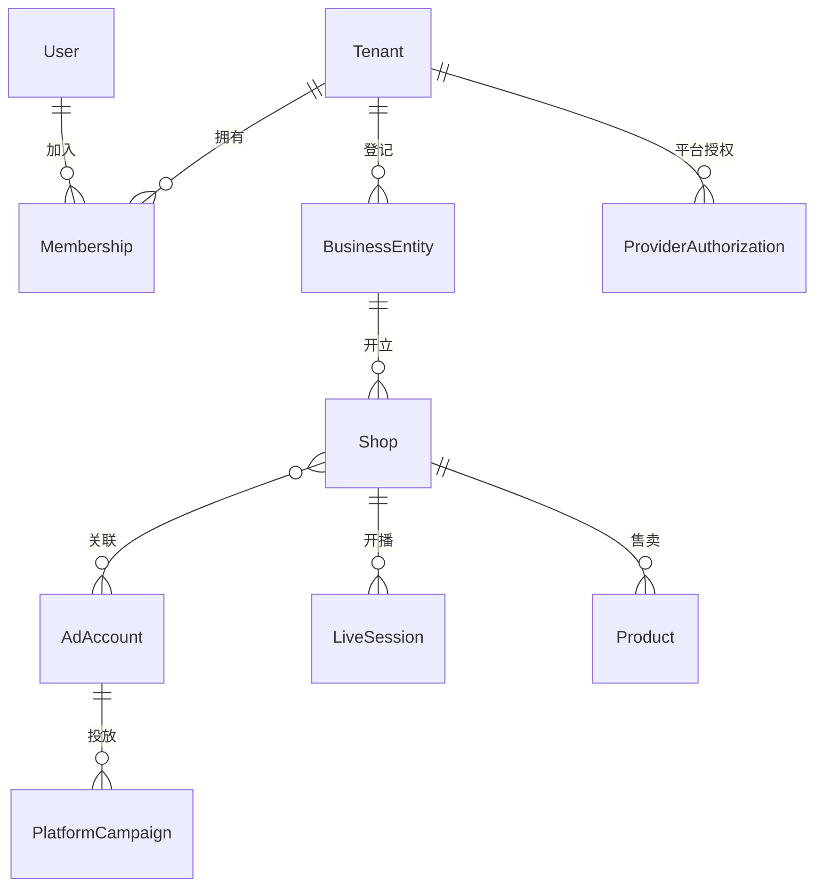
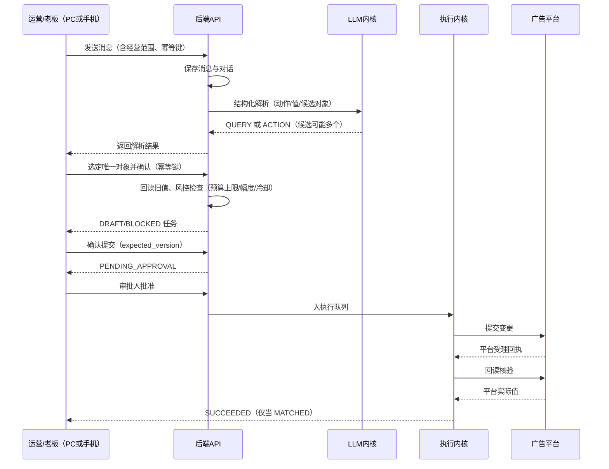

# 01 业务架构与需求分析

本册说明后端要支撑的业务：产品闭环、角色与组织、业务域划分、典型业务流程、非功能要求和演进边界。所有结论来自前端源码、既有前后端契约（G1-A 初稿、command_job V1.0、V8 投放契约、V9 多平台契约）和 V9 多平台功能重规划，不引入臆想需求。

## 1. 产品定位与业务闭环

易致·驭量是直播电商经营管理系统，服务的是在微信小店、抖音/巨量、小红书等渠道做直播带货的经营组织。它不代替广告平台的投放后台，而是站在商家一侧，把"定目标、备货盘、做内容、投广告、看结果"串成一条可审计的经营链路。

业务主闭环：

当前前端已经完成全部页面、交互、本地草稿和 Mock 演示；**没有任何真实平台调用、真实会话、真实 AI 和真实执行**。后端的职责就是把这条链路中需要"真数据、真裁决、真执行、真留痕"的部分承接起来。前端架构文档对此的定性是：页面和本地编辑交互已覆盖多个工作台，真实会话、平台授权、AI 生成、广告执行与回读核验由独立后端承接。

## 2. 角色与组织

### 2.1 业务角色

前期系统服务公司内部，一线使用人分三类（运营/投手、服务商、老板/管理者），另设系统管理员负责后台，权限诉求差别明显：

| 角色 | 典型工作 | 系统权限特征 |
|---|---|---|
| 运营/投手 | 日常盯盘、直播监控、改计划预算出价、提交申请、按内容 SOP 工作流出素材、写复盘 | 需要具体操作权，动作最多 |
| 服务商（代运营） | 同时服务多个商家，替客户操盘 | 需要跨租户/跨店铺数据范围，但每个操作必须留痕并能被客户看到 |
| 老板/管理者 | 看经营概况、看 ROI、审批花钱的动作 | 读全局、管审批，通常不直接改计划 |
| 系统管理员 | 企业信息、成员角色、平台连接、自动化岗位 | 后台管理权限，不天然有业务审批权 |

系统不设独立的"内容制作"角色：内容生产不是独立岗位的手工专区，而是把策划、脚本、素材、剪辑等创作过程梳理成 SOP 自动化工作流（见内容工厂域与 08 册），由运营/投手在经营流程中直接使用。

这四类不是固定死的四个账号，而是由"角色 + 数据范围"组合授权，详见 09 册。一个人可以同时是 A 店投手、B 店只读查看者。

### 2.2 组织对象模型

真实世界的组织关系比"公司-店铺"两级复杂，后端按四级加关联建模：

- Tenant（企业/租户）：计费和隔离的边界。公司自身是一个租户，代运营客户各自是独立租户。
- BusinessEntity（经营主体）：平台侧的广告主主体/商家主体资质，一个企业可能有多个主体。
- Shop（店铺）：微信小店、抖店、小红书店铺等经营阵地。
- AdAccount（广告账户）：广告平台的投放钱包与操作对象，与店铺是多对多关联，分 `BOUND（已关联）` 与 `AUTHORIZED（关联且已获权）` 两个层次。
- Membership（成员关系）：用户与租户的挂靠，带角色与数据范围；服务商员工挂靠客户租户时带来源标记。

## 3. 业务域划分

后端按以下十一个业务域组织代码。划分依据是前端实际页面与既有契约，而不是抽象时髦概念。

| 业务域 | 前端工作台 | 后端职责 |
|---|---|---|
| 身份与组织 | 登录、用户中心、企业与权限 | 会话、用户、租户、成员、角色、邮件验证码 |
| AI 驭量中枢 | 指挥台、手机指令 | 项目、对话、消息、自然语言指令解析、任务归类 |
| 经营概况 | 经营总览 | 三 KPI 聚合、渠道/场次分布、待办与异常汇总 |
| 直播运营 | 直播监控、商品货盘 | 场次、实时指标、讲解编排（草稿同步）、回放证据 |
| 商品经营 | 商品与货盘 | 商品/SKU/库存只读镜像、订单罗盘数据、经营分析 |
| 投放管理 | 目标、计划、决策、预算、执行五个工作台 | 目标策略、计划镜像与变更、AI 决策、预算分配、资金、审批执行 |
| 广告创编 | 平台新建向导（腾讯/巨量/聚光/微信豆） | 能力驱动的配置目录、资源选项、校验、提交、撤回 |
| 内容工厂 | 策划、视频、图文、剪辑、素材库（运营按 SOP 工作流使用，无独立内容角色） | 把创作过程 SOP 化为自动化工作流：云端文档与素材、生成任务编排、对象存储、平台素材关联 |
| 数据复盘 | 经营分析、复盘报告 | 分析任务、不可变结果、报告草稿、固定版本发布与客户链接 |
| 平台连接 | 平台连接、自动化岗位 | OAuth 授权、令牌保管、能力凭证、连接器健康、岗位调度 |
| 系统底座 | 横切 | 风控、审计、通知、幂等、对账、可观测 |

## 4. 典型业务流程（后端视角）

### 4.1 登录与进入工作区

用户邮箱密码或邮箱验证码登录，后端核验后签发 HttpOnly Cookie 会话；前端凭会话读取身份（含租户、可访问店铺、页面授权、动作权限），再拉取授权范围内的快照。未登录返回 401；目标页未授权进入用户中心。前端三层判断（登录态、页面授权、动作/账户授权）中，**只有后端逐接口鉴权是安全边界**。

### 4.2 自然语言指令到执行任务

硬规则：多候选必须消歧，禁止默认选第一条；消息发送与任务创建分别使用幂等键；确认、审批、取消带乐观锁版本；浏览器端永远不能创建 `AUTOPILOT`（自动化岗位）来源的任务，该来源只由后端调度产生。

### 4.3 直播监控

选择已授权场次后，按直播、经营、任务、计划四个模块拉取数据。后端要提供按场次组织的实时/准实时聚合，并声明每类数据的刷新最小间隔与新鲜度（前端默认直播 45 秒、经营 120 秒、任务 30 秒、计划 120 秒口径，实际以后端声明为准）。开播/关播在没有真实推流授权前一律进入 `MANUAL_REQUIRED` 人工交接，不能调用广告暂停来冒充关播。

### 4.4 广告创编（能力驱动）

新投放流程固定为：平台 → 产品线 → 账户 → 目标 → 投放对象 → 定向 → 预算出价 → 素材 → 校验 → 提交回读。每一步的可填字段、可选项、上下限、单位都由后端按"账户 + 上下文"实时返回能力声明，前端不硬编码平台枚举。提交时后端一次性校验：能力版本有效、校验令牌绑定的完整配置未被篡改、权限与资金通过、幂等键不冲突，再进入审批与执行。

产品线之间不允许套用：DOU+ 是订单式流程，不复用项目/单元模型；微信小店是经营数据，不是广告钱包；微信豆写接口未证实前只能保存草稿、导出方案、跳转官方人工入口，任何情况下不返回"创建成功"。

### 4.5 数据复盘与客户交付

复盘流程为：选择范围与维度（店铺/直播/投流/短视频）→ 创建分析任务（排队、运行）→ 生成不可变分析结果（指标、趋势、专项、诊断）→ 选日报/周报/月报周期 → 编辑报告草稿（乐观锁版本）→ 预览/导出 HTML/发布固定版本。日报要求 1 天数据、周报连续 7 天、月报完整自然月，不允许用 7 天数据生成月报。发布后的报告需要正式公网客户链接（访问受控），这是后期对商家交付的主要载体之一。

### 4.6 平台授权与能力治理

管理员在"平台连接"发起 OAuth 授权，后端保管访问令牌与刷新令牌（加密），持续声明每个账户在每条接口目录上的六阶段能力状态。"目录里有这个接口""路径核验过""应用拿到 scope""账户完成授权""参数规则核验过""真实写入并回读成功"是六件不同的事，状态分别存储、分别展示，禁止合并成一个"已支持"。

## 5. 核心非功能要求

### 5.1 安全与资金正确性（最高优先级）

- 所有广告写操作必须经过：真实对象归属校验 → 风控检查 → 审批 → 幂等提交 → 平台回执 → 独立回读核验，六步缺一不可。
- 企业日预算硬上限、单次变动幅度、同计划冷却时间、单日操作次数在服务端强制执行，前端校验仅为体验。
- 结果未知（超时/无回执）冻结重放，凭原幂等键查询对账，禁止自动重试资金类写入。
- 平台令牌、Cookie、校验令牌绝不出现在业务响应和日志中；订单收货信息、手机号、结算信息默认不进入 AI 上下文（个人信息最小化）。

### 5.2 数据口径严肃性

- 店铺支付 GMV、直播 GMV、视频 GMV、广告归因 GMV 可能重叠，无订单级去重依据时不得相加。
- 每条指标必须带来源、归属时间、抓取时间、时区、粒度、归因窗口、退款处理方式与口径警告。
- 暂停计划保留历史消耗；没有有效分母不算 ROI；数据过期允许展示但阻断依赖新数据的变更。
- 微信小店结算余额、广告钱包余额、微信豆是三种钱，分别展示，禁止混算。

### 5.3 可用性与性能

- 一期内部用户规模小（几十个并发、几十到上百租户与店铺），不追求高并发架构，追求"不出错账、不重复投放、可追溯"。
- 普通查询接口 P95 小于 500ms（不含平台实时拉取）；平台数据走"同步落库 + 读库聚合"，页面请求不直接同步等待平台 API。
- Worker 与 API 分离，平台限流和慢响应不拖垮交互接口。

### 5.4 可演进性

- 多租户 SaaS 开放与私有化交付共用一套代码，配置切换。
- 模块化单体的依赖方向为后期按域抽取独立服务预留切面（投放执行、AI 内核、连接器是三个天然的候选）。
- 平台连接器以统一端口接口接入，新增平台或产品线不改核心链路。

### 5.5 可观测与可运维

- 每个请求有 requestId 贯穿 API、Worker、平台调用、AI 调用日志。
- 平台调用与 AI 调用分别记账：成功率、耗时、Token、费用、限流次数可查。
- 所有业务写操作有审计流水，能回答"谁在什么时候依据什么批准了什么，平台最终变成了什么"。

## 6. 一期不做的事（明确边界）

防止范围蔓延，以下能力一期明确不做，架构中只预留位置：

1. 不做平台自动推流控制；开播关播保持人工交接。
2. 不做跨平台资金自动调拨；平台账户间转款走线下，系统只记录。
3. 不自研视频/图片渲染引擎；生成与渲染复用 NEXORA 等外部能力，后端只编排。
4. 不做秒级行情式数据推送（不上 WebSocket 行情房间）；数据以准实时同步落库为主。SSE 只承载两类轻量流量：AI 对话流式输出，以及任务/审批/核验的状态变更通知（实体版本变化事件，客户端收到后按权限重读，事件投影持久化、断线可续传）。
5. 不做开放平台三方应用市场；对外只预留 API Token 与单租户交付形态。
6. 不做复杂批量投放；前端已明确首轮不提供批量批准、批量改预算，后端不为未开放的交互提前建设。
7. 不做微服务拆分、不引入服务网格；没有规模压力前用模块化单体。
8. 一期不对接抖音系（巨量营销/千川/DOU+/本地推/抖店）与小红书系（聚光/小红书电商）连接器：一期平台对接聚焦腾讯系（adq/wxpromo/wxshop/beans），先在公司内部验证经营价值；上述平台统一列二期，在同一连接器框架与执行内核上复制扩展，一期其能力保持 NOT_INTEGRATED、不出现可写入口。

## 7. 与前端契约的对应关系

后端接口不是从零设计，前端已有四份契约资产，后端遵循并补齐：

| 契约资产 | 后端处理方式 |
|---|---|
| G1-A《API 契约需求初稿》 | 认证、快照、任务、回执的基础约定全部采纳 |
| command_job V1.0 | 12 状态、7 动作、JobValue 类型、幂等与版本字段原样兼容 |
| V8.0 投放管理契约 | `/v1/delivery/*` 工作区、计划变更、目标、预算、决策、审批、核验全套采纳 |
| V9.0 多平台契约 | `/v1/delivery/configuration/*` 与 `/v1/delivery/integrations/*` 采纳，六阶段凭证落库 |
| 1818 条平台接口目录 JSON | 导入为平台接口目录表，作为连接器能力治理的原始依据 |

契约字段命名维持现状（下划线风格的 command_job 字段与驼峰风格的 V8/V9 字段并存），后端对外的 Pydantic 模型按各契约分别定义，内部领域模型统一规范，在接口层做转换，不强迫前端改字段。
