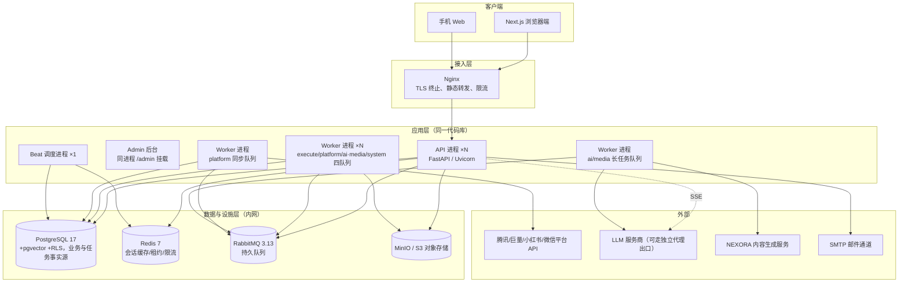
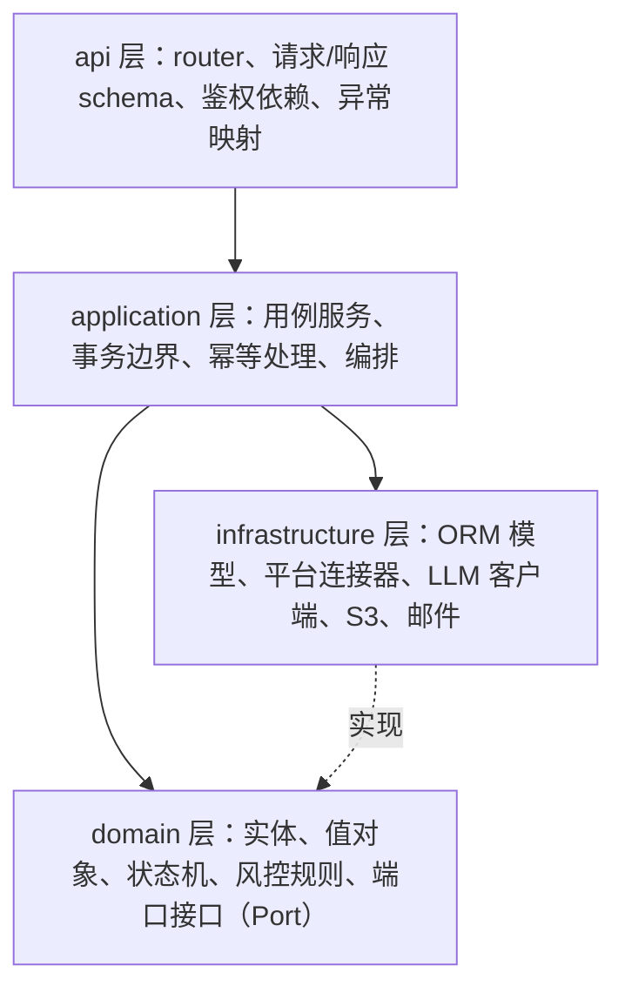
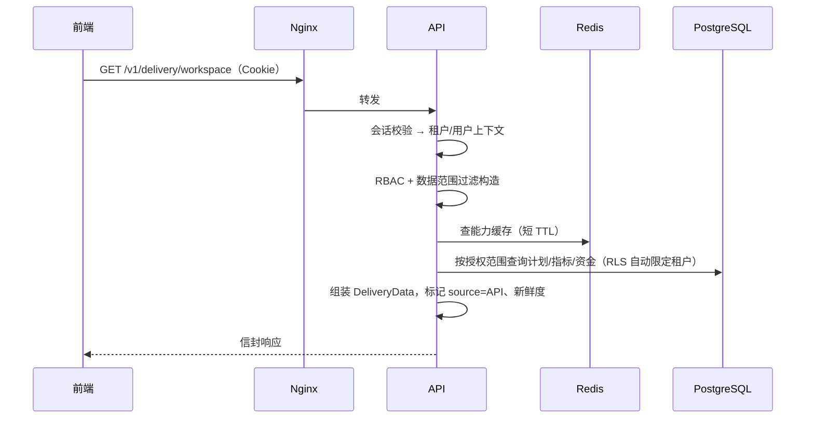
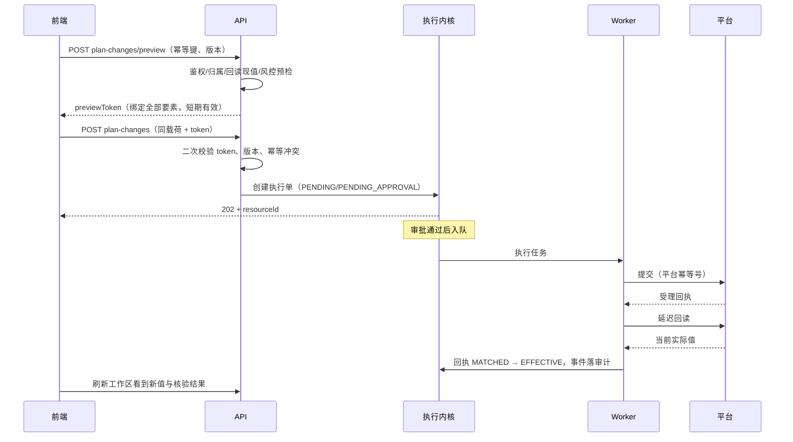

# 03 总体架构与模块设计

本册描述系统的运行形态、模块划分、分层规则、代码工程结构和典型请求链路。目标是让任何开发在动手写第一个接口前，先知道"代码放在哪、依赖谁、不许碰谁"。

## 1. 运行形态：模块化单体

一期采用模块化单体（Modular Monolith）：一个代码仓库、一套可部署制品，内部按业务域分模块；部署时 API 进程与 Worker 进程分离，水平扩 API 和 Worker 即可。



为什么不是一上来就微服务：团队与用户规模都在早期，微服务带来的网络边界、分布式事务、多仓库部署成本远大于收益。模块化单体通过纪律换选项：模块边界、依赖方向、数据库归属先立住，将来哪个域真的需要独立扩缩容（最可能是连接器同步与 AI 长任务），直接抽进程抽服务，业务代码不用大改。

## 2. 进程与队列划分

| 进程 | 职责 | 扩缩方式 |
|---|---|---|
| API | 全部 HTTP 接口、SSE 对话与状态事件、OAuth/Webhook 回调、健康检查、Admin | 无状态水平扩 |
| Worker（default/execute 队列） | 执行单提交、审批后置、通知、对账 | 按积压扩 |
| Worker（platform 队列） | 平台报表/资源同步、令牌刷新、回读核验，受平台限流约束 | 按平台分并发上限 |
| Worker（ai/media 队列） | LLM 长任务、报告生成、素材生成编排（低预取、有界并发） | 按模型并发额度扩 |
| Worker（system 队列） | 过期扫描、Outbox 补偿、到期任务租约扫描、分区与留存维护 | 低并发 |
| Beat | 定时调度，单点（PostgreSQL 租约 + Redis 锁防多实例重复触发） | 固定 1 个，备机抢锁 |
| Flusher（可同 API 进程内协程或独立小进程） | Outbox 事件向 RabbitMQ 发布确认投递 | 与 API 同扩或单实例 |

队列隔离的意义：平台同步慢且有平台侧限流，不能占满 worker 拖慢执行回执；AI/媒体任务耗时最长，单独排队并降低预取，防止一个长任务占住整队。所有队列共用同一 RabbitMQ 虚拟主机与代码库，只是路由键不同；任务事实与恢复依据在 PostgreSQL，Broker 只负责把任务引用可靠送到 Worker。

## 3. 分层架构与依赖规则

单个模块内部四层，依赖只能从上往下，禁止反向与跨层绕过：



- api 层不写业务规则，只做协议转换：解析请求、调用用例、把异常翻译成统一错误信封。
- application 层编排业务用例，控制数据库事务，处理幂等键和乐观锁，不直接出现平台 HTTP 细节。
- domain 层是纯 Python，不依赖 FastAPI、SQLAlchemy、httpx；状态机（如指令任务 12 态流转）、金额计算、风控判定都在这里，可单测。
- infrastructure 层实现 domain 定义的端口：仓储（Repository）、平台网关（PlatformGateway）、AI 网关（LLMGateway）、文件存储（BlobStorage）、通知（Notifier）。

模块间依赖规则：

1. 模块之间只能通过对方模块的 application 服务接口或 domain 端口调用，不许直接读别人的 ORM 表。
2. 查询类跨域读需求走"查询服务"（只读对方暴露的查询接口）或只读视图，不允许为了方便开 ORM 直连。
3. 平台连接器、AI 内核是横切能力，业务模块依赖其端口接口，不依赖具体实现。
4. `platform`（系统底座）不反向依赖任何业务模块。

## 4. 业务模块清单

| 模块（包名） | 核心职责 | 主要数据表归属 |
|---|---|---|
| `platform` | 配置、日志、异常、信封、中间件、租户上下文、事务基件 | 无业务表 |
| `identity` | 用户、登录、会话、邮箱验证码、组织、成员 | users/tenants/memberships/sessions/email_codes |
| `access` | 角色权限、页面授权、数据范围解析 | roles/permissions/role_grants/data_scopes |
| `workspace` | AI 中枢：项目、对话、消息、指令解析入口 | projects/conversations/messages |
| `command` | 指令任务 command_job 的 12 态生命周期 | command_jobs/job_events/interpretations |
| `execution` | 统一执行内核：执行单、审批、幂等、风控网关、回读、对账 | execution_orders/execution_attempts/platform_receipts/approvals/idempotency_requests/reconciliation_tasks |
| `policy` | 企业经营目标与风控策略、版本管理 | risk_policies/policy_versions |
| `catalog` | 经营资产目录：主体、店铺、账户、关联、连接 | business_entities/shops/ad_accounts/entity_links/provider_authorizations |
| `capability` | 平台接口目录与六阶段能力凭证治理 | endpoint_catalog/capability_assertions/account_capabilities |
| `delivery` | 投放域：目标、计划镜像、变更、AI 决策、预算、资金 | goals/campaigns/plan_versions/decisions/budget_allocations/funds_snapshots |
| `configuration` | 广告创编向导：配置目录、能力、选项、校验、任务 | config_tasks/validation_tokens（缓存） |
| `connectors` | 八个平台连接器实现、OAuth 回调、平台 HTTP 客户端 | platform_raw_payloads/sync_runs（落库表归此模块） |
| `reporting` | 同步落库的指标事实、经营概况聚合、分析数据底座 | metric_facts/overview_mv（视图） |
| `live` | 直播场次、实时数据、回放片段 | live_sessions/replay_segments |
| `commerce` | 商品、SKU、库存、订单罗盘只读镜像 | products/skus/order_facts |
| `content` | 运营驱动的创作 SOP、策划/脚本/视频/图文/剪辑文档、素材资产、平台关联 | workflow_templates/workflow_runs/workflow_run_steps/content_documents/content_assets/generation_jobs/content_account_links |
| `analysis` | 分析任务、不可变结果、报告草稿、发布 | analysis_tasks/analysis_results/report_drafts/published_reports |
| `aikernel` | LLM 路由、提示词注册、结构化输出、用量账本、向量检索 | prompt_versions/ai_invocations/ai_memory（向量） |
| `notify` | 邮件、站内消息、企微/钉钉 webhook 通知 | notifications |
| `audit` | 审计流水采集与查询 | audit_logs |

模块对外暴露 `service.py`（写用例）与 `queries.py`（只读查询）两个入口文件，外部模块只从这两个文件导入。

## 5. 代码工程结构

```text
backend/
  pyproject.toml
  alembic.ini
  .env.example
  docker-compose.yml                 # 本地与一期部署
  docker-compose.prod.yml
  Dockerfile
  src/yuliang/
    main.py                          # FastAPI 应用装配
    settings.py                      # pydantic-settings 配置
    api/                             # 路由聚合、SSE 端点、鉴权依赖、异常映射
    platform/                        # 系统底座（稳定原语，不依赖业务模块）
      errors.py                      # 错误码与异常定义
      envelope.py                    # 统一响应信封、requestId
      middleware.py                  # 租户上下文、日志、请求计时
      db.py                          # engine/session、RLS 会话设置（psycopg 3）
      redis.py
      events.py                      # 持久化事件投影与 SSE 分发
      security/                      # 密码哈希(argon2id)、签名、AES-GCM 加密基件
      pagination.py
    modules/
      identity/                      # 每个业务模块内部固定子包：
      access/                        #   interfaces/（路由与 schema）
      workspace/                     #   application/（用例、事务边界）
      command/                       #   domain/（实体、状态机、规则、端口）
      execution/                     #   infrastructure/（仓储、外部适配）
      policy/                        #   models.py（ORM 模型）
      catalog/
      capability/
      delivery/
      configuration/
      connectors/
        domain/                      # PlatformGateway 端口、连接器协议
        infrastructure/
          registry.py
          tencent/                   # adq、wxpromo
          ocean/                     # 巨量营销/千川/DOU+/本地推/抖店
          xhs/                       # 聚光、小红书电商
          wxshop/
          beans/
          oauth/
          ratelimit.py               # 平台侧限流与熔断
      reporting/
      live/
      commerce/
      content/
      analysis/
      aikernel/
        gateway.py                   # LLM 路由端口与实现
        prompts/                     # 提示词模板与版本
        parsing.py                   # 结构化输出与 Pydantic 校验
        memory.py
      notify/
      audit/
    infrastructure/                  # 跨模块基础设施实现
      blob.py                        # S3/MinIO 与预签名
      amqp.py                        # RabbitMQ 连接、发布确认
      outbox.py                      # Outbox 投递器、consumer inbox
      mail.py                        # SMTP
    worker/                          # Celery 应用（prefork，同步 psycopg）
      celery_app.py
      tasks_execution.py
      tasks_sync.py
      tasks_ai.py
      tasks_system.py
    admin/                           # SQLAdmin 注册与独立鉴权
  alembic/
    versions/
  tests/
    unit/ integration/ contract/
  deployment/                        # Dockerfile、Compose、备份和升级说明
  scripts/                           # PowerShell 本地辅助脚本、接口目录导入
```

说明：

- 采用 src 布局（`src/yuliang/`），与历史 V1.1 设计一致；测试与打包以已安装包方式导入，避免开发期路径穿透。
- 每个业务模块内部固定四套子包 `interfaces / application / domain / infrastructure`，模块小可以合并文件但不改变依赖方向；可用架构测试（import-linter）强制依赖方向。
- `models.py` 是 SQLAlchemy ORM 模型，只有本模块 infrastructure 与 Alembic 引用；API 进程使用 async session，Worker 使用同步 session，二者不共享连接与会话实例。
- 前端的 1818 条平台接口目录 JSON 通过 `scripts/` 导入到 endpoint_catalog 表，不手工搬运。
- API 路由按契约版本挂载：`/v1/auth/*`、`/v1/frontend/*`、`/v1/command-jobs/*`、`/v1/delivery/*`、`/v1/business-analysis/*`，与前端 ApiClient 现有路径完全一致。

## 6. 典型请求链路

### 6.1 只读查询（如投放工作区）



关键纪律：读接口不做平台实时调用，数据全部来自落库镜像；新鲜度由同步时间戳表达，过期数据照常返回但带状态，是否阻断变更由写接口判断。

### 6.2 写操作（以预算调整为例）



### 6.3 SSE 对话链路

前端发起消息后，普通消息保存与解析结果仍走 JSON；当进入"AI 流式生成"（内容草稿、复盘文本）时，接口以 `text/event-stream` 返回增量 token，事件中携带 messageId 与 requestId，结束事件携带完整结构与用量。鉴权、租户上下文与普通接口一致；连接异常中断时前端凭 messageId 重新拉取已完成内容，不产生重复消息（消息创建幂等）。

### 6.4 状态变更事件链路（对接前端 subscribe）

前端传输层预留了事件订阅入口，后端提供 `GET /v1/events` 的 SSE 长连接，用于任务审批、执行状态、核验结果、生成进度等状态变化通知。关键设计：事件不是实时推送业务数据，而是"实体变了、版本是多少"的轻量通知，客户端收到后按权限重读授权资源。

- 业务变更与outbox事件同事务提交；投影器消费持久化事件，在独立短事务内去重、分配租户序号并写event_projections。Broker故障时可扫描PG待投影事件恢复，事件事实不会因Pub/Sub或Broker丢失而消失。SSE游标序只代表投影提交顺序，实体新旧由version判定。
- 每个租户一条按序号递增的投影水位，由投影器持锁在同一投影事务内分配直到提交，保证提交可见顺序；event_id用于消费去重，tenant_seq用于SSE游标，不使用全局identity id作为提交水位。事件保留7天，数据结构见13册。
- API 实例用 Redis Pub/Sub 作为跨进程唤醒通道：一个 Worker 更新实体后发布唤醒，持有该租户连接的 API 实例从投影表补发新事件；Pub/Sub 丢失时有定时数据库轮询兜底，Redis 不作为唯一事件流。
- SSE 支持 `Last-Event-ID` 续传；游标过旧（超过保留期）发送 resync 信号，前端做一次全量/分资源重读。连接建立与每次补发都校验会话与数据范围，权限撤销或注销后立即关闭对应订阅。
- 事件体不含金额明细等敏感业务载荷，只含实体类型、ID、版本、事件类型，避免越权数据经事件通道泄漏。

## 7. 横切机制

### 7.1 租户上下文

每个请求经认证中间件解析出 `user_id / tenant_id / 数据范围`，写入上下文对象；获取数据库连接时执行 `SET LOCAL app.current_tenant = '<tenant_id>'`，PostgreSQL RLS 策略据此过滤全部业务表。后台管理跨租户操作必须走显式提权的系统账号并写审计，普通业务连接无此权限。

### 7.2 requestId 与幂等标识

- API 入口生成或透传 `requestId`（响应信封必返），写入 structlog 上下文，向平台与 LLM 出站请求时作为关联头透传，Worker 任务继承。
- 业务幂等键由客户端生成（UUID），服务端按"键 + 租户 + 接口"唯一索引落表，返回首次结果，键冲突且载荷不同返回 409。

### 7.3 配置与特性开关

- 环境配置集中在 `settings.py`，平台凭证、LLM 配置、功能开关入库或入环境变量。
- 平台能力开关不用硬编码 feature flag，而由 capability 模块的账户能力数据驱动；系统级开关（如是否开放某平台写链路）入配置表并记录变更。

### 7.4 异常与事务

- 领域异常（业务被拒绝、版本冲突、能力未授权）与基础设施异常（超时、连接失败）分开定义，api 层统一映射错误码（见 05 册）。
- 用例方法默认"一个用例一个事务"；涉及平台副作用的步骤在事务提交后投递任务（outbox 模式，见 06 册），避免"库已回滚但平台已下单"。
