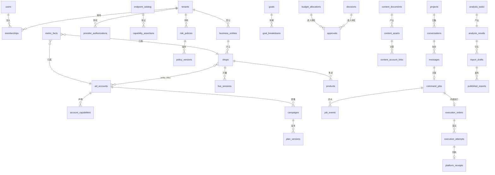

# 04 领域模型与数据库设计

R00-02的迁移顺序、会话与成员复合外键、认证权限、事实键、系统模板与事件水位见[数据库与认证冻结规格](../contracts/R00-02-数据库与认证规格.md)。13册分段DDL同步此规格；实际迁移与数据库攻击/并发测试按M0及对应领域卡验收。

本册给出核心领域模型、数据库分组表设计、关键枚举、金额与指标口径、多租户 RLS 落法和索引策略。表设计以"能支撑前端全部契约 + 留好治理字段"为度，字段给出业务要点，不全量罗列 created_at 等公共字段。命名采用蛇形小写；对前端输出时按各契约模型转换（command_job 输出蛇形，V8/V9 输出驼峰）。

## 1. 总体 ER 关系



## 2. 公共约定

租户业务实体表包含以下公共字段（下文中不重复）。全局身份users、登录前挑战/认证事件、系统只读字典、consumer_inbox另按R00-02的例外清单处理，不能套用租户业务表模板：

| 字段 | 类型 | 说明 |
|---|---|---|
| id | uuid | 内部主键统一 UUID v4，对外只暴露字符串 ID |
| tenant_id | bigint not null | 租户列，RLS 依据，全部业务表必有 |
| created_at / updated_at | timestamptz | UTC 存储 |
| deleted_at | timestamptz null | 软删除标记（仅目录类对象需要，流水事实表不软删） |

约定：

- 金额列统一 `bigint`，单位 CNY 分，列名以 `_minor` 结尾；金额校验 `0 < amount_minor <= 9007199254740991`（2^53-1，JSON 安全整数上限），平台上下限更窄时由连接器二次校验。微信豆列 `bigint` 单位豆，列名 `_beans`；比值列 `numeric(12,4)` 并限定业务合理区间。禁用 float/real 存金额。
- 乐观锁版本列统一 `version int not null default 1`，更新带 `where version = :expected`。
- 对外业务实体主键用UUID，租户主键用正bigint且对外序列化字符串；事实/审计/事件/调用明细可用bigint内部流水号。分区主键包含分区列，不把内部流水号充当业务ID或SSE游标。
- 平台原生标识单独 `native_id varchar`，永不与内部 id 混用；平台父子层级用 `native_parent_id`。
- 租户业务对象间用 `(tenant_id, id)` 或含店铺/商品归属的更严格复合外键；全局users/permissions、租户根、系统模板选择器是明确例外。RLS不能替代外键；数据范围仍由服务端鉴权，不能仅检查“同租户”。
- 枚举优先用 `varchar + check`，不用数据库原生 enum 类型（平台枚举演进频繁，改 check 比改 enum 类型成本低）。
- 平台原始载荷存 `payload jsonb`，抽取的稳定字段建实列，查询走实列与索引。
- 写操作关键表（任务、审批、执行、预算）的状态更新全部走条件更新（带 tenant_id、当前状态、expected_version），影响行数不为 1 即冲突，不允许读后无条件覆盖。

## 3. 身份与组织域

### users 用户

users是全局身份表，不带tenant_id，不允许普通业务连接直读（尤其password_hash）。租户归属只来自memberships；不再用users主租户推导权限。对其他成员显示资料走按当前租户成员关系过滤的受控查询。

| 字段 | 要点 |
|---|---|
| email | 唯一登录邮箱，小写归一，citext 或唯一索引 |
| password_hash | argon2id 哈希；验证码登录用户可为空 |
| display_name | 昵称，1-40 字符（沿用前端校验） |
| status | ACTIVE / DISABLED |
| last_login_at | 最近登录 |

### tenants 企业（租户）

| 字段 | 要点 |
|---|---|
| name | 企业名称 |
| plan | 套餐/合作模式：INTERNAL（公司自有）、AGENCY_CLIENT（服务商客户）、EXTERNAL（开放采购） |
| isolation_mode | SHARED（共享库）/ DEDICATED（预留独立库），一期全部 SHARED |
| status | ACTIVE / SUSPENDED |

### memberships 成员关系（联合租户-用户）

| 字段 | 要点 |
|---|---|
| tenant_id + user_id | 联合唯一 |
| kind | INTERNAL 内部员工 / AGENCY_STAFF 服务商员工挂靠 / CUSTOMER 客户本人 |
| id + tenant_id + user_id | 建三列唯一键，sessions以同三列复合FK绑定真实成员和用户；不复制另一份agency_user_id |
| status | ACTIVE / REMOVED |

一个用户可挂靠多个租户，登录后按会话选定当前 tenant_id；切换租户重新签发会话数据范围。

### roles / permissions / role_grants 角色权限

采用 RBAC：角色挂权限点，成员挂角色。

- 预置角色：`OWNER`（老板/企业主）、`OPERATOR`（运营投手，含使用内容 SOP 工作流）、`AGENCY_OPERATOR`（服务商投手）、`AUDITOR`（只读审计）、`PLATFORM_ADMIN`（平台管理员，仅内部）。不设独立内容制作角色，内容域权限默认并入 OPERATOR。
- 权限点与前端现有字符串对齐并扩展：`snapshot.read`、`task.create`、`task.approve`、`task.execute`、`policy.edit`、`goal.edit`、`plan.write`、`budget.edit`、`content.write`、`report.publish`、`connection.manage`、`admin.access` 等。
- 权限点细到动作，页面级授权（workspacePages）由角色拥有的权限点推导，不单独维护页面勾选，避免页面与权限两套真相。前端需要的 `workspacePages` 列表由登录接口聚合返回。

### data_scopes 数据范围

角色解决"能不能做这个动作"，数据范围解决"能对哪些对象做"。

| 字段 | 要点 |
|---|---|
| membership_id | 归属成员关系 |
| scope_type | ALL_TENANT / ENTITY / SHOP / ACCOUNT |
| entity_id / shop_id / account_id | 范围对象，按 type 取一 |
| permissions_mask | 该范围上授予的权限点子集（可空表示继承角色全集） |

运行时鉴权解析为"动作权限点 AND 对象在数据范围内"两个条件同时成立。服务商员工默认只对被授权店铺/账户有范围，不能跨客户。

### sessions 会话、email_codes 验证码

- sessions：token_hash（随机bearer的SHA256摘要，令牌使用256位随机源）、user_id/tenant_id/membership_id、csrf_token_hash、authz_version、签发/滑动/绝对到期、revoked_at。PG是事实源，每次受保护请求检查会话、身份、租户、成员有效性；Redis缓存不能绕过吊销。最多7天绝对寿命，昵称仍按1–40字符。
- email_codes：id即对外challengeId、email、purpose=LOGIN、code_hash（由服务端独立pepper做HMAC-SHA256，绑定challenge/purpose）、expires_at、attempts/max_attempts、consumed_at、verified_at。密码可空，验证码登录不要求创建假密码；未匹配身份的发码/失败日志不使用虚构tenant=0。
- auth_challenges：登录前CSRF预认证挑战，独立于六位邮件码；只存cookie_token_hash/csrf_token_hash和到期/撤销状态，不能混作登录成功证明。auth_events是受限认证审计，全局、tenant_id可空、邮箱/IP仅受控摘要。

## 4. 经营资产与连接域

### business_entities 经营主体

租户下的平台广告主/商家主体：name、provider、native_entity_id（平台主体 ID，加密或脱敏展示按场景）、qualification_status。

### shops 店铺

| 字段 | 要点 |
|---|---|
| tenant_id / entity_id | 归属 |
| connector_id | 前端八连接器之一：adq/wxpromo/beans/wxshop/qianchuan/douyinshop/juguang/redshop |
| native_shop_id | 平台店铺 ID |
| name / status | 名称、授权状态 |

### ad_accounts 广告账户

tenant_id、entity_id、native_account_id、provider、product_line、name、currency（CNY/BEAN）、authorization_status（六态 Availability）、scope_granted（已授权 scope 数组）、token_ref（指向 provider_authorizations）、last_synced_at。

### entity_links 关联关系

多对多关联表：左对象（类型 ENTITY/SHOP/ACCOUNT + id）、右对象、relation（SHOP_ACCOUNT 等）、bind_state（BOUND/AUTHORIZED）。这是 V9 契约"经营主体、店铺、账户独立建模、多对多 links"的落地。

### provider_authorizations 平台授权

| 字段 | 要点 |
|---|---|
| tenant_id / account_id（可空，应用级授权时为空） | 归属 |
| provider / product_line | 平台与产品线 |
| app_id | 我方平台应用 ID |
| access_token_enc / refresh_token_enc | AES-256-GCM 密文，禁止明文落库 |
| scopes | 授权范围数组 |
| expires_at / refresh_expires_at | 令牌有效期 |
| status | ACTIVE / EXPIRED / REVOKED / REFRESH_FAILED |
| authorized_at / last_verified_at | 授权与最近核验时间 |

主密钥（KMS Key）从环境注入，一期可用单主密钥 + 密钥版本号字段，后期换云 KMS 不需改密文结构。

## 5. 能力治理域

### endpoint_catalog 平台接口目录（1818 条）

由前端 `platform-api-catalog.json` 导入：

| 字段 | 要点 |
|---|---|
| catalog_id | 稳定 ID（前端已生成），全局唯一 |
| provider / product_line | 归属平台产品线 |
| source_file / source_ref | 四份图谱来源 |
| operation / normalized_path | 操作名与规范化路径（腾讯补 /v3.0/、聚光补 /api/open） |
| http_method | 已知方法；原资料未给则 UNKNOWN |
| scope_hint | 资料中声明的 scope |
| doc_status | 资料状态标记 |

### capability_assertions 能力证据（六阶段）

每条断言绑定"账户 × 接口目录项 × 阶段"：phase（PATH_VERIFIED/SCOPE_GRANTED/ACCOUNT_AUTHORIZED/BACKEND_INTEGRATED/SCHEMA_VERIFIED/EXECUTION_VERIFIED）、result（PASS/FAIL/UNKNOWN）、proof_ref（核验记录或平台响应存档 ID）、checked_at、checked_by、limitations。六状态不可跳级累积，执行能力必须六阶段全 PASS 才允许真实写入。

### account_capabilities 账户能力视图（对前端）

缓存对前端输出的能力矩阵：account_id、action（create/budget/bid/pause/resume/review/analyze/goal/allocate/verify/retry/rules）、status（Availability 六态）、reason、permission、execution（COMMAND_JOB/DIRECT/MANUAL）、automation_mode（OBSERVE/APPROVAL/CONTROLLED）、refresh_seconds、max_age_seconds、schema_json（objectives、targets、bidEditable、min/maxAmount 等）、version、checked_at。

字段级能力（创编向导 FieldCapability）按上下文键（context_key）缓存为 `configuration_capabilities`：context_key、capability_version、fields_json（含 state 六态、required、min/max/step/unit/specs/options）、expires_at。

## 6. 中枢与任务域

### projects / conversations / messages

- projects：tenant_id、user_id（创建人）、name。
- conversations：project_id 可空（未归类）、title、last_message_at。
- messages：conversation_id、role（USER/ASSISTANT/SYSTEM）、content、client_msg_id（发送幂等键，唯一）、interpretation_json（解析结果快照）、created_at。

### command_jobs 指令任务（兼容 V1.0 契约）

字段与前端 `CommandJob` 一一对应，要点：

- source：PC_MANUAL / MOBILE_COMMAND / AUTOPILOT（AUTOPILOT 仅后端创建）。
- target_type：AD_PLAN / LIVE_SESSION；target_id 为内部对象 ID。
- action_type 七类；old_value/new_value 用 JSONB 存类型化 JobValue（kind=MONEY/RATIO/BOOLEAN/HANDOFF），check 约束 kind 合法；old_value 由服务端回读写入，创建请求不接受客户端 old_value。
- status：12 态 varchar + check；version 乐观锁；idempotency_key 在租户内唯一，不同载荷冲突报错。
- risk_json（risk_summary）、approval_json、error_json 存快照结构；执行段关联执行内核（execution_orders）。
- intent_hash：创建时对规范化后的"动作 + 目标对象 + new_value + 单位"计算的不可变意图哈希；审批记录保存批准时的 intent_hash 与 policy_version，后续版本递增不改变已批准意图，执行前用哈希证明"批准的就是将要执行的"，修改目标值必须新建任务。
- expires_at：创建时计算（默认申请有效期 15 分钟，可配置）。
- (tenant_id, status, updated_at) 建索引服务待办列表。

### job_events 任务状态流水

job_id、from_status、to_status、actor_id、detail、at。状态流转是否合法由 domain 层状态机校验，任何状态变化同步追加不可变流水。

### interpretations 指令解析留痕

message_id、raw_text、scope_json、result_kind（QUERY/ACTION/UNRECOGNIZED）、structured_json、model_ref（模型与提示词版本）、confidence、latency_ms。用于审计 AI 解析质量与后期纠错。

## 7. 风控策略域

### risk_policies / policy_versions

企业级风控策略（对应前端 RiskPolicy + V8 PolicyRequest）：

| 字段 | 要点 |
|---|---|
| tenant_id / account_id | 企业策略 account_id 可空；账户策略必填 |
| daily_budget_minor | 企业日预算上限（CNY 分）；上限统计含暂停计划配置预算 |
| target_roi | 经营 ROI 目标（numeric） |
| max_change_percent | 单次预算/出价变化幅度上限 1-100 |
| cooldown_minutes | 同计划成功操作冷却（整数分钟，默认 5） |
| mode | MANUAL / COPILOT / AUTOPILOT（前端文案：人工操作/辅助建议/自动化候选） |
| account 级扩展 | roi_floor、pacing_threshold、budget_limit、min_observation_minutes、max_changes_per_day |
| version | 乐观锁版本 |

每次修改写 policy_versions 全量快照；任务创建、确认、批准、执行前都要按当前版本重跑风控，规则版本变化导致旧申请失效（前端展示重新核对）。

## 8. 投放域

### goals / goal_breakdowns 经营目标

goals：scope_json（范围）、name、period（DAILY/WEEKLY/MONTHLY/LIVE）、start_at/end_at、gmv_target_minor、budget_amount + currency（CNY/BEAN）、roi_floor、status、version。
goal_breakdowns：goal_id、target_type（ENTITY/SHOP/ACCOUNT/LIVE）、target_id、target_minor，要求目标实体真实存在且在范围内，禁止越权关联与重复分配。调整历史进 goal_versions。

### campaigns 计划镜像 + plan_versions 版本

平台计划的内部镜像（Campaign/PromotionOrder 统一表，用 kind 区分）：

| 字段 | 要点 |
|---|---|
| tenant_id/account_id/shop_id | 归属与范围 |
| native_id / native_parent_id | 平台 ID 与父对象 |
| kind | CAMPAIGN / ADGROUP / AD / PROMOTION_ORDER |
| provider / product_line | 平台产品线 |
| name / status | RUNNING/PAUSED/REVIEW/FAILED/COMPLETED/UNKNOWN |
| budget_minor / bid_minor / target_roi | 当前配置值（按币种能力区分，豆为 _beans） |
| linked_objects_json | PRODUCT/VIDEO/LIVE/MATERIAL 关联 |
| objective / started_at / ended_at | 扩展属性 JSON |
| version | 内部乐观锁；native_version 存平台版本（V9 expectedVersion 用） |
| last_synced_at / source_updated_at | 同步与平台更新时间分离 |

plan_versions：每次回读到的配置变化与每次申请的变更都写一条（before_json/after_json/change_source），支撑详情抽屉里的变更历史。

### decisions AI 决策建议

| 字段 | 要点 |
|---|---|
| tenant_id/account_id/plan_id | 对象 |
| kind | ROI/PACING/CPA/EFFICIENCY/CREATIVE/LIVE/STATUS/SYNC |
| evidence_json | 指标证据、时间窗、样本量、观察周期 |
| suggested_action + payload_json | 建议动作与目标值（平台原生单位） |
| status | OPEN/APPROVED/REJECTED/DEFERRED/MODIFIED/EXPIRED |
| valid_until | 建议有效期；规则版本变化或证据过期禁止直接采纳 |
| rule_version / insight_source | RULES / AI |
| history_json | 处置历史（at/actor/status/comment） |

### budget_allocations / allocation_versions 预算分配

分配矩阵落地：parent_allocation_id（层级）、account_id、plan_id 可空、period、amount、currency、internal_status（申请/生效/驳回）、platform_status、verification_status、version。上级总额、未分配额、单次上限、冲突、审批阈值由后端事务校验。

### budget_ledgers / budget_reservations 额度账本与预占

风控额度不能靠每次实时求和（平台外部改动与未结算增额会让判断失真），用账本串行结算：

- budget_ledgers：每个额度桶（企业日预算、账户预算等，按 policy_id + bucket_key）唯一一行，confirmed_total_minor（已核验确认的计划配置预算合计，含暂停计划）、reserved_increase_minor（未结算增额预占合计）、limit_minor、version；检查与预占锁同一行（select for update 行锁）。
- budget_reservations：job_id/order_id、bucket_key、amount_minor、state（HELD 预占中 / SETTLED 已结算 / RELEASED 已释放）；一个动作一条预占唯一约束。
- 结算规则（详见 06 册）：增额核验成功后同事务 confirmed += delta 且 reserved -= delta；确认未执行才释放；减额仅在核验成功后减少 confirmed；同步器发现平台人工改动经额度应用服务串行入账并对账，不直接覆盖账本。

### funds_snapshots 账户资金

按同步时间存四类资金快照：AD_BUDGET（配置额度）、AD_CASH_BALANCE（广告钱包）、MERCHANT_SETTLEMENT（店铺结算）、BEAN（微信豆），金额分列 + 币种标识，互不替代；带 synced_at 与来源。

### approvals 通用审批

| 字段 | 要点 |
|---|---|
| subject_type/subject_id | 关联 command_job / decision / budget_request / config_task |
| tenant_id | RLS |
| before_json / after_json | 变更前后快照 |
| reason / requester_id | 申请理由与发起人 |
| status | PENDING/APPROVED/REJECTED/CANCELLED |
| approver_id / decided_at / comment | 审批结果 |
| method | MANUAL / SERVER_POLICY（低风险白名单自动批准，需策略授权） |
| approved_version / version | 被批准对象版本与审批自身乐观锁 |
| approved_payload_hash / policy_version | 批准时的不可变意图哈希与所依据策略版本；执行前复核意图未被篡改、审批未撤销；审批历史只追加（统一写 approvals 表，subject_type=COMMAND_JOB；不另设 job_approvals 表） |

## 9. 执行内核域

执行内核域按"申请单（各业务域）→ 执行单 → 执行尝试 → 平台回执"四层落表，配合目标守卫、幂等账、Outbox/Inbox、到期任务表与执行单状态流水。表间关系见 06 册，完整 DDL 见 13 册第 5 节，状态转移见 12 册。

### execution_orders 统一执行单

所有平台写操作的统一内核记录（详见 06 册）：biz_type（COMMAND_JOB/PLAN_CHANGE/CONFIG_TASK/BUDGET_REQUEST/PLATFORM_COMMAND）、biz_id、account_id、provider/product_line、catalog_id（接口目录项）、request_payload（提交平台完整参数留档）、payload_digest、status（内部十态）、idempotency_key、idempotency_parent_key（撤回场景）、intent_hash、cancellable、scheduled_at、finished_at、error_json。领取栅栏 fence 与租约 lease_owner/lease_until 在 target_execution_guards 表（每目标一行），不放在执行单上；状态推进全部走条件更新（状态 + version，领取经守卫 fence 条件更新）。

### execution_attempts 执行尝试

一次执行单可以因限流退避等原因产生多次尝试，每次尝试独立留证：order_id、attempt_no（(tenant_id,order_id,attempt_no) 唯一）、platform_request_key（独立于前端幂等键的稳定平台请求键）、result（ACCEPTED/REJECTED/UNKNOWN）、started_at/finished_at、error_classification。Worker 领取时先读 attempts 判断是否已有在途尝试，绝不凭 Celery 重投递直接再发一次写请求。

### platform_receipts 平台回执与核验

attempt_id、source（MOCK/PLATFORM，生产只允许 PLATFORM）、platform_receipt_id、accepted、received_at、verification（PENDING/MATCHED/MISMATCH/UNKNOWN）、observed_value_json、verified_at、readback_payload_ref（脱敏原始证据存档引用）。执行单置 EFFECTIVE 的数据库级约束：存在 source=PLATFORM AND accepted=true AND verification=MATCHED 的回执；无此回执的成功状态无法落库。

### target_execution_guards 目标执行守卫

target_type、target_id、active_order_id、fence、lease_until、quarantined（隔离标记）。每个投放目标唯一一行：同一计划有未结算变更时，第二个冲突写任务不能领取执行；UNKNOWN 未消除前目标保持隔离，租约只恢复调度资格、不代表旧请求已停止。这样同一目标的操作顺序由数据库守卫保证，不依赖多消费者队列的天然顺序。

### idempotency_requests 幂等账

(tenant_id,caller_id,operation,key) 唯一索引、request_hash、biz_id、status（IN_FLIGHT/DONE）、expires_at。IN_FLIGHT 中并发请求返回 409 或等待首次结果；同键不同载荷返回 409；超时结果保留记录供查询，绝不生成第二次写入。幂等键保留期覆盖客户端重试与审计周期，归档后旧键也不能复活成新写操作。

### outbox_events / consumer_inbox 事务消息

- outbox_events：与业务变更同事务写入（event_id、aggregate_id、aggregate_version、payload、published_at、lease_until），投递器向 RabbitMQ 发布并等 publisher confirm 后标记已投递；崩溃重启由未投递索引补偿，重复发布靠 event_id 去重。
- consumer_inbox：(consumer,event_id) 唯一，Worker 处理事件先登记 inbox；涉及外部副作用（平台调用）时还必须结合 execution_attempts 判重，不能在副作用发生前简单标记完成。

### scheduled_tasks 到期任务表

kind、business_key、due_at、state、lease_until、payload_ref；所有"延迟 N 分钟回读""到期扫描""过期申请"都落这张表而不是只靠 Celery ETA（ETA 依赖进程内存且不可见）。扫描器用短租约领取，崩溃后租约超时可重新领取，业务键幂等保证不重复执行。

### reconciliation_tasks 对账任务

结果未知执行单的对账工作项：order_id、original_key、platform_receipt_id、next_check_at、attempts、final_status。由扫描器按退避触发，只做查询核对，不重放写入；人工核对动作单独授权并记录依据，不允许直接把单据改成成功。

## 10. 内容域

> 本域面向运营/投手的创作 SOP 工作流，不设独立内容角色；编排层与完整接口设计见 16 册，关键表 DDL 见 13 册第 7 节。

### content_documents 云化作品

字段与前端 ContentDocument 一一对应：kind（planning/scripts/graphics/videos/editing 五值小写；planning 工作台同时展示 scripts）、title、product_id、parent_id（派生链：策划→脚本/视频/图文/剪辑）、workflow_run_id（SOP 编排归属）、status（draft/review）、revision（云端乐观锁）、brief_json（audience/objective/sellingPoints/channel/requirements）、body、scenes、boards、nodes、edges、clips、settings、prompt、messages。云端保存与 IndexedDB 本地草稿的协调规则（冲突三选一、派生由服务端执行）见 16 册第 6 节。

### content_assets 素材资产

document_id 可空、kind（image/video/audio/text 四值，对齐前端）、name、object_key（S3/MinIO 私有 key）、mime、size_bytes、duration、text、平台素材 id 与审核状态经上传回写后存 spec_json/review_status。

### generation_jobs 生成任务

type（VIDEO/IMAGE/GRAPHIC/VIDEO_EDIT/SCRIPT）、provider（NEXORA 等）、external_job_id、parameters_json、status（QUEUED/RUNNING/WAITING_PROVIDER/WAITING_REVIEW/SUCCEEDED/FAILED/CANCELLED）、progress、result_asset_id、error、cancel_supported、estimated_cost_minor/actual_cost_minor。后端只编排与回读，不实现渲染。供应商超时但可能已扣费/已生成时，按 external_job_id 查询，不重复发起付费调用。

### generation_steps 生成步骤

复杂创作（商品资料→卖点→脚本→分镜→图片→视频→字幕→审核）分步落表：job_id、step_id、step_type、input_ref、model_ref、prompt_version、output_ref、state、started/finished_at。某步重做只失效依赖其输出的下游步骤，已人工确认的独立结果保留。每步产物与成本可追溯（详见 08 册、16 册）。

### workflow_templates / workflow_runs / workflow_run_steps（SOP 编排层）

系统预置与租户可配的 SOP 模板、一次创作线及其步骤运行态（PENDING/READY/RUNNING/WAITING_REVIEW/DONE/SKIPPED/FAILED，显式 depends_on）。编排层只存步骤状态与产物引用，正文事实仍在 content_documents，不重复存。完整定义见 16 册第 2 节。

### content_account_links 投放账户关联

第一段"交接意图"：asset_id、account_id、account_name、native_id、product_line、business_entity_id、shop_id、linked_by/at（字段对齐前端 ContentAccountLink），按(product_line,account_id)去重；第二段真实上传走执行内核，回写 native_material_id 与 link_status（INTENT_LINKED / UPLOADED / REVIEWING / READY / REJECTED）。两段链路不得合并（见 16 册第 7 节）。

## 11. 分析与复盘域

### analysis_tasks / analysis_results

analysis_tasks：query_json（shopId/platform/日期/dimensions/timezone）、status（queued/running/succeeded/failed）、progress、error、idempotency_key。
analysis_results：不可变结果，task_id 唯一；completeness（complete/partial/empty）、coverage、attribution、comparison_json、metrics_json、points/points_json、sections_json、insights_json、insight_source（rules/ai）、rules_json、schema_version=business-analysis-v1。结果只追加不修改，重新分析生成新结果。

### report_drafts / draft_versions / published_reports

- report_drafts：result_id、period（daily/weekly/monthly/custom）、title、modules_json（八章模块）、status、version。
- draft_versions：每次保存的全文快照，支持版本对比与恢复。
- published_reports：draft_id + version 唯一、public_token（随机长 token）、url、visibility（PRIVATE/LINK）、expires_at、snapshot_json（发布时冻结全文）、published_by/at。客户链接凭 token 访问，不需要登录但 token 不可猜测、可吊销；过期与访问统计预留。

## 12. 直播与商品域

### live_sessions 场次

shop_id、native_live_id、status（NOT_STARTED/LIVE/ENDED/UNKNOWN）、started_at/ended_at、cover_key、source_updated_at；在线人数等实时值不入主表，走实时指标键值/事实表。

### replay_segments 回放片段

live_id、product_id、start_seconds/end_seconds、transcript（ASR 文本）、advice、video_key（S3，需获权或商家上传）、alignment_json（与广告/订单事件对齐信息）。

### products / skus

products：shop_id、native_product_id、name、price_minor、speech_advice；skus：product_id、native_sku_id、price_minor、stock（库存按同步时间快照）。商品表现（clicks/paid_orders）走指标事实表，不写在商品表。

### lineup_drafts 场次货盘草稿

live_id/shop_id、owner_user_id、items_json（商品顺序、讲解时间、话术）、saved_at。沿用前端并发保存检查（saved_at 比较），云端同步后以 revision 检查。官方货盘只读，编排稿不回写平台。

## 13. 指标事实与原始数据域（reporting）

### metric_facts 指标事实表

这是经营概况、投放工作台、复盘分析的统一数据底座。

| 字段 | 类型 | 要点 |
|---|---|---|
| tenant_id | bigint | RLS |
| fact_date | date | 指标归属日期（北京时间自然日） |
| granularity | varchar | DAY / HOUR（小时行带 fact_hour 0-23） |
| provider / product_line | varchar | 来源平台产品线 |
| shop_id / account_id / campaign_id / live_id / product_id / sku_id | uuid（可空性按维度） | 复合FK校验租户及店铺/商品关系；SKU要求同时给product_id |
| entity_kind / native_entity_id | varchar | 明确统计对象类型及来源原生标识；视频未建内部目录时不伪造UUID，仍受provider/product_line/account/店铺范围约束 |
| metric_name | varchar | 指标标识（spend_minor/paid_gmv_minor/orders/clicks/...） |
| value_num | numeric(24,6) | 指标值；MINOR/BEAN必须为整数；汇总不平均比率 |
| unit | varchar | MINOR / COUNT / RATE / RATIO / HOURS / BEAN |
| currency | varchar | CNY / BEAN / null |
| timezone | varchar | 当前只允许Asia/Shanghai，明确参与可比键 |
| attribution_window | varchar | 归因窗口标识，参与可比键 |
| comparable_key | varchar | 口径可比键（窗口+币种+退款口径组合） |
| source_updated_at / fetched_at | timestamptz | 平台更新时间与我方抓取时间 |
| sync_run_id | uuid | 同步批次 |

唯一键完整列为13册ux_metric_facts_biz：租户/日期/粒度/小时、provider/product_line、entity_kind/native_entity_id、全部内部维度、metric_name/unit/currency/timezone/attribution_window/comparable_key，使用NULLS NOT DISTINCT。不得漏小时、币种或时区，也不能只靠可自由填写的comparable_key补救。upsert只接受同来源已确认版本/顺序；fetched_at晚不等于来源更新。

设计说明：

- 不做宽表（不把几十个指标开成列），平台指标集合会持续增加，长表 + metric_name 扩展零改表；查询按常用过滤建组合索引，概况页聚合走物化视图。
- 缺指标不写零行：没抓到就是没有行，聚合时以 NULL 语义处理，与前端"缺失不补零"对齐；真实零值写 value_num=0。
- 不同口径（不同归因窗口、是否含退款）是不同行，用 comparable_key 阻止跨口径求和。

### overview_mv / 报表物化视图

按日预聚合三 KPI（广告消耗、支付 GMV、ROI）与渠道/店铺分布，由同步任务完成后刷新；ROI 在聚合时用 sum(gmv)/sum(spend) 计算，不平均比率。前期用物化视图或定时生成的汇总表，数据量小也可先直接查询事实表，索引到位后再引物化视图。

### platform_raw_payloads 平台原始载荷存档

sync_run_id、provider、endpoint_catalog_id、account_id、request_params_hash、payload jsonb、fetched_at、status。用途：口径争议追溯、字段后补抽取、AI 诊断取证。设置保留期（如 180 天）后分区裁剪。

### sync_runs 同步批次

connector、account_id、task_type、started/finished_at、status（SUCCESS/PARTIAL/FAILED/RATE_LIMITED）、cursor、items_count、error_summary。同步健康度看板的数据源。

### metric_facts 分区策略

按 fact_date 月度分区（pg_partman 或手工季度建表），一期数据量不到分区门槛时先普通表 + 日期索引，预留分区迁移脚本，不提前优化。

## 14. AI 与审计域

### prompt_versions 提示词版本

prompt_key（如 command_parse、decision_diagnose、report_generate）、version、template、model_cfg_json、output_schema_ref、status（DRAFT/ACTIVE/DISABLED）、created_by。提示词变更走版本，AI 调用留痕可回溯到具体版本。

### ai_invocations 调用账本（model_invocations / usage_ledger）

tenant_id/user_id、scene（解析/决策/报告/内容）、capability_alias（如 copywriting.default、strategy.reasoning）、provider、model、prompt_version、model_config_snapshot（调用时实际配置不可变快照）、tokens_in/out、cost_estimate/cost_settled_minor、latency_ms、status、external_request_id、request_id、created_at。结果未知的调用单独标记，按供应商任务 ID 查询，不按零费用入账。成本核算与质量分析依据；按团队、用户、客户项目、能力与任务归集，与广告预算分账。model_configs 表存能力别名到供应商模型的路由、参数约束、并发上限与成本单价，密钥不入库只存密文引用。

### ai_memory 长期记忆（pgvector）

embedding vector(1536)（维度随模型配置）、owner_scope_json、memory_type、content、ref_type/ref_id。用途：指令上下文（店铺/计划背景）、相似诊断案例、素材语义检索。一期只对明确白名单场景启用，不把订单个人信息向量化。

### audit_logs 审计流水

actor_id、actor_kind（USER/SYSTEM/AUTOPILOT/AGENCY_STAFF）、tenant_id、action、subject_type/subject_id、before_json/after_json、request_id、ip、user_agent、at。只追加不修改不删除；敏感字段在写入前脱敏（token/secret/手机号等）。审批、登录、授权、权限变更、所有执行单状态变化必须有审计。

### notifications 通知

type（APPROVAL_TASK/EXECUTION_RESULT/AUTH_EXPIRY/SYSTEM）、receiver_user_id、channel（EMAIL/INBOX/WECHAT_WEBHOOK）、payload_json、status、read_at。审批待办与执行结果通知的基础。

### event_projections 状态事件投影

支撑03册SSE：tenant_id、tenant_seq、source_event_id、entity_type/entity_id、version、event_type、created_at；(tenant_id,tenant_seq)和(tenant_id,source_event_id)分别唯一。先锁租户head，再去重、分配序号和写投影，持锁到提交；重复事件不递增head。head和保留边界一同管理；游标绑定租户/成员/权限版本，签名结构及缺口/重连规则见R00-02。序号反映投影提交顺序，不声称等于所有业务发生顺序；资源version仍需防旧事件覆盖。

## 15. RLS 多租户策略落法

每张业务表启用 RLS，策略示意：

```sql
create policy tenant_isolation on campaigns
  using (tenant_id > 0 and tenant_id = nullif(current_setting('app.current_tenant', true), '')::bigint)
  with check (tenant_id > 0 and tenant_id = nullif(current_setting('app.current_tenant', true), '')::bigint);
```

- API 与 Worker 每个数据库会话开始事务时设置租户上下文（连接池用 `SET LOCAL`，随事务归还连接失效，防止串租户）。
- 平台同步 Worker 按"每账户一个租户上下文"处理任务，严禁一个会话跨租户批量写。
- 数据库账号最小权限：应用账号不是表所有者、不是超级用户、无 BYPASSRLS；敏感表（资金、授权、审计、执行）额外 `FORCE ROW LEVEL SECURITY`，即使表所有者查询也受策略约束。迁移使用独立高权限账号，应用运行时不持有该账号。
- 认证函数所有者auth_fn_owner为NOLOGIN/BYPASSRLS，仅有认证必需表权限；不授业务表、不授给应用SET ROLE。维护身份按独立运维任务最小授权，不通过app_login或app_auth扩权，禁止一条“全部表CRUD”默认授权。
- 单租户私有化交付时，RLS 策略照常生效（固定默认租户），代码不分支，只是没有第二个租户数据。

## 16. 索引与约束要点

| 对象 | 索引/约束 |
|---|---|
| 全部业务表 | (tenant_id) 通常进组合索引前缀 |
| users.email | 唯一索引（小写归一） |
| memberships | (tenant_id, user_id) 唯一 |
| command_jobs | (tenant_id, status, updated_at)、idempotency_key 唯一、(target_type, target_id) |
| execution_orders | (tenant_id, status, scheduled_at)、(tenant_id, biz_type, biz_id)、idempotency_key 唯一 |
| execution_attempts | (tenant_id, order_id, attempt_no) 唯一 |
| target_execution_guards | (tenant_id, target_type, target_id) 唯一 |
| idempotency_requests | (tenant_id, caller_id, operation, key) 唯一 |
| outbox_events | event_id 唯一、(published_at) 部分索引过滤未投递 |
| consumer_inbox | (consumer, event_id) 唯一 |
| scheduled_tasks | (state, due_at) 到期扫描索引、(kind, business_key) 唯一 |
| campaigns | (tenant_id, account_id, native_id) 唯一、(tenant_id, shop_id, status) |
| metric_facts | 唯一约束见 13 节；(tenant_id, fact_date, provider, account_id) |
| capability_assertions | (account_id, catalog_id, phase) |
| audit_logs | (tenant_id, at desc)、(subject_type, subject_id) |
| published_reports | public_token 唯一（部分索引只对有效发布） |

- 金额约束：`check (budget_minor is null or budget_minor > 0)`、ROI `check (target_roi is null or target_roi > 0)`。
- 状态与枚举全部 check 约束兜底，非法值无法落库。
- 回执成功条件加 check 约束，代码 Bug 也不能写出"无匹配回执但成功"的记录。

## 17. 迁移与演进纪律

- 所有表结构变更只经 Alembic 迁移脚本，禁止手工改库；迁移脚本必须可重复执行于干净库（CI 跑 upgrade head）。
- 平台新增字段先入 JSONB，验证稳定两个迭代后再抽实列并做数据回填迁移。
- 破坏性变更（删列、改类型）直接改，不维护双写（产品前期无历史客户端包袱）；对前端契约的变更必须先改接口 schemaVersion 并与前端联调。
- 数据库不存业务文件，文件只在对象存储；库里只存 key 与元数据。
