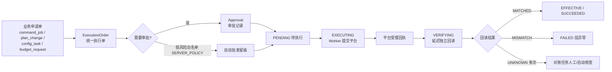

# 06 执行内核与风控设计

本册是系统里最重要的安全设计：凡是会花钱、会改广告计划、会影响直播的动作，全部收敛到统一执行内核处理。前端契约反复强调的"申请不等于执行、受理不等于成功、回读匹配才算数"，在后端必须有机制级保证，而不是靠开发自觉。

## 1. 设计目标

1. 任何平台写操作只能有一条进入通道：统一执行单（ExecutionOrder）。
2. 每个动作可回答六个问题：谁申请、依据什么策略、谁批准、发给了哪个平台、平台受理了什么、回读实际变成了什么。
3. 重复请求、重复点击、超时重试、网络抖动在任何情况下不产生第二次真实下单。
4. 结果未知时系统挂起对账，不猜成功、不自动重放。
5. 风控规则在创建、确认、批准、执行四个时点分别校验，任何时点不过就阻断，且无法靠审批绕过。

## 2. 统一执行单模型

系统里存在多个"申请入口"：中枢指令任务（command_job）、计划变更（plan-changes）、创编任务（configuration tasks）、预算申请（budget-requests）、平台资源命令（integrations commands）。它们的业务表单不同，但平台副作用的处理结构完全一致。执行内核把这部分抽成统一模型：



申请单与执行单的关系：

- 一个申请单 0..1 个执行单（草稿、驳回、取消的不产生执行单）。
- 申请单保存业务表单和对前端的 12 态/业务态表达；执行单保存平台调用与核验事实。
- 前端 V8 契约第 6 节的状态映射作为对前端投影规则：内核 EFFECTIVE 投影到 command_job 的 SUCCEEDED 必须同时满足 PLATFORM 回执 + accepted=true + MATCHED，由查询层做映射，不允许两套状态各写各的。
- command_job 的 DRAFT/PENDING_APPROVAL 等状态继续按 V1.0 契约存在和流转；执行内核是其"执行段"的内部实现，前端无感知。

### 2.1 执行单字段要点

biz_type/biz_id（反查申请单）、tenant_id、account_id、provider、product_line、catalog_id（接口目录项）、request_payload（提交平台的完整参数留档）、payload_digest、idempotency_key、idempotency_parent_key、status、requires_approval、approval_id、platform_endpoint、platform_idempotent_no（平台侧幂等号）、receipt_id、cancellable、lock_token、scheduled_execute_at、verify_after_seconds、attempt_count、last_error、timestamps。

### 2.2 内部标准状态

`PENDING_APPROVAL（待审批）/ PENDING（已批准待执行）/ EXECUTING（提交中）/ VERIFYING（待回读）/ EFFECTIVE（已核验生效）/ FAILED（明确失败）/ UNKNOWN（结果未知）/ CANCELLED / PARTIAL（批量部分成功，一期前端不开放批量，预留）/ MANUAL（人工交接）`。

合法流转由领域状态机枚举，非法流转在 domain 层直接抛异常：

```text
PENDING_APPROVAL -> PENDING | CANCELLED
PENDING -> EXECUTING | CANCELLED
EXECUTING -> VERIFYING | FAILED | UNKNOWN
VERIFYING -> EFFECTIVE | FAILED | UNKNOWN
UNKNOWN -> EFFECTIVE | FAILED          （只能经对账任务转移）
FAILED -> PENDING                      （仅 safeRetry 资格成立时新建执行单，沿用原申请与原幂等键）
MANUAL 为终态交接                       （开播/关播类，不调用平台）
```

command_job 侧的 12 态映射投影与此一致（BLOCKED/MANUAL_REQUIRED/REJECTED/EXPIRED 在申请单侧表达，执行单不存在这些态）。

## 3. 风控检查体系

### 3.1 四类规则

| 规则类 | 检查内容 | 数据依据 |
|---|---|---|
| 额度类 | 企业全部关联计划配置日预算总和（含暂停计划）不超企业上限；账户预算分配不超上级额度与未分配额；预算增加、消耗扩大类动作默认要人工审批 | risk_policies 当前版本、budget_allocations 快照、campaigns 配置 |
| 幅度类 | 单次预算/出价变动百分比不超 max_change_percent；ROI 目标必须为正；金额为合法整数分 | 申请前后值 |
| 频率类 | 同计划成功动作冷却 cooldown_minutes；单账户单日变更次数 max_changes_per_day；提交频控 | Redis 冷却键 + 成功执行单计数 |
| 资格类 | 账户动作能力 AUTHORIZED；能力凭证未过期（maxAgeSeconds）；计划归属在操作者数据范围；计划状态允许变更；授权 scope 覆盖；平台对象版本未变 | account_capabilities、entity_links、plan_versions |

直播动作另有规则：REQUEST_LIVE_START/END 无真实推流授权时直接 MANUAL_ONLY，进入 MANUAL_REQUIRED，不允许选择"先暂停广告代替"。

### 3.2 额度账本与预占公式

额度判断不能每次临时求和，必须通过 budget_ledgers / budget_reservations 串行结算（表结构见 04 册）：

设额度桶内 `B` = 已核验确认的计划配置预算合计（含暂停计划），`R` = 未结算增额预占合计，本次增额 `delta = max(new - old, 0)`。在额度桶行锁内验证：

```text
B + R + delta <= limit    通过后写入预占 HELD
```

- 增额核验 MATCHED 的同一事务内：`B += delta`、`R -= delta`，预占置 SETTLED；确认平台未执行（FAILED 定性）才释放预占（RELEASED）。
- 减额仅在回读 MATCHED 后调减 B；UNKNOWN 期间预占不释放。
- 同一计划存在未结算变更时，目标守卫拒绝第二个冲突写任务。
- 同步器发现平台侧人工改动，经额度应用服务串行入账并产出对账差异；已超限或数据过旧时禁止新的增额写入并告警。
- 配置预算额度与真实消耗是两个模型：系统无法阻止人在平台后台直接操作，因此不承诺实际消耗绝对不越限，但所有经本系统的写入必不越限，外部改动必有差异告警。

### 3.3 四时点重验

同一份风控结论不在多个时点复用：

1. 创建时：全量检查，决定 DRAFT/BLOCKED，产出 risk_summary（checks 逐项、policy_version、checked_at）。
2. 确认时（DRAFT → PENDING_APPROVAL）：重新检查额度、冷却、对象版本。
3. 批准时：检查审批人权限、被批准版本、规则版本是否仍为最新、approved_payload_hash 与当前意图一致；旧申请遇到策略新版本一律 409，要求重新确认。批准后任务版本正常递增不影响执行，执行前校验的是不可变意图哈希而非版本号永远相等。
4. 执行前最后一刻：Worker 再查现值与资格，平台已经被人改过则放弃执行并置 FAILED/MISMATCH 风险，不用旧值盲目覆盖。

检查项必须是真检查（每条 check 对应一条可解释规则），禁止返回"全部通过"的空 checks 列表；risk_summary 落库留痕。

### 3.4 工作模式与自动执行边界

MANUAL（人工操作）/COPILOT（辅助建议）/AUTOPILOT（自动化候选）三档只决定系统"帮人做多少"，永不改变权限：

- MANUAL：系统只展示，申请全部人工发起。
- COPILOT：AI 生成决策建议（decisions），采纳仍创建申请走人审。
- AUTOPILOT：自动化岗位可为低风险动作预生成申请，但预算增加、扩大消耗、关闭重要计划默认仍需人工审批；只有命中策略白名单（动作类型、幅度、账户、时间窗全部满足）且策略授权 SERVER_POLICY 时，审批记录才可以 method=SERVER_POLICY 自动通过，并在审计中明确记录是策略批准而非人批准。
- 前端浏览器永远不能提交 AUTOPILOT 来源；接口层硬拦。

## 4. 幂等与并发控制

### 4.1 三层幂等

1. **接口幂等**：`idempotency_requests` 以 (tenant, caller_id, operation, key) 唯一。首次请求落 IN_FLIGHT 并执行；同键并发请求拿到 409 或首次结果；同键不同载荷 409。
2. **平台幂等**：提交平台时生成/使用平台幂等号（腾讯等平台支持请求去重参数），使网络重试在平台侧也不产生重复单；平台不支持幂等号的动作，先创建占位、确认无同值在途后再提交，且禁止自动重试。
3. **业务幂等**：撤回携带原创建键与新撤回键；查询接口永远允许用原键查询，结果未知不创建新单。

### 4.2 乐观锁

所有申请单与计划镜像带 version。更新语句形如 `update ... set version=version+1 where id=:id and version=:expected`，影响行数为 0 即 409，并返回最新版本供前端展示差异。审批针对"被批准资源自身版本"与"审批记录版本"分别校验。

### 4.3 目标守卫与分布式锁

顺序保证以数据库为准、Redis 为辅：

- 第一重是 target_execution_guards 行级守卫：Worker 用条件更新（fence 版本栅栏 + 短租约）原子领取执行单，两个 Worker 竞争时只有一个能领取成功；UNKNOWN 未消除前守卫保持 quarantined，租约过期也不会让新 Worker 重发写请求，只恢复"调度资格"。
- 第二重是 Redis 短锁：同一账户批量场景下降低无谓竞争、保护非 DB 临界区（如令牌刷新）；带短 TTL 与看门狗续期，获取失败放弃本轮。
- Beat 调度用 PostgreSQL 租约 + Redis 锁防多实例。锁不替代幂等账，Redis 锁丢失不影响正确性（守卫与幂等仍在库里）。

### 4.4 Outbox/Inbox：数据库与平台副作用的一致性

写操作按以下顺序，避免"库回滚了平台已下单"或"库成功了任务没入队"：

1. 一个短数据库事务内：复检、审批留痕、额度预占、状态推进、写 outbox_events，一并提交；事务不跨越任何外部 HTTP。
2. 事务提交后由投递器把事件发布到 RabbitMQ，等待 publisher confirm，并处理不可路由回退；确认后标记事件已投递。
3. Worker 至少一次收到消息，先经 consumer_inbox 登记去重，再检查执行尝试与守卫状态，然后才发起平台调用；平台结果与回读在独立短事务落库，最后 ack 消息。
4. 进程崩溃恢复时，未投递的 outbox 事件被高频补偿投递；已投递未回执的执行单由到期扫描与对账兜底。RabbitMQ 整体不可用时事件在库内积压并暂停新执行授权。

平台调用本身不是数据库事务能覆盖的，因此设计上接受"申请先成功、执行稍后完成"的最终一致，前端通过状态与事件观察，不设计成同步返回成功。

## 5. 执行与回读核验流程

### 5.1 提交与受理

Worker 取出 PENDING 执行单：

1. 用目标守卫条件更新原子领取（fence + 租约），领取后执行前最后复检（现值、能力、意图哈希、审批未撤销）。
2. 置 EXECUTING，登记 execution_attempts（attempt_no 递增、独立的平台稳定请求键 platform_request_key）；重投递场景先读 attempts，存在 UNKNOWN 在途尝试则不重新发起写请求。
3. 经对应连接器调用平台写接口（请求参数、响应全文脱敏后存档）。
4. 平台明确受理：落 platform_receipts（PLATFORM、platform_receipt_id、accepted=true、received_at），状态 VERIFYING，并在 scheduled_tasks 安排延迟回读（如 30-120 秒，平台数据有延迟）。
5. 平台明确拒绝：FAILED + 平台错误码与中文说明，retryable 按错误分类（限流式可延迟重试，参数式不重试）。
6. 超时/连接中断：attempt 结果 UNKNOWN，执行单不重试写动作，转对账。

### 5.2 独立回读

回读必须是独立的只读查询，不用提交响应里的回显当证据：

- 按动作类型取数：预算/出价/ROI/状态类读计划详情或配置回读接口；订单类读订单详情。
- 比较 observed_value 与申请 new_value：数值按平台单位严格比较（容忍平台最小单位舍入规则，规则按产品线配置）；布尔状态按平台状态映射比较。
- 结果落 verification：MATCHED / MISMATCH / UNKNOWN（平台数据尚未刷新）。
- UNKNOWN 允许按退避再回读若干次（如 1/3/10 分钟），在核验期限内持续读不到不立即判死；超过窗口仍 UNKNOWN 转 reconciliation_tasks 人工核查，期间前端持续展示"核验中/结果未知"，不放成功。
- 首次 MISMATCH 不立即认定失败：按能力声明做有限次复读（排除平台延迟刷新），到期后结合受理证据与读回结果分类；确认为 MISMATCH 才置 FAILED 并告警（可能被他人改动、平台异步拒绝、部分生效），进入异常队列，不自动"补一刀"。效果是否达标（ROI 变好等）永远不作为参数核验依据。

### 5.3 安全重试 safe-retry

只有同时满足才出现 safeRetry 入口（前端契约要求）：

- 执行单明确 FAILED（不是 UNKNOWN）；
- 平台错误分类标记为可重试；
- 后端确认原幂等键无在途记录、对象现值与申请前一致或差异可解释；
- 动作在重试白名单内（资金增加类默认不进白名单）。

重试不新建申请：沿用原申请、原幂等键，生成新的执行尝试记录，全程审计可区分首次与重试。前端无入口直接调用平台。

### 5.4 撤回 cancellations

仅当执行单 cancellable=true（平台支持且状态在 PENDING/未受理阶段）才允许；撤回本身也是一次平台操作，走独立幂等键与回读。已受理或平台不支持撤回的，返回明确拒绝，前端引导线下处理。

### 5.5 结果未知对前端 V1 客户端的兼容表达

command_job V1.0 契约的 12 个状态中没有 UNKNOWN，不能把内部状态直接发给当前前端客户端。兼容投影规则（对历史 V1.1 设计的明确落地，联调前同步进契约记录）：

| 内部事实 | 对前端 V1 任务状态 | 回执表达 |
|---|---|---|
| 已提交、请求结果不确定（超时/无响应） | 维持 `EXECUTING` | receipt.accepted=null、verification=`UNKNOWN`、error.code=`RESULT_UNKNOWN`、retryable=false |
| 已明确受理、回读暂不可用 | 维持 `VERIFYING` | accepted=true、verification=`UNKNOWN`，附最后核验时间 |
| 对账取得可靠证据确认受理 | `VERIFYING` → 回读流程 |
| 对账取得可靠证据确认未执行 | `FAILED` | 带对账依据 |
| 未来客户端升级后 | 可新增公共 `RECONCILING`/`UNKNOWN` 状态，联合升级类型、校验器、OpenAPI 与 UI，不私下扩枚举 |

前端任务详情在上述场景必须展示"对账中/结果未知"、最后核对时间和核对入口，不能只显示普通执行中；任务列表该单据保持进行中样式，不进入成功或失败计数。内部 execution_orders 仍可以有完整 UNKNOWN 状态机，查询层负责投影隔离。

## 6. 审批设计

### 6.1 审批模型

- 审批资源 approvals 与申请单解耦：一个申请单对应一条当前审批，驳回后修改重新申请生成新审批。
- 审批人解析顺序：申请单显式指定审批人 > 账户/企业配置的审批角色 > 企业 OWNER；申请人不能审批自己的单（SERVER_POLICY 除外）。
- 老板视角：待办列表只看"待我处理"，审批详情提供变更前后、理由、逐项风控证据、关联计划当前状态。

### 6.2 审批动作

APPROVE / REJECT（驳回必填原因）：

- 批准时校验 expected_version（审批资源版本）与申请单版本、规则版本；任何过期 409。
- 批准只代表"允许执行"，执行单进入 PENDING，前端展示"已批准·未执行"，不提前改计划参数展示。
- 驳回后申请单 REJECTED 终态；通知申请人；可复制原申请快速重建（重建是新单据新幂等键）。
- 取消 CANCELLED 只允许 DRAFT/PENDING_APPROVAL/APPROVED（未执行）阶段；执行中是否可取消以平台能力为准。

### 6.3 过期与冷却

- 申请有效期默认 15 分钟（配置项），PENDING_APPROVAL/APPROVED 等未执行状态超时由 Beat 扫描置 EXPIRED；前端可显式看到过期原因。
- 执行中的任务不允许用"过期"终止——过期只针对未执行申请。
- 成功动作冷却以"回读 MATCHED 时间"为起点写 Redis 键，冷却期内同对象同类动作风控拦截。

## 7. 对账与异常治理

### 7.1 对账任务来源

- 提交超时、响应丢失、回读长期 UNKNOWN 的执行单。
- 平台异步审核/延迟生效类订单（创编任务 PENDING/PROCESSING 较久）。
- 定期全量抽样：随机抽取近期 EFFECTIVE 单复核对平台现值，发现静默漂移（他人在平台后台改回）生成异常事件与决策建议。

### 7.2 对账处理

对账 Worker 只查询不写入：用原幂等键/平台回执号查询平台真实状态，能定性则推动 UNKNOWN → EFFECTIVE/FAILED；不能定性则保留 UNKNOWN 并通知人工，提供"平台截图/回执号/申请参数"对照信息。对账操作同样写审计。

### 7.3 异常队列与告警

MISMATCH、多次刷新令牌失败、平台 5xx 率上升、限流持续、对账积压超过阈值 → 通知（站内 + 邮件/企微 webhook），并在内部后台异常面板聚合。资金类异常优先级最高。

## 8. 与前端状态语义的最终对齐

落地时严格遵守以下对前端的表达纪律（这些都来自契约，后端不得"优化"）：

1. SUCCEEDED/EFFECTIVE 只在 PLATFORM + accepted + MATCHED 三条件齐备时出现。
2. EXECUTING/VERIFYING 期间不修改本地计划镜像的生效值；镜像值只由回读同步更新。
3. FAILED 与 UNKNOWN 是两种状态：明确失败可在资格满足时 safe-retry；结果未知只能查询对账。
4. 审批通过不回显新预算/出价；只有核验生效后工作区数据才变化。
5. MANUAL_REQUIRED 是正常业务终态（人工交接完成），不是系统失败。
6. Mock 回执（source=MOCK）在 API 模式永远不可能出现，接口层与数据库 check 双重禁止。
7. 自动策略的成功必须在任务与审计中标明 AUTOPILOT 来源与 SERVER_POLICY 批准，不伪装成人的操作。
