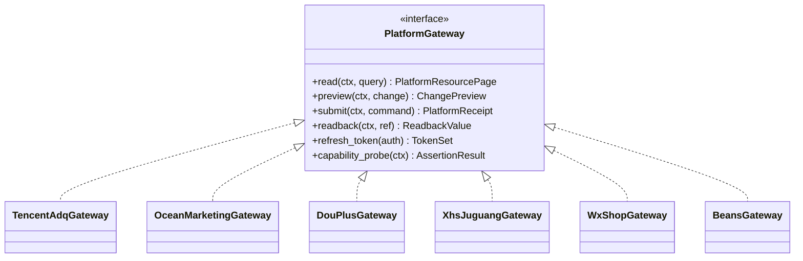
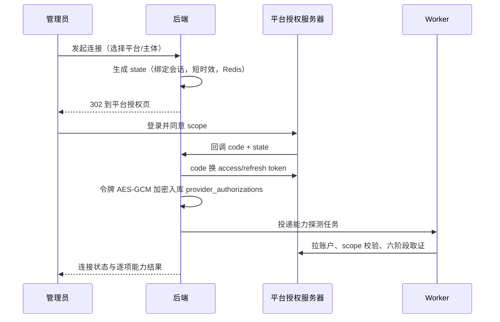

# 07 平台连接器设计

本册设计服务端与各广告/经营平台对接的统一方式。连接器是本系统最复杂、最容易出资金事故的出站边界，设计目标是：密钥不出服务端、能力不凭想象、调用不受平台风控反噬、新增平台不改业务内核。

## 1. 对接范围与基本事实

依据 V9 规划与 1818 条接口目录，需要对接的平台与产品线。**对接分期已拍板：一期只做腾讯系四个连接器并在公司内部验证价值，抖音系与小红书系全部列入二期（见 11 册）；连接器框架与目录治理仍按全集设计。**

| provider | product_line | 角色 | 接口目录规模 | 分期与优先级 |
|---|---|---|---|---|
| tencent | adq | 腾讯营销广告（主投） | 367 条 | 一期：M1 只读，M2 写链路试点 |
| wxshop | wxshop | 微信小店经营（商品/订单/罗盘/资金/售后） | 288 条 | 一期：M1 只读闭环 |
| beans | beans | 视频号微信豆加热 | 目录中无完整写接口 | 一期：M1 只读摸底、M4 出书面结论；写证据取得前仅草稿/人工入口 |
| tencent | wxpromo | 微信小店推广/视频号推广 | 腾讯营销内场景 | 一期：M4 按 ADQ 同体系取证补全 |
| xhs | juguang | 小红书聚光 | 93 条（43 条路径已核验，50 条待核） | 二期 A：43 条已核验路径只读先行 |
| ocean | douyinshop | 抖店经营 | - | 二期 A：只读 |
| xhs | redshop | 小红书电商 | - | 二期 A：只读 |
| ocean | ocean_marketing | 巨量营销项目/单元 | 1070 条（全产品线合计） | 二期 B：一条写产品线贯通（与 dou_plus 二选一） |
| ocean | dou_plus | DOU+ 订单式投放 | 同上 | 二期 B：独立订单向导（与 ocean_marketing 二选一） |
| ocean | qianchuan | 巨量千川 | 同上 | 二期 C：授权后逐接口开 |
| ocean | local_push | 本地推 | 同上 | 二期 C：授权后逐接口开 |

一期内 ocean/xhs 各产品线的 account_capabilities 一律为 NOT_INTEGRATED，operations 为空；接口目录照常导入，但不产生适配器实现，也不允许前端出现可写入口。

必须始终牢记的事实：接口目录只是资料，"路径可见、路径已核验、应用拿到 scope、账户完成授权、参数规则核验通过、真实写入回读成功"是六件独立的事。连接器的所有行为由能力数据放行，不由开发口头确认。

## 2. 端口与适配器结构

业务内核只依赖统一端口接口，平台差异封装在各适配器内：



- 端口定义在 domain/基础设施接口层；执行内核、配置工作台、资源查询服务只认识端口。
- 适配器按 provider + product_line 注册（registry），运行时按账户上下文取实例；同 provider 不同产品线共用签名/令牌逻辑但各自实现资源模型。
- 一个平台目录端点（catalog_id）映射到适配器内一个操作描述（method、path 模板、参数构造器、响应映射器、回读器），映射表代码化并与 endpoint_catalog 双向引用。

连接器内部分层：

```text
connectors/
  base.py            # 端口协议、上下文、标准结果/异常
  registry.py        # 适配器注册与查找
  http.py            # 统一 HTTP 客户端：签名注入、代理策略、日志、限流、重试
  security.py        # 令牌取用、加密解密、自动刷新
  capability.py      # 能力探测与证据记录
  tencent/
    sign.py          # 腾讯 Marketing API 签名
    adq/             # ADQ 操作实现与映射
    wxpromo/
  ocean/
    sign.py client.py marketing/ qianchuan/ douplus/ localpush/ douyinshop/
  xhs/juguang/
  wxshop/
  beans/
  oauth/             # 各平台授权流程与回调
```

## 3. 授权（OAuth）与令牌管理

### 3.1 授权流程



要点：

- state 防 CSRF；回调校验 state 与当前管理员会话；平台支持的增量授权、授权账户选择参数按平台文档传递。
- 每个平台的应用配置（app_id、secret）按环境管理，secret 只存服务端环境变量/密文配置，不进代码库。
- 一个应用下挂多个广告账户：应用级授权与账户级授权分别记录，scope 以账户实际授予为准，不拿应用 scope 推定所有账户可用。

### 3.2 令牌保管与刷新

- access_token、refresh_token 用 AES-256-GCM 加密存 PostgreSQL；Redis 只缓存解密后的短时 access token（TTL 略短于有效期），不落盘明文。
- 刷新集中在连接器 security 层：刷新锁按 authorization_id 互斥（避免多 Worker 并发刷新使旧 refresh_token 失效），刷新失败按次数退避，连续失败置 REFRESH_FAILED 并通知重授，同时把相关账户能力降级（写能力立即冻结，读能力按平台规则处理）。
- 令牌相关字段永不进入业务响应、日志与错误信息；日志中间件对 authorization/cookie/token/secret 等关键字脱敏。
- 断开连接：撤销本地授权记录（平台支持 revoke 则调用），分级展示影响面（关联店铺、计划、自动化岗位），确认后冻结能力并保留历史审计。

### 3.3 出口网络策略

- 平台 Host 白名单写在适配器配置（api.e.qq.com、api.weixin.qq.com、巨量/小红书各自域名），HTTP 客户端强制校验；国内平台直连，不走代理。
- 仅 LLM 客户端可使用独立代理配置，连接器不继承代理环境变量，防止误挂代理触发平台风控。
- 全部出站请求带连接/读取超时（连接 5 秒、读取按平台接口分级 10-30 秒）。

## 4. 能力六阶段的取证机制

能力注册表回答"这个账户在这个接口上现在能做什么"。六阶段（对应前端 verification 七字段）：

| 阶段 | 通过含义 | 取证方式 |
|---|---|---|
| PATH_VERIFIED | 规范化路径与 HTTP 方法经真实文档/实测确认 | 文档核验 + 探测请求记录 proof |
| SCOPE_GRANTED | 我方应用已取得该接口 scope | 应用授权页/平台 scope 查询留证 |
| ACCOUNT_AUTHORIZED | 具体账户完成授权且在有效期 | 授权成功记录 + 定期校验 |
| BACKEND_INTEGRATED | 后端已实现该操作适配器与映射 | 代码版本 + 集成测试报告 ID |
| SCHEMA_VERIFIED | 请求参数规则（必填、枚举、单位、组合）经真实账户验证 | 真实沙箱/灰度账户请求样本与平台返回 |
| EXECUTION_VERIFIED | 真实写入并回读成功至少一次（或按平台允许的灰度验证） | 执行单 MATCHED 回执 ID |

证据记录（capability_assertions）含 result、proof_ref、checked_at、limitations；任一阶段 FAIL/过期，聚合能力相应降级，前端按钮按状态置灰并显示原因。能力探测由 Worker 按计划重跑（授权变更、平台版本更新、定时复核），不是一次性手工标记。

对前端的两类能力输出：

1. 账户动作能力（account_capabilities，12 动作六态）给投放工作台；
2. 字段级能力（configuration_capabilities，六态字段 + 选项 + 约束）给创编向导，按 context_key 精确缓存——同一账户不同营销目标/版位/出价方式下字段集不同，禁止按账户粗粒度缓存。

资源选项（地域、兴趣行为标签、人群包、关键词等）一律实时或准实时来自平台查询，关键词不能把用户任意输入当合法标签；人群包来源、授权、兼容性由后端校验。

## 5. HTTP 客户端治理：限流、重试、熔断

### 5.1 平台侧限流

- 每个 provider/account 维护令牌桶或固定间隔配额（配额值按平台文档与实测配置），请求前在 Redis 取令牌；平台返回限流错误码时按 Retry-After/平台建议动态退避并写 sync_runs 状态 RATE_LIMITED。
- 不同平台 QPS 差异大，配置按 provider 维度；同步类批量任务与用户触发的写请求分队列，写请求优先。
- 平台报表/同步任务在业务低峰（凌晨北京时间）拉取日级数据，整点附近错峰。

### 5.2 重试策略

- 默认重试只对幂等读请求与明确可重试的网络错误（连接失败、5xx、429），指数退避 + 抖动，最多 3 次。
- 写请求的重试权在执行内核（safe-retry），HTTP 客户端绝不自动重试 POST 写操作。
- 每次重试记录 attempt 与平台 trace（有则记录），便于对账。

### 5.3 熔断

- 按 provider（必要时按接口组）用熔断模式：滑动窗口错误率超阈值（如 50%/20 次）熔断几分钟，期间快速失败并返回 DEGRADED 能力状态，半开探测恢复。
- 熔断影响面是"该平台操作暂不可用"，不拖垮其他平台和本地查询；概况页仍展示上次成功数据并标注来源时间。

## 6. 数据同步设计

### 6.1 同步对象与调度

| 同步类型 | 内容 | 触发 |
|---|---|---|
| 资产同步 | 店铺、账户、计划/订单结构、商品库存 | 授权后全量 + 定时增量（如 10-30 分钟） |
| 资金同步 | 广告钱包、店铺结算、微信豆余额 | 定时（如 5 分钟，预算工作台） |
| 报表同步 | 日/小时报表、罗盘经营数据 | 定时拉取（按平台数据延迟设定，如每 30-60 分钟，凌晨补全天数据） |
| 直播同步 | 场次状态与场次指标 | 场次进行中按平台允许频率（15-60 秒级，遵守配额） |
| 事件驱动 | 审核状态变化、订单状态 | 平台有回调/Webhook 则订阅，无则轮询 |

调度由 Celery Beat 生成任务，每个任务绑定明确的 tenant/account 上下文，在独立数据库会话设置 RLS；任务并发度受平台配额闸控制。

### 6.2 同步落库纪律

- 原始载荷先落 platform_raw_payloads（存档与追溯），再映射到镜像表/事实表；映射器失败不影响原始数据保留。
- 镜像 upsert 以 (tenant, account, native_id) 为键；检测到平台配置变化时写 plan_versions（before/after + change_source=PLATFORM_SYNC），外部在平台后台的直接改动也有痕迹。
- 指标写 metric_facts upsert，保留 source_updated_at 与 fetched_at；同批次任务可安全重跑（幂等）。
- 平台删除/不可见对象不直接物理删，标记 status=UNKNOWN/ARCHIVED，防止一次接口异常把本地计划全清掉。
- 游标（cursor/时间增量）存 sync_runs，失败后从游标恢复，不漏拉不重复。

### 6.3 新鲜度表达

- 每个账户/数据类型向 API 输出 sync 状态：last_success_at、source_lag、max_age_seconds、refresh_seconds。
- 前端展示"平台数据时间"与"我们同步时间"两个时间；超 maxAge 的数据可看不可写（写接口预检拦截）。
- API 不做"请求时现拉平台"的同步阻塞调用（授权与少量强一致校验除外，如执行前现值回读）。

## 7. Webhook 与异步回执

- 平台支持消息回调的（审核结果、订单/授权事件），开放独立回调端点 `/v1/webhooks/{provider}/`：验签（平台签名）、时间戳防重放、事件 ID 去重（Redis/落表），快速 200 后投递 Worker 处理。
- 回调事件更新关联对象状态（素材审核、创编订单 PROCESSING→结果），并驱动执行单核验；回调不直接改金额类字段，仍以回读接口为最终依据。
- 回调端点不依赖登录 Cookie，安全靠平台签名与白名单，纳入攻击面测试。

## 8. 各平台特殊处理纪律

### 8.1 腾讯营销 ADQ

- 走 Marketing API 3.0（路径带 /v3.0/），按账户实际营销目标决定可用字段；动态创意、定向标签、人群、估算接口分别映射。
- 优化目标权限必须调 optimization_goal_permissions/get 类依据，不能让前端硬编码目标枚举。
- 微信小店/视频号资产（wechat_channels_accounts、wechat_shop、store_product_items）作为投放对象与经营数据两条线接入。
- 资金 funds/get、实时消耗 realtime_cost、操作日志 operation_log_list 支撑预算工作台与审计核对。

### 8.2 巨量引擎（二期，本节为二期实现纪律，一期不开发）

- 先区分产品线再选域名/版本/接口：巨量营销（project/promotion）、千川、本地推、DOU+（douplus/order），禁止用营销单元接口承载 DOU+ 订单。
- DOU+ 订单向导实现独立的可选商品/目标查询、订单创建、订单列表/报表/关闭映射。
- 千川/本地推在账户实际授权与接口版本确认前，operations 返回空，能力停留 NOT_INTEGRATED。
- 文件/视频上传、预审（preaudit）、素材库与投放创编链路对接时，文件经我方对象存储中转后上传，留存平台素材 ID。

### 8.3 小红书聚光（二期 A 只读先行，一期不开发）

- 已核验的 43 个路径优先实现只读（计划/单元/创意/报表/笔记/账户预算），创编类 50 个未核验路径不开放写入，能力给 UNCONFIRMED/NOT_INTEGRATED。
- 数据分实时与离线报表，注意各自延迟；搜索词/否定词作为独立资源工作区。

### 8.4 微信小店（经营，不是广告）

- 商品/库存/订单/罗盘/售后/资金全部按经营数据接入；资金是 MERCHANT_SETTLEMENT，绝不映射成广告钱包。
- 订单与售后响应做个人信息最小化：收货姓名/电话/地址默认不入库不进 AI 上下文；确需履约展示的字段按角色脱敏（客服场景单独授权）。
- 联盟推广计划（league promotion）是分销经营对象，禁止进入广告计划表与投放决策。

### 8.5 微信豆加热

- 目录中没有完整合法写接口证据前：实现产品/视频/直播选择与方案草稿、预算（BEAN）与有效期管理、方案 JSON 导出、官方入口跳转；不创建任何订单、不返回成功态。
- 一旦取得正式接口与授权证明，按标准六阶段取证后接入，且写链路复用统一执行内核。

## 9. 连接器可测试性

- 适配器对平台的请求/响应用录制夹具（cassette）测试：签名、参数构造、错误码分类、回读比较在 CI 离线可验。
- 集成测试对接平台沙箱/灰度账户（需业务方提供，见路线图前置条件），用最小金额/可删除对象做真实写入回读演练，演练记录即 EXECUTION_VERIFIED 证据。
- 平台版本升级（接口版本、字段变更）先在 staging 回归全部夹具与契约黄金样例，通过后更新能力证据再切生产。
