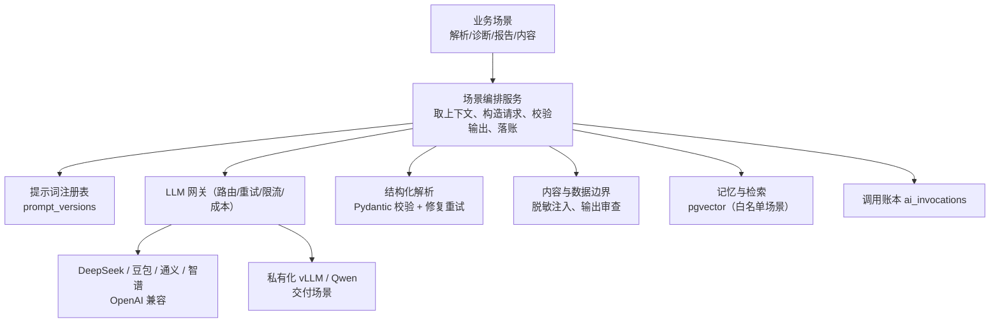

# 08 AI 能力设计

本册设计后端的 AI 内核：用在哪些场景、怎么接入大模型、怎么保证输出可用可控、怎么控制成本与数据边界。立场很明确：AI 在本产品里是"懂业务的参谋和助理"，不是"自动花钱的手"。所有花钱动作的最后一步永远属于执行内核和人的审批。

## 1. AI 应用场景盘点

按产品闭环梳理，AI 场景分四类，优先级不同：

| 场景 | 入口 | 一期程度 | 安全级别 |
|---|---|---|---|
| 指令解析 | AI 中枢对话、手机指令 | 一期必做 | 中：解析错只是不执行，有消歧和确认兜底 |
| 投放决策诊断 | 投放建议（decisions）、经营异常解释 | 一期规则先行，AI 增强 | 高：只产出建议，采纳进审批 |
| 复盘分析生成 | 经营分析、日报周报月报 | 一期可做 | 中：基于已核算指标写结论，不改原始数据 |
| 内容创作辅助 | 选题、脚本段落改写、图文文案、简报生成 | 一期可做基础文本，视频/图片走 NEXORA | 低-中：内容由人采纳后入库 |
| 内容生成（图/视频） | 内容工厂生成任务 | 对接 NEXORA，不自研 | 任务编排与状态回读 |
| 对话问答（经营数据问答） | 中枢 QUERY 类反馈 | 二期 | 中：只读、必须标口径与来源 |

前端现状提醒：首页"内容创作/经营分析"推荐提示和 Mock 规则匹配不是 AI 已接通；后端接入后这些入口才有真实智能。AI 直播诊断（基于回放 ASR 与指标对齐）列为二期。

## 2. LLM 内核总体结构

设计要点：

1. **场景服务不直接调 SDK**。所有调用经 LLM 网关，网关负责多模型路由、密钥管理、超时重试、限流降级、用量统计；业务层只声明场景、输入、期望的输出结构。
2. **提示词是版本化资产**。每个场景一个 prompt_key + 版本，模板与模型参数（temperature、JSON mode、工具定义）入库管理，改提示词走新建版本，任何 AI 输出可追溯到当时模板。
3. **输出先结构化再使用**。指令解析、诊断建议等需要系统消费的输出一律走 function calling/JSON mode，用 Pydantic 模型强校验；校验失败自动修复一次（把校验错误回喂模型），仍失败则降级为 UNRECOGNIZED 或规则结果，绝不让模型自由文本直接驱动动作。
4. **生成类内容不自动生效**。文案/脚本/报告文本以"草稿候选"返回前端，由用户显式采纳；复盘结论写入草稿不覆盖不可变结果。

## 3. LLM 网关设计

### 3.1 多模型路由

- 统一适配 OpenAI Chat Completions 兼容协议（`/chat/completions`、SSE、tools），配置项：model_key、base_url、api_key（密文）、上下文长度、价格表、能力标签（function_calling/json_mode/vision）。
- 路由策略按场景配置：默认模型、备用模型（主模型超时/限流自动切换）、成本优先/质量优先。一期模型数量少，用配置表加薄封装即可，不引入复杂路由框架；多供应商协议适配可以评估 LiteLLM 作为内部端口后的可选实现（逐项验证结构化输出、工具、流式与图像视频能力后再采用），但不强制部署独立 LiteLLM Proxy，能力别名（copywriting.default 等）始终由我方 model_configs 掌握，业务代码不绑定供应商模型名。
- 私有化交付：base_url 指向客户内网 vLLM，账密与公网模型配置解耦，场景代码零改动。
- 海外模型若使用，仅网关这一个 httpx 实例走独立代理出口（见 07 册网络纪律）。

### 3.2 可靠性

- 超时分级：解析类 15 秒、报告生成类走 Worker 异步（分钟级）；SSE 场景向前端流式转发同时在服务端聚合完整结果。
- 重试只对 429/5xx/网络抖动，最多 2 次并切换备用模型；4xx（内容被拒、参数错）不重试。
- 熔断：单模型错误率超阈值降级到备用模型，全部不可用时场景优雅降级（指令解析回退到规则解析并明确标注，报告生成转失败可重试），不拖垮主业务接口。

### 3.3 成本与用量

- 每次调用写 ai_invocations：场景、模型、token 数、估算成本、延迟、租户、结果状态；管理后台可按租户/场景/周期看 Token 与费用。
- 上下文做预算控制：注入的经营数据先裁剪（只带当前对象与时间窗必要字段），长对话做摘要式压缩，避免无界上下文烧钱。
- 设租户级软限额（日 Token/费用阈值告警），为后期按租户计量计费打底。

## 4. 场景设计一：自然语言指令解析

输入：用户原话、当前经营范围（scope）、账户/计划/场次候选集合、近期对话上下文。
输出（沿用前端三分类）：

- QUERY：查询类，返回可直接回答的结构化数据需求与引用对象 ID；实际数据由业务查询服务提供，模型不编造数字。
- ACTION：动作类，必须给出 action_type（七类之一）、new_value（合法 JobValue 结构）、target_type 与 candidate_ids（0-N）；数值提取遵守单位规则（"5000 块"→500000 分、ROI 6.2 保持比值、微信豆明确单位）。
- UNRECOGNIZED：信息不足/超出动作白名单，返回需要澄清的问题。

关键规则：

- 一条指令只允许一个动作；多目标/混合预算出价直接判 UNRECOGNIZED（与前端 Mock 既有拒绝逻辑一致）。
- candidate_ids 多于一个时不选定，前端消歧；为零个时 UNRECOGNIZED。模型只在服务端提供的授权对象集合内选择，杜绝幻觉 ID（输出 ID 必须在候选集合内校验）。
- 解析置信度低或金额/单位不确定时，宁可澄清不猜；解析结果落 interpretations 表，包含模型版本与提示词版本，供后续 Badcase 分析。
- 风控判断不交给模型：模型不输出"这个操作安不安全"，风控完全由规则引擎按数据裁决。

## 5. 场景设计二：投放决策与诊断

### 5.1 规则先行、AI 增强

决策链路分两层：

1. 规则引擎（确定性 Python 规则，不依赖模型）：基于指标事实表计算 ROI 低于 floor、预算花速（pacing）异常、CPA 恶化、消耗上升但转化下降、计划状态异常、数据同步异常等，产生带证据的决策候选。规则参数来自账户策略（roi_floor、pacing_threshold、min_observation_minutes、min_spend 等）。
2. AI 诊断层：对规则命中的候选生成"原因假设 + 建议动作叙述 + 需要关注的风险"，输入限定为该计划时间窗内的真实指标、平台状态与历史相似案例，输出引用证据条目，禁止给无数据支撑的收益承诺。

前端 decision 结构（kind 八类：ROI/PACING/CPA/EFFICIENCY/CREATIVE/LIVE/STATUS/SYNC）保持；`insightSource` 区分 rules/ai，前端可标明依据类型。

### 5.2 证据与采纳纪律

- 每条建议必须带证据时间窗、样本量、观察周期、数据延迟与归因窗口说明；数据不足时规则不产出、AI 明确返回"证据不足"，不生成填充结论。
- 建议有 valid_until；过期或规则版本变化后前端禁止直接采纳，需重新评估。
- 采纳建议只是创建带完整前后值的申请单，进入标准审批与执行内核；AI 不产生 approval、不直接调用连接器。
- 效果复盘只做"建议-执行-后验指标"的关联记录，不自动宣称 AI 因果收益（外部因素无法排除时如实标注）。

## 6. 场景设计三：经营分析与复盘报告

- 分析任务（analysis_task）由 Worker 执行：先取数（指标事实、维度、对比期），计算趋势、贡献、漏斗等结构化结果（确定性计算），再让 AI 基于结果 JSON 生成章节叙述（摘要、异常解读、行动建议），叙述里每个结论绑定指标/行项引用，前端可做证据跳转。
- 指标口径（分子分母、可比键、退款/归因）在取数层锁定，AI 不参与数值计算，只做解释；比率趋势按重新汇总的值生成，不拿日比率平均。
- 报告周期由数据覆盖决定：日报 1 天、周报连续 7 天、月报完整自然月，不足直接拒绝生成，AI 不允许"凑"。
- 八章结构中缺少数据的章节明确写缺项原因，不编利润（无成本/退款数据时不出利润结论）。
- 生成结果存草稿供编辑；客户发布版是冻结快照。一期也可保留纯规则模板报告作为模型不可用时的降级。

## 7. 场景设计四：内容创作辅助与 NEXORA 对接

本场景的使用者是运营/投手，不设独立内容制作角色：系统把内容创作过程（选题、卖点、脚本、分镜、出图、出片、字幕、审核）梳理成 SOP 自动化工作流，嵌在运营的经营流程中由其逐步驱动，AI 负责按 SOP 产出候选与编排，人负责确认。

- 文本类（选题建议、简报、开场补充、段落改写、图文文案）：场景服务提供商品卖点、历史脚本、平台规格（字数/画幅/时长）作为上下文，输出候选文本，用户采纳后才写入 content_documents。
- 图/视频/剪辑生成：本后端不建渲染能力，按既有规划对接 NEXORA：
  - generation_jobs 记录参数与外部任务 ID，状态机 QUEUED/RUNNING/WAITING_PROVIDER/WAITING_REVIEW/SUCCEEDED/FAILED/CANCELLED（定义见 04 册）：已提交供应商但回读未明落 WAITING_PROVIDER，成片待人工确认落 WAITING_REVIEW；
  - 提交后 Worker 轮询或接收 NEXORA 回调更新进度；成片下载入我方对象存储登记为 content_asset，再由用户决定加入素材库/继续剪辑；
  - 失败可读原因透传，支持取消与否以 NEXORA 能力为准；不启动假进度条。
- 素材与平台广告账户的上传关联走连接器（素材上传接口、预审状态），生成服务与平台上传是两段链路。

## 8. 数据边界与安全

- 个人信息最小化：构造上下文时默认剔除订单收货人、手机号、详细地址、结算账户；角色无权限的数据不进入提示词。
- 平台令牌、Cookie、内部错误堆栈不进提示词；出站到模型的内容经过字段白名单序列化器。
- 对话与生成内容按 tenant 隔离存储；向量记忆按 owner_scope 过滤，RAG 检索同样受租户 RLS/范围约束，绝不跨租户召回。
- 模型输出做安全审查（敏感违法内容、越权动作诱导拦截）；对"让系统直接执行/跳过审批"类提示注入，系统侧根本没有该能力路径（AI 输出不能直接触达连接器），形成结构性防护。
- 提示词中明确模型角色边界：只可建议、不可承诺收益、不确定要说明、数字以系统提供为准。

## 9. AI 记忆与检索（pgvector）

一期只开三个白名单用途，避免过度建设：

1. 指令上下文：店铺/账户背景、常用计划叫法（aliases）向量化，辅助"把千川 A 计划..."这类指代消歧。
2. 诊断案例库：历史决策与后验效果沉淀为案例，检索相似计划表现辅助诊断（仅检索本租户数据）。
3. 素材语义检索：素材标题/脚本/标签向量化，支撑素材库"找类似的"。

技术落法：pgvector 扩展，embedding 调用与主模型解耦（可选独立 embedding 模型），维度固定并在表注释标明；写入随业务事件异步生成（Worker），不阻塞主链路；向量检索结果再经租户/数据范围过滤。订单与个人信息不向量化。

## 10. 质量评估与持续运营

- 留痕即评估基础：interpretations 表可对比"模型解析 vs 实际执行动作"，定期统计解析准确率、消歧率、单位错误率；ai_invocations 提供延迟与成本数据。
- 提示词改动用固定的离线样例集回归（历史 Badcase 沉淀为样例），关键指标不下降才允许新版本置 ACTIVE。
- 提供"解析反馈"隐性闭环：用户在多候选间的选择、对建议的采纳/忽略/修改都是弱标签，供后续优化，不做强制评价打扰。
- 模型供应商切换或价格调整时，只需改网关配置并跑回归样例，业务无感。
