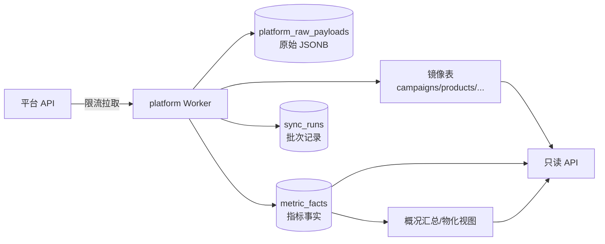

# 10 异步任务、数据同步与部署运维

本册说明 Worker 分工、定时调度、指标数据管道、环境配置、部署拓扑、监控告警和备份恢复。一期方案刻意保持"一个人也能运维"的简单度，同时给二期上规模留好路径。

## 1. 异步任务总览

### 1.1 队列划分

| 队列 | 任务类型 | 并发原则 |
|---|---|---|
| execute | 执行单提交、审批后置、通知、对账 | 中等并发，按目标守卫与账户锁互斥 |
| platform | 资产/资金/报表同步、令牌刷新、回读核验 | 受每平台配额严格限制，账号维度小并发 |
| ai/media | 报告生成、批量诊断、embedding 生成、内容任务编排 | 受模型并发额度限制，长任务低预取 |
| system | 过期扫描、outbox 投递、到期任务领取、分区维护、清理归档 | 低并发，Beat 驱动 |

任务路由在代码内显式声明，写死队列名不搞动态队列。队列全部持久化、消息持久化、发布确认开启，死信队列统一收集超过重试上限的任务并告警。平台同步与执行任务分队列的好处：同步积压不会让"审批后下单"排队。

### 1.2 关键任务清单

| 任务 | 触发 | 队列 | 要点 |
|---|---|---|---|
| execute_order | 执行单批准 | execute | 守卫领取、复检、调连接器、落尝试与回执 |
| schedule_verify | scheduled_tasks 到期 | platform | 独立回读，UNKNOWN 退避，首次不匹配不立即判死 |
| reconcile_unknown | 扫描器按退避 | execute | UNKNOWN 单据查询定性，只查不写 |
| expire_jobs | Beat（每分钟） | system | 未执行申请到期置 EXPIRED；已领取执行的不允许过期 |
| refresh_platform_tokens | Beat + 到期事件 | platform | 刷新串行锁互斥，失败降级能力 |
| sync_assets / sync_funds / sync_reports / sync_live | Beat 排期 + 手工触发 | platform | 游标增量、批次幂等 |
| capability_probe | 授权后/周期 | platform | 六阶段取证 |
| run_analysis | 用户创建分析任务 | ai/media | 取数-计算-AI 叙述 |
| generate_content | 内容生成 | ai/media | NEXORA 提交与状态回读，按供应商 ID 查询不盲重试 |
| deliver_notification | 事件 | execute | 邮件/站内/webhook |
| flush_outbox | Beat（高频，如每 10 秒） | system | 未投递事件发布确认补偿 |
| lease_scheduled | Beat（高频） | system | 到期任务表短租约领取 |
| daily_report_refresh / partition_maint / raw_retention | Beat 低峰 | system | 汇总刷新、分区、留存清理 |

### 1.3 可靠性纪律

- 事实源在 PostgreSQL：job_id、event_id 与 Celery task_id 分开建模，关闭对 Redis result backend 的状态依赖；队列至少一次投递，重复投递是常态而非异常。
- 任务幂等：内部副作用靠 consumer_inbox 去重；外部平台调用必须先查 execution_attempts 与目标守卫，UNKNOWN 在途时进入查询/核验，绝不重复写入或扣费。
- 重试：Celery 自动重试只用于可重试异常（限流、临时网络），指数退避带上限；业务拒绝（参数错、风控不过）不重试，直接 FAILED；严禁对广告写入和付费生成配置无差别 `autoretry_for=Exception`。死信重放同样经过执行资格检查，不提供无条件批量重放。
- 确认机制：评估并开启 `acks_late`，联合同步验证 `task_reject_on_worker_lost`、重试上限与死信行为；任务函数返回 SUCCESS 只代表 Python 逻辑完成，不代表平台核验或生成流程结束。
- 消息体纪律：Celery 任务只携带业务 ID 与稳定 event_id（JSON 序列化），不传视频文件、ORM 实例或明文令牌；不在 ETA 内存里堆长等待，延迟回读与长轮询落到 scheduled_tasks。
- RabbitMQ 不可用时 Outbox 在库内积压，达到阈值暂停新执行授权并向前端明确"排队中"，不丢申请。
- 可见性：每个任务写状态与 attempts；管理后台能看到卡住的队列、在途时长、失败原因；积压超阈值告警。
- Beat 高可用：Beat 单实例运行，借助 PostgreSQL 租约 + Redis 锁实现主备（备机抢不到锁只待命），不做多节点并行调度。

## 2. 数据同步管道

### 2.1 从平台到页面



- 所有页面读接口只查本地库，绝不请求时同步打平台；实时感由同步频率与新鲜度标识提供。
- 同步失败时保留上一版数据并明确 stale 状态；写接口预检对超 maxAge 的数据直接拦截（可看不可写）。

### 2.2 时序与频率（初始建议，按平台配额调整）

| 数据 | 频率 | 说明 |
|---|---|---|
| 资金余额 | 5 分钟（工作时段） | 预算分配页敏感数据 |
| 计划结构/状态 | 10-15 分钟 | 变更频繁对象 |
| 直播中指标 | 15-60 秒（遵守平台配额，仅进行中场次） | 结束自动停止 |
| 小时/日报表 | 每 30-60 分钟增量，凌晨全量校准前一日 | 平台数据有延迟，以凌晨校准为准 |
| 商品/库存 | 30 分钟 | 经营页 |
| 罗盘/订单 | 30-60 分钟 | 只读经营分析 |
| 能力复核 | 每日低峰 + 授权/版本事件触发 | 能力不过期不轻易降级 |

频率以后端返回给前端的 refreshSeconds/maxAgeSeconds 为权威，前端实际轮询不得突破最小间隔（前端已实现 min interval 机制）。

### 2.3 口径与迟到数据

- 平台报表会修订历史（退款、归因窗口回滚）：事实表 upsert 支持更新已有日期数据，凌晨校准任务把近 N 日（如 7 日）重拉覆盖；概况与报告标注数据更新时间。
- 退款处理、归因窗口随平台行记录；不同窗口数据不同行不同 comparable_key。
- 平台时区/日切差异在适配器层统一转北京时间归属日，转换逻辑按平台配置并留测试。

## 3. 环境与配置

### 3.1 环境划分

| 环境 | 用途 | 数据 |
|---|---|---|
| local | 个人开发（Windows + Docker Compose 起 PG/Redis/RabbitMQ/MinIO） | 种子假数据 |
| dev | 联调环境，前端可配 NEXT_PUBLIC_API_BASE_URL 指向 | 脱敏/测试账户 |
| staging | 与生产同构，平台沙箱/灰度账户，发布前验证 | 沙箱数据 |
| prod | 正式 | 真实账户与数据 |

### 3.2 配置管理

- pydantic-settings 读环境变量；本地用 .env（gitignore），仓库提供 .env.example 全量字段注释。
- 配置分组：数据库/Redis/S3、会话与安全密钥、各平台 app 凭证（按环境）、LLM 模型表与密钥、限流参数、租户模式（multi/single）、邮件/webhook、特性开关。
- 平台应用凭证等需要后台查看的配置也可入"系统配置表"（密文存储），减少改配置发版频率；启动引导类配置（数据库连接）仍走环境变量。
- 所有环境时区：容器统一 UTC，业务时区在应用层固定 Asia/Shanghai。

## 4. 部署拓扑

### 4.1 一期：单机 Docker Compose（内部使用）

```text
单台 Linux 服务器（建议 4C8G 起步，数据与素材量大则挂数据盘）
  Nginx 容器        443/80，TLS、反代 API、前端静态（前端可独立部署或同机）
  api 容器 ×1       首次1个Uvicorn worker，副本/并发按压测实测增加，不默认2×4进程
  worker 容器        execute、platform、ai/media、system 四队列（compose 分 profile 或单容器多队列，按量拆）
  beat 容器 ×1
  postgres:17 容器   数据卷挂载 + 每日备份脚本（pgvector、pgcrypto）
  redis:7 容器       AOF 持久化（会话缓存/租约/限流，可重建）
  rabbitmq:3.13 容器 持久化卷，单节点，开启管理插件（仅内网）
  minio 容器         素材/报告存储，数据卷
  admin              随 api 同进程 /admin
```

资源增长后的单机内扩缩顺序：先加 worker 并发，再拆分队列到独立容器，最后迁多机。PostgreSQL 与 MinIO 数据定期快照到异机/对象存储，避免单机磁盘故障全损。

4C8G仅为待实测参考，不是已验证容量。Compose必须给各服务设资源预算，记录API/Worker/数据库/MQ/对象存储合计峰值，按19册A41压测后确定；核心告警、备份和在途异常可见性在G-MVP前提供，不等M5。

### 4.2 二期：Kubernetes（SaaS 开放）

- Helm Chart 编排：api 无状态 Deployment（HPA 按 CPU/队列积压）、worker 按队列分 Deployment、beat 单副本 + 选主、PostgreSQL 用云托管 RDS（主备 + 自动备份）、Redis 云托管、RabbitMQ 用三节点 Quorum（云托管 MQ 或自建 StatefulSet，跨可用区）、对象存储用云 OSS。失去 MQ 多数派时 Outbox 继续积压并暂停执行派发，恢复后自动补偿。
- 配置走Secret/ConfigMap；Ingress终止TLS；数据库仅允许api、需要读写业务状态的worker、迁移和受限运维身份访问，分别最小权限。不能只允许api而阻断worker的回读落账/outbox处理。
- 灰度发布：新版本先 staging 验证平台契约黄金样例，生产按滚动发布；数据库迁移先于应用部署（Alembic 向后兼容扩展式变更），迁移失败阻断发布。
- 私有化交付物：同一镜像 + compose/helm 两套编排 + 初始化脚本（建租户、导平台应用配置、初始化 LLM 通道）+ 运维手册。

### 4.3 与前端的部署关系

- 前端 Next.js 与后端独立部署独立域名或同域路径反代均可；同域可简化 Cookie/CORS（建议生产同站点不同路径或同主域子域，如 app.example.com 与 api.example.com 需正确配置 SameSite 与 CORS）。
- Nginx 同时承担静态官网/前端资源与 API 反代；`/v1` 路由到 api，其余走前端。

## 5. 日志、指标与追踪

### 5.1 日志

- structlog JSON 输出：timestamp/level/event/request_id/tenant_id/user_id（如已认证）/module；平台调用另记 provider/account/catalog_id/latency/status，AI 调用记 model/scene/tokens/cost。
- 日志禁止明文凭据（脱敏中间件强制）；错误堆栈仅在受控日志保留，响应只给中文业务信息。
- 一期日志随容器 stdout，由 Docker 日志驱动 + 定时收集；上 K8s 后接 Loki/ELK。

### 5.2 指标（Prometheus）

- 应用层：请求量/时延/错误率（按路由）、会话数、409/429 次数。
- 业务层：执行单各状态计数、回读 MATCHED/MISMATCH/UNKNOWN 数、风控阻断数、对账积压、任务成功率。
- 平台层：每 provider QPS、限流次数、熔断状态、同步延迟（source lag）。
- AI 层：调用量、Token、估算费用、超时/降级次数。
- 基础设施：PG/Redis/RabbitMQ/MinIO 连接与资源（node_exporter / 容器指标）、RabbitMQ 队列深度与无消费者告警。

### 5.3 追踪与告警

- OpenTelemetry 注入 traceId（与 requestId 关联），串起 API → Worker → 平台/LLM；一期可先只做日志关联，Jaeger/Tempo 随 K8s 阶段上。
- Sentry 接未捕获异常。
- 告警规则（发邮件/企微群）：执行 MISMATCH/资金类 FAILED、对账积压超 30 分钟、平台持续熔断、令牌批量刷新失败、AI 全部模型不可用、磁盘/连接池告警、备份失败。
- 值班可读的"系统状态页"（内部）：各连接器健康、最近同步、队列积压、当日执行与异常数。

## 6. 备份与恢复

- PostgreSQL：每日凌晨全量备份（pg_basebackup 或 pg_dump 逻辑备份，一期规模 pg_dump 足够）+ WAL 归档（PITR 可选）；备份加密传异机/对象存储，保留 14-30 天；每周做一次恢复演练（恢复到隔离环境验证可用性）。
  逻辑pg_dump不能与WAL直接组合实现PITR；采用PITR须完整物理基备与连续WAL。恢复后先只读并冻结写派发，核对恢复点后的平台在途/已扣费单，再按账户恢复；详见A36。
- Redis：AOF 持久化，会话缓存与限流数据可丢失重建，不作为关键数据备份对象。
- RabbitMQ：单节点期持久化卷随宿主机快照，队列与交换机定义纳入代码（Celery 声明），节点重建后由 Outbox 补偿未确认消息；高可用期靠 Quorum 副本，不依赖手工备份恢复消息。
- MinIO/对象存储：服务端桶版本或每日镜像到异机；素材类数据丢失可重新上传，发布报告与审计附件需要重点保留。
- 审计日志：随库备份；交付客户环境按合同约定导出留存。
- 恢复目标：RPO 24 小时（一期），二期云托管可到分钟级；RTO 4 小时内恢复核心只读与审批能力。

## 7. 数据留存与清理

| 数据 | 留存策略 |
|---|---|
| platform_raw_payloads | 180 天，按月分区到期清理 |
| ai_invocations 明细 | 180 天（费用汇总长期保留） |
| 会话/验证码 | 自动过期 |
| 审计日志 | ≥1 年 |
| 已发布报告 | 长期（除非租户注销） |
| 指标事实 | 长期（日级长期，小时级保留 1 年） |
| 注销租户数据 | SaaS 模式按合同导出后冻结/清理；RLS 保证清理脚本按租户精确执行 |

清理任务全部由 system 队列调度，低峰执行并记录清理批次。

## 8. Windows 本地开发约定

- 开发机 Windows，运行时容器化 Linux：本地依赖（PG/Redis/RabbitMQ/MinIO）一律用 `docker compose up` 提供，不在 Windows 裸装服务。
- Python 虚拟环境用 uv/venv；PowerShell 执行策略限制下使用 `.cmd` 形式命令；提供 `scripts/dev-env.ps1` 类辅助脚本（创建 .env、起容器、跑迁移、导种子数据）。
- 代码路径处理全部 pathlib，脚本兼容 Windows 路径；定时任务在容器内由 beat 提供，不依赖 Windows 计划任务。
- 提交前本地至少跑通：ruff、mypy（核心模块）、pytest、Alembic upgrade head 干净库验证。
