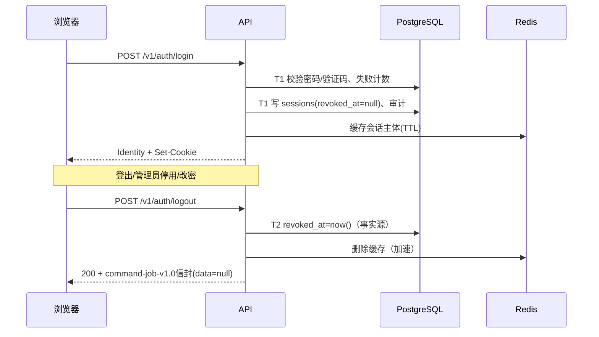
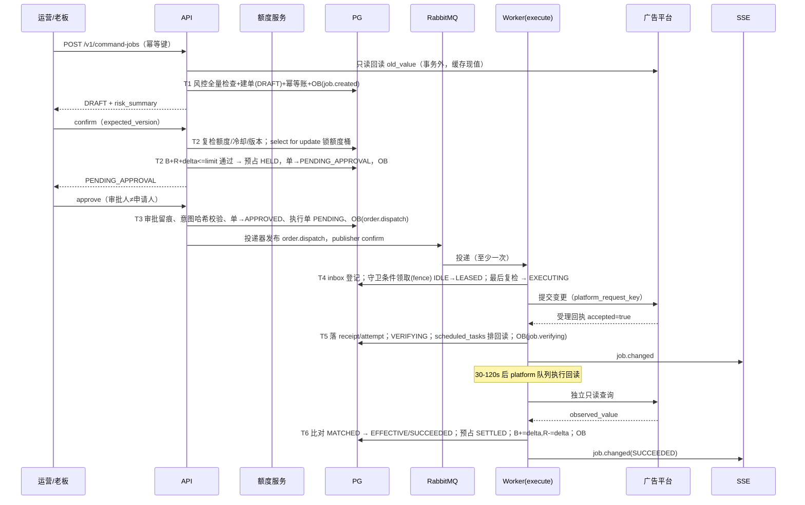
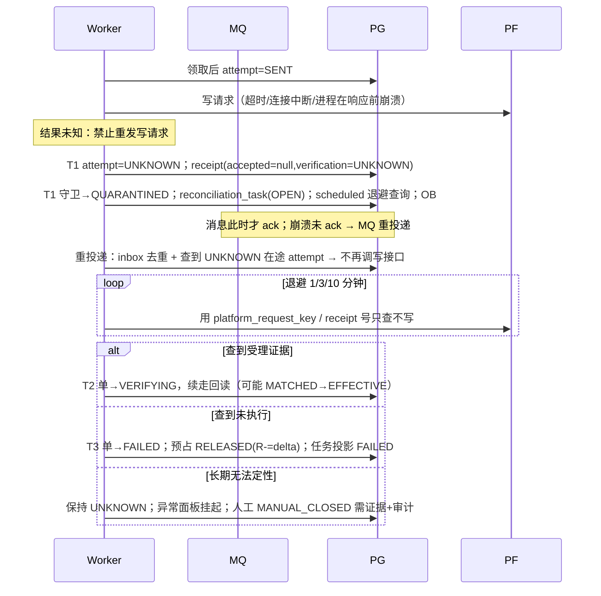
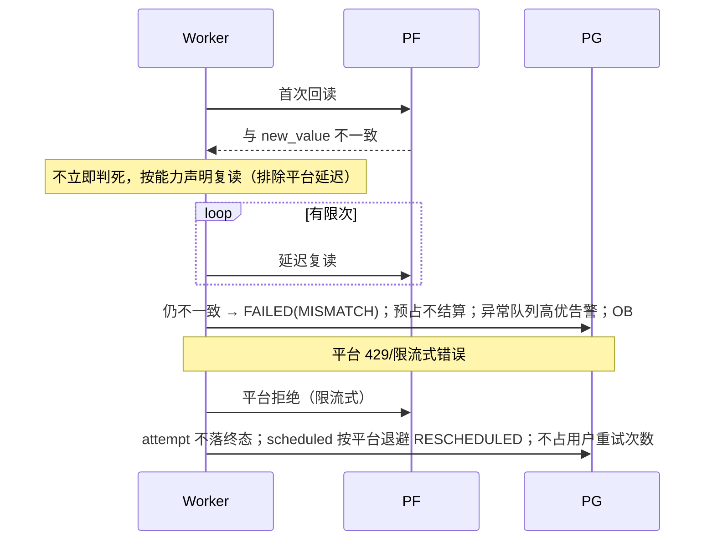
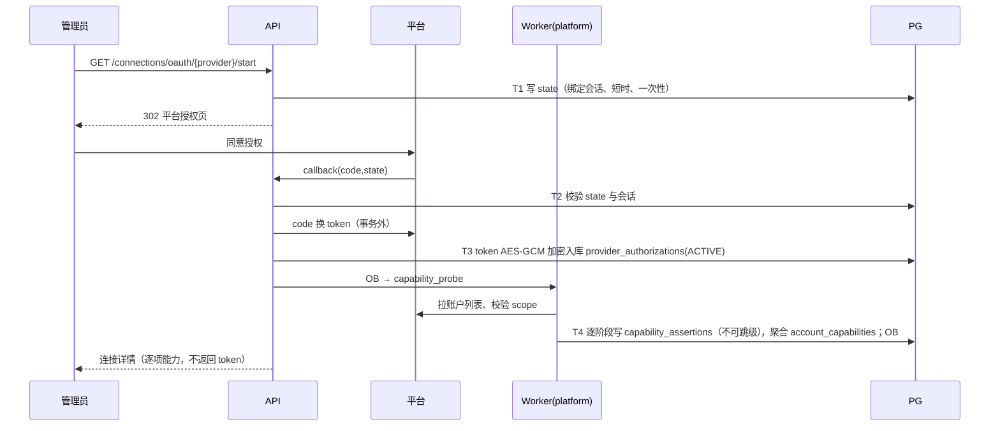
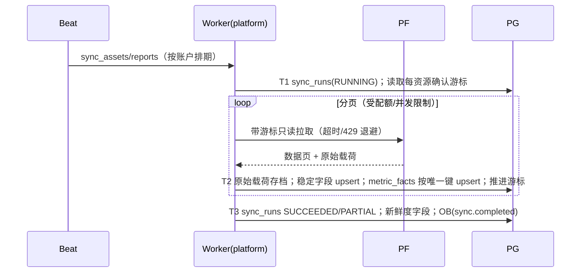
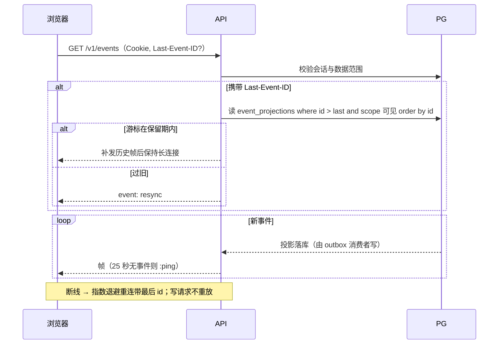
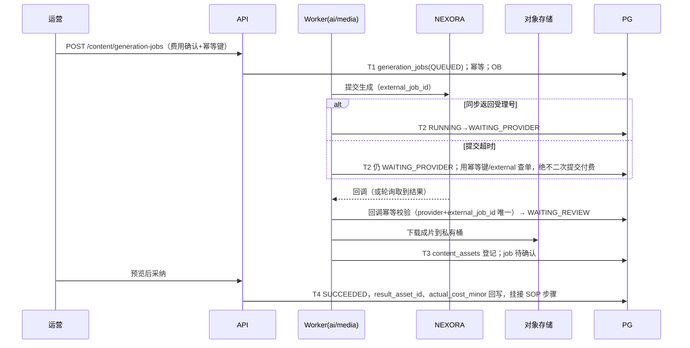
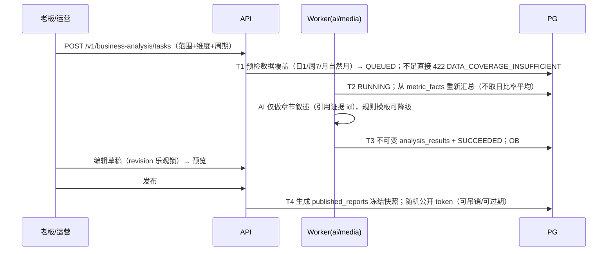

# 15 关键链路时序与事务边界

本册用时序图把系统最容易出错的九条链路画到"哪一步在哪个事务里、崩溃在各点如何恢复"的粒度。图中 T1/T2 标注数据库事务边界，Q 表示入 RabbitMQ 队列，OB 表示写 outbox_events，SSE 表示事件投影通知。所有外部 HTTP（平台、LLM、NEXORA）一律在事务外执行。

## 0. 事务编码约定

1. API async 与 Celery prefork 共用同一套 Service/状态机代码，差别只在 session 工厂（async psycopg / 同步 psycopg）；业务规则不出现第二份。
2. 一个用例最多三类数据库事务：读事务（短）、"决策事务"（状态推进+预占+outbox，短、不跨外部调用）、"落账事务"（外部结果回来后记账，短）。
3. 事务开始先 `set_config('app.current_tenant', ..., true)`；连接归还池即失效。
4. 锁顺序固定：租户 → 额度桶 → 目标守卫 → 业务单（按 id 排序），避免死锁。
5. 消息只携 ID 与 event_id，工作数据回库读取；消息处理结束（外部结果落账后）才 ack。

## 1. 登录与会话吊销

失败点：T2后删缓存失败不影响吊销。每次受保护请求先经受限认证仓储校验PG会话/成员状态；不能只相信尚未到TTL的缓存，也不能声称缓存版本会“自然”知道库已变更。认证引导权限见09册；Redis仅缓存可重建主体属性，不可用时回源。

## 2. 指令→确认→审批→执行→回读（正常路径）

要点：T2/T3/T5/T6都是独立短事务；平台调用在T4提交后。守卫领取失败不能直接推定任务已完成：检查inbox/attempt，只有PROCESSED可直接ack，其余在途走持久化恢复/对账，未发送走受控重新调度，确保任务仍可见。T1回读old_value失败按UPSTREAM_ERROR拒绝创建，不信前端现值。

## 3. UNKNOWN 与崩溃恢复（资金安全核心）

崩溃点对照：

| 崩溃位置 | 恢复行为 |
|---|---|
| T3 提交后、发布 MQ 前 | outbox 补偿投递，命令不丢 |
| MQ confirm 前进程死 | 事件仍 PENDING，flush_outbox 重发；inbox 保证不重复执行 |
| 平台返回前 Worker 死 | 消息重投；attempt 在途判重，只查不写 |
| 平台成功、落 T5 前死 | 同 UNKNOWN 路径，查询定性，不重复下单 |
| T6 落账后、ack 前死 | 重投后 inbox 已 PROCESSED，直接 ack |

前端全程看到：EXECUTING + RESULT_UNKNOWN（可解释文案与核对时间），不出现失败闪烁，也不能再点提交（423 LOCKED/409 TARGET_QUARANTINED）。

## 4. MISMATCH 与平台限流

MISMATCH 不自动"补一刀"覆盖；参数式错误（余额不足、非法值）不重试；资金增加类默认不在 safe-retry 白名单。

## 5. OAuth 授权与六阶段取证

回调与发起会话的浏览器无关（可换机完成），state 绑定的是发起管理员身份。令牌刷新：refresh_platform_tokens 按 provider+主体串行锁；刷新失败能力立即降级，写能力同步关闭并通知前端。

## 6. 平台数据同步管道

一个 Worker 会话只处理一个租户上下文；PARTIAL 时游标只推进到已确认页。限流策略（QPS、错峰、熔断）按平台配置，熔断期同步任务 RESCHEDULED，不发告警风暴（持续阈值才告警）。页面请求永远读库，不被同步慢调用阻塞。

## 7. SSE 订阅、补发与重连

权限撤销/租户切换：服务端检测到会话失效直接关闭流，客户端跳登录。投影由 outbox 消费事务写库，SSE 进程只是"读投影唤醒连接"，无状态、可多实例水平扩展（一期单实例也成立）。

## 8. 内容生成（NEXORA）与扣费未知

重复回调：唯一索引兜底，重复只回 200 不重复处理。已扣费但结果长期丢失：保持 WAITING_PROVIDER 并告警，人工凭供应商账单核对，不自动退款也不自动重发。

## 9. 分析报告生成与发布

发布后的报告不可变；勘误发新版本。公开链接阅读接口不建会话、只校验 token 状态与过期时间，且受速率限制防爬。

## 10. 失败处理统一口径

1. 任何"写了库但外部结果未知"都走 UNKNOWN/WAITING_PROVIDER 挂起，不用超时当失败、不用重试赌幂等。
2. 所有补偿（outbox 补发、scheduled 到期、对账扫描）都是只推进状态的扫描器，频率可配且可暂停；它们不重新承载业务决策。
3. 队列不可用：API 写事务正常提交（事件在库），健康检查 readyz 失败以阻止扩容实例写入；恢复后积压按队列出清，监控积压年龄而不是任务数。
4. 每条异常分支须有审计/指标；故障演练见11册10.1及19册A17–A25/A33/A36。发送供应商请求前持久化我方请求键与SENT状态；外部ID未返回也必须可挂起核对，不能重新发付费请求。
