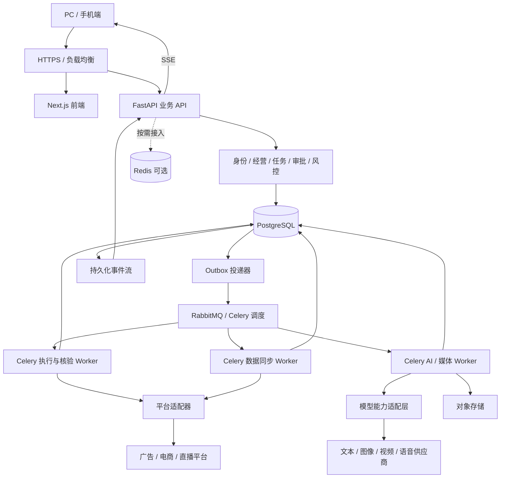
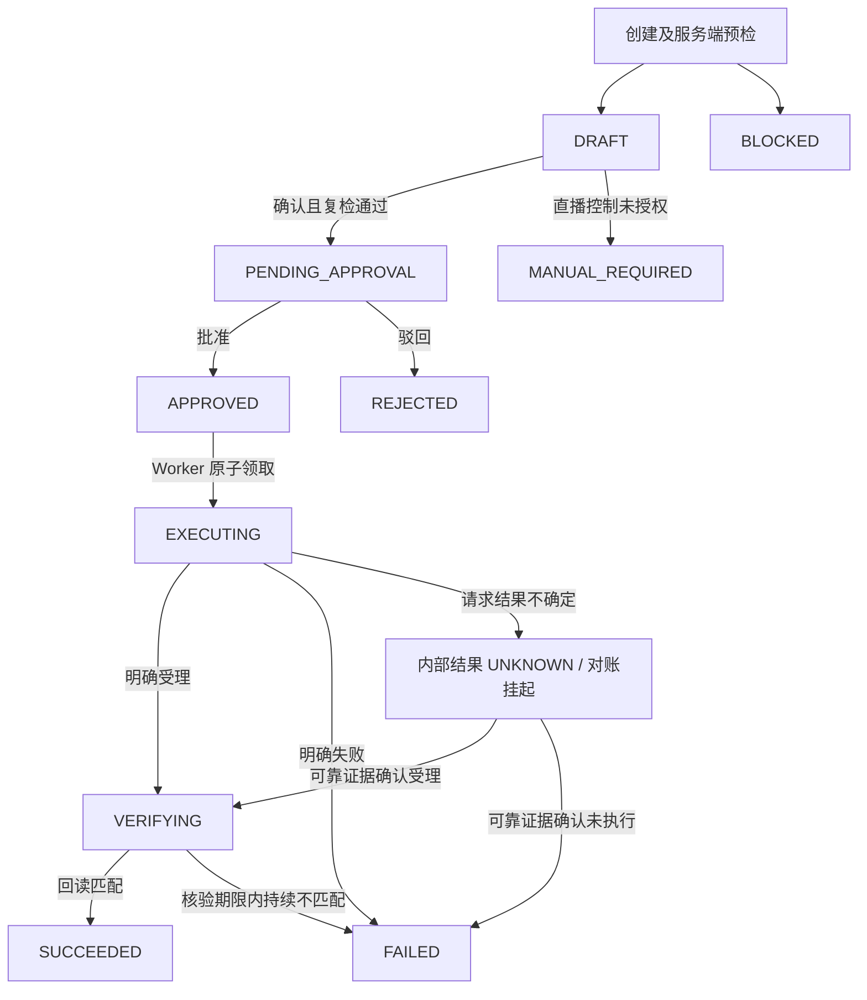
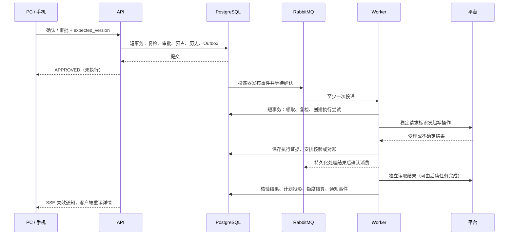

# 易致·驭量后端技术架构与实施设计 V1.1（Python）

日期：2026-10-22（Asia/Shanghai）

状态：建议设计，供开发评审；尚未实现后端、购买云资源或完成平台授权。

修订：用户已确定转用 Python。本文替代前一版技术选型和部署假设，文件路径保留以兼容已有链接；历史版本可通过 Git 查看。本次仅更新设计文档，不表示已搭建或迁移后端服务。

代码基线：`53b8569`，V12 R1，22 个 PC 业务入口及手机四标签。

契约基线：`src/lib/domain.ts`、`src/lib/command-job.ts`、`src/services/contracts.ts`、`src/services/api-client.ts` 及 `docs/shared/contracts/api-handoff-2026-10-22/openapi.json`。

## 1. 目标、假设与决策

目标是先支持内部服务商和运营的创作、图文、视频、策略与投放工作，后续根据第三方采购需求商业化。首期优先建立可恢复的 AI 创作闭环；涉及真实广告写入时，沿用严格的审批、风控与核验。

当前按小团队、内部使用、模型主要通过外部 API 接入设计，不再将数百至千家店铺、多可用区集群或对外 SaaS 作为首期前提。实际用户并发、账户数量、平台配额、数据保留期、云平台及月预算尚未提供；容量、成本及迭代工期仍待验证。内部客户数据隔离和费用归属现在建设，自助采购、套餐与订阅计费后续建设。

| 决策 | 建议 | 原因及调整条件 |
|---|---|---|
| 核心语言 | Python，初始兼容基线 3.13 | 统一承载业务、模型适配和工作流；不是追求最新版本，B0 验证供应商 SDK 与全部依赖后锁定补丁版本 |
| API 框架 | FastAPI、Uvicorn、Pydantic v2 | 参数与响应验证、REST、流式响应；显式配置严格金额验证，不接受隐式布尔/浮点转换 |
| 数据访问 | SQLAlchemy 2.x、psycopg 3、Alembic | 事务、连接池和迁移；版本通过集成测试锁定，不叠加多个 ORM |
| 工程工具 | uv、pyproject.toml、uv.lock | 统一 Python 与依赖版本，开发/CI/部署使用锁文件；尚未创建这些工程文件 |
| 身份与权限 | FastAPI 鉴权依赖、可撤销会话、RBAC/对象授权；有身份源时接 OIDC | 框架不自动提供完整账号系统；CSRF、会话轮换、密码哈希及对象权限需显式实现与测试 |
| 主数据库 | 托管 PostgreSQL 18；云侧不满足时用仍受支持的 17 | 业务事实、约束、额度和审计采用统一事务 |
| 缓存 | Redis 可选，首期不是必需部署项 | 有实测缓存或跨实例限流需求后引入；基础额度和低频配额检查可由数据库承担 |
| 异步任务 | Celery、RabbitMQ | Celery 管理 Python 任务；RabbitMQ 传递任务引用；业务状态与恢复依据在 PostgreSQL，按至少一次调度与重复执行防护设计 |
| 队列冗余 | 内部试用可单节点持久化 RabbitMQ；高可用阶段使用三节点 Quorum | 单节点不承诺节点故障可用性；生产写入仍由 Outbox 和数据库扫描补偿 |
| 定时任务 | PostgreSQL 到期任务表、租约领取、独立扫描进程 | 到期事实落库；可由受控单实例 Celery Beat 触发扫描，领取与执行仍需数据库去重 |
| 文件 | 云对象存储 | 图片、音视频、报告附件；数据库只保存元数据与引用 |
| 实时同步 | SSE 加持久化事件恢复 | 当前交互主要是服务端向两端通知状态变化 |
| AI 接入 | 内部能力接口、供应商 SDK、按需采用 LiteLLM SDK | 文本、图像、视频、语音分能力封装；不假定网关覆盖所有供应商参数；独立网关后续评估 |
| AI 编排 | 显式步骤和持久化状态优先，LangGraph 按需 | 复杂分支、暂停恢复和人工审核出现后引入，不代替 Celery 调度或业务审批 |
| 媒体处理 | 独立 Python/Celery 队列，必要时调用 FFmpeg | CPU/GPU 密集处理与 API 隔离；外部模型 API 接入不自动要求购买 GPU |
| 部署 | Docker Compose 起步，数据库和对象存储优先托管 | API 与 Worker 分容器，同一服务器可运行；两节点及多可用区按停机损失升级 |
| 观测与验证 | 结构化日志、健康检查、基础告警、pytest、Ruff、类型检查 | OpenTelemetry、Prometheus/Grafana 按需接入；SQL、队列与平台桩做集成测试 |

首期不同时引入 Kafka、Elasticsearch、ClickHouse、Temporal、服务网格、Kubernetes 或复杂微服务体系。引入依据必须是业务需求、故障恢复复杂度或实测容量，不是页面数量或供应商模型数量。

## 2. 逻辑架构与运行单元



采用一个 Python 工程的模块化单体，模块接口在同一代码体系内协作；API 接收前端请求、鉴权、创建任务和返回结果，Worker 领取并执行后台任务。两者是独立进程，可共享代码和数据库，首期可部署在同一台服务器。后续按队列分别扩容，不要求现在拆分代码仓库。

FastAPI 的 async/await 适用于异步 I/O；同步 SDK 不直接放入事件循环，转交 Worker 或受控线程池。转码等计算密集任务放独立进程。BackgroundTasks 不承担付费生成、投放写入或其他必须重启恢复的业务。

API 每个请求/并发任务独立使用 SQLAlchemy Session，禁止跨并发任务共享 AsyncSession。Celery 首期采用常规 prefork Worker 和进程内同步数据库/HTTP 客户端；异步 API 与同步 Worker 可共享领域逻辑，但分别建立连接池，不传递 ORM 实例或共享事件循环。数据库引擎在 Worker 子进程启动后初始化，不复用父进程活动连接。

建议后端工程放在 `backend/`，保留现有前端结构与 npm 命令。以下为未来工程目录，不代表本次已创建：

```text
backend/
  pyproject.toml
  uv.lock
  src/yuliang/
    api/             # FastAPI 应用、路由、鉴权依赖、异常和 SSE
    worker/          # Celery 应用、任务注册、队列与扫描入口
    modules/
      identity/      # 身份、租户、授权范围
      business/      # 店铺、账户、计划、商品、直播场次
      command/       # 指令、任务及状态机
      approval/      # 审批规则与决定
      risk/          # 风控、额度预占、停止开关
      connector/     # 授权、能力、平台适配接口
      reporting/     # 同步数据、归因、指标聚合
      content/       # 素材、生成任务、审核
      replay/        # 转写、片段、证据与报告
      notification/  # 通知与持久化事件
      ai/            # 模型能力、路由、调用、费用与流程步骤
    infrastructure/  # 数据源、消息、对象存储、密钥、观测
  alembic/           # 数据库迁移
  tests/             # 领域、接口、数据库、队列及恢复测试
  deployment/        # Dockerfile、Compose、备份和升级说明
```

每个业务模块内部按 `interfaces → application → domain` 组织，基础设施实现领域端口。模块不得通过读取其他模块的 Repository 绕过业务规则；共享代码限于 ID、时钟、错误等稳定原语。可用架构测试检查依赖方向。

## 3. 页面覆盖与后端模块归属

| 前端入口 | 后端能力 | 阶段 |
|---|---|---|
| command（AI驭量中枢）、mobile | 指令解析、任务汇总、待办、SSE | 首期业务闭环；AI 候选后续启用 |
| overview、analytics | 同范围指标、来源、新鲜度、归因 | 只读接入 |
| goals、budgets | 策略版本、预算口径、额度预占 | 真实执行前完成 |
| plans、decisions、tasks、executions | 对象、任务、审批、执行、核验 | 首期业务闭环 |
| monitor、products | 直播场次、商品、计划关联、只读诊断 | 先只读，后补分析 |
| reports | 回放、转写、证据、报告版本 | 后续业务扩展 |
| planning、scripts、videos、graphics、editing | 内容项目、生成任务、产物、审核 | 后续业务扩展 |
| assets、experiments | 素材版本、实验、投放关联与效果 | 先素材，后实验归因 |
| agents | 岗位配置、策略授权、运行记录 | 后续业务扩展 |
| connections、settings | 平台授权、能力、企业和权限 | 基础工程及只读接入 |

导航中的五类 AI 能力是产品入口，不意味着当前已有对应模型或后台服务。每个未来能力应经过“任务模型—异步执行—产物—审核—消费场景”设计。

## 4. 身份、租户和凭据

1. 已有企业身份源时优先 OIDC；无身份源时采用本地账号、经过验证的密码哈希库及可撤销服务端会话，通过 FastAPI 依赖统一校验。首期会话保存在 PostgreSQL；Redis 不是唯一会话事实源。内部成员用邀请/管理方式开通，暂不开发公开注册、订阅和销售计费。
2. 同域入口分别转发前端和 `/v1/*`。会话使用 HttpOnly、Secure Cookie；写请求验证 CSRF Token。登录、注销、切换身份后的 Token 生命周期必须与前端联调。
3. 授权组合为租户成员关系、角色权限、店铺/账户范围和具体对象归属。浏览器提交的 `tenant_id`、审批人、风险结果和执行状态均不可信。
4. `task.create`、`task.approve`、`task.execute`、`policy.edit` 分离。生产默认创建人与审批人分离，租户的例外策略需要显式授权及审计。
5. 业务表携带租户标识，跨表外键用 `(tenant_id, id)` 关联，防止跨租户对象组合；查询与更新都校验授权。
6. PostgreSQL RLS 作纵深隔离。应用账号非表所有者、非超级用户、无 BYPASSRLS；敏感表按需 FORCE RLS。租户上下文在事务内设置并在结束时失效；异步 Worker 同样建立租户上下文。
7. 平台 Token 和模型密钥使用密钥管理服务及信封加密，不在普通业务响应、日志、消息或浏览器中传播明文。令牌刷新按授权记录串行并带版本，防止并发覆盖。
8. 平台回调校验签名、时间窗、事件去重和对象归属。上传产物进行类型、大小和必要的安全检查；对象键由服务端分配，下载使用短期签名链接。

## 5. 任务、审批和执行模型

### 5.1 保留的公共契约

动作保留：`CHANGE_DAILY_BUDGET`、`CHANGE_BID`、`SET_ROI_TARGET`、`PAUSE_AD_PLAN`、`RESUME_AD_PLAN`、`REQUEST_LIVE_START`、`REQUEST_LIVE_END`。

保留来源 `PC_MANUAL / MOBILE_COMMAND / AUTOPILOT`；公开用户创建入口不接受 AUTOPILOT。自主任务由受授权的后端策略生成，仍执行相同风控和审批体系。

`old_value`、对象账户归属、风险、有效期和审批人均由后端确定。批准的是不可变意图、目标值、目标对象及审批依据；确认之后不提供原地修改目标值接口，修改需创建新任务。

### 5.2 状态迁移和未知结果



`DRAFT / PENDING_APPROVAL / APPROVED` 允许在版本检查下取消或到期；与 Worker 领取竞争时通过同一任务行锁或 CAS 决定唯一结果。已领取执行的任务不得直接 EXPIRED、取消或释放预占。

确认、审批、执行前复检若发现授权、旧值、策略或对象发生变化，阻断或使旧申请失效，要求重新申请；不得沿用旧审批。`approved_version` 保存批准时输入版本，后续正常执行递增任务版本时不能简单要求二者永远相等；应验证批准的不可变业务载荷哈希、策略依据及审批未撤销。

当前 v1 状态枚举没有 UNKNOWN。首期兼容方案：请求结果未知时维持 `EXECUTING`，回执 `accepted=null`、`verification=UNKNOWN`、错误 `RESULT_UNKNOWN`、`retryable=false`，暂停写入并进入对账。已知受理但回读暂不可用时维持 `VERIFYING`，使用同样的未知核验信息。前端需展示“对账中/结果未知”，不能只显示普通执行中。

未来若引入公共 `RECONCILING` 或 `UNKNOWN`，需要联合升级类型、校验器、OpenAPI 和 UI；不能直接把新状态发给当前客户端。当前兼容方案是对旧文档中“超时即 FAILED”的有意修订，联调前须更新契约记录。

对于最终一致的平台回读，先按能力声明进行有限次读取和退避；首次不匹配不立即认定失败。到期后根据受理证据与读回结果分类，不制造平台回执或把效果达标当成参数核验。

### 5.3 执行时序



数据库事务不跨越外部 HTTP 调用。平台请求超时、进程在请求后崩溃、响应落库前崩溃，都需要进入恢复核对，而非重新发起相同写操作。

## 6. 核心表结构设计

以下为逻辑表与约束设计，不是已执行的 DDL 或 Alembic 迁移；按里程碑分批建立，不要求 B0 一次创建全部表。业务主键使用 UUID；对外序列化为字符串。所有核心表有 UTC 时间字段，业务表包含租户；敏感写表有 version。

| 表 | 关键字段 | 约束与索引 |
|---|---|---|
| tenants / users / memberships | 租户、账号、成员状态 | 邮箱规范化；成员唯一 `(tenant_id,user_id)` |
| roles / permissions / role_bindings | 角色、权限、作用域 | 绑定包含租户、店铺或账户范围 |
| sessions | token_hash、user_id、tenant_id、expires_at、revoked_at | 仅保存会话令牌哈希；过期索引；切换租户重新校验 |
| shops / ad_accounts | tenant_id、connector_id、native_id | 按平台身份范围建立唯一约束；租户组合外键 |
| ad_plans | account_id、native_plan_id、budget_minor、bid_minor、target_roi、enabled、observed_at、version | 唯一 `(tenant_id,account_id,native_plan_id)` |
| live_sessions / products | 店铺、平台标识、真实状态、来源时间 | 状态映射版本；指标缺失允许 null |
| connector_authorizations | account_id、scopes、encrypted_token、expires_at、version | 授权对象关联；刷新锁和撤销状态 |
| connector_capabilities | authorization_id、action、readable、writable、verifiable、checked_at | 能力以账户和动作区分，不以平台名称统一推定 |
| risk_policies | budget_limit_minor、max_change_percent、cooldown、mode、version | 预算非负；模式不等于授权 |
| budget_ledgers | tenant_id、policy_id、confirmed_total_minor、reserved_increase_minor、version | 每个额度桶唯一；检查与预占锁定同一行 |
| budget_reservations | job_id、bucket_id、amount_minor、state | 一个任务一种预占唯一；UNKNOWN 不释放 |
| command_jobs | 来源、目标、动作、typed_value、status、intent_hash、policy_version、version、expires_at | 租户状态时间索引；目标时间索引；禁止直接写成功状态 |
| idempotency_requests | caller_id、operation、key、request_hash、job_id | 唯一 `(tenant_id,caller_id,operation,key)`；同键异载荷 409 |
| job_approvals | job_id、actor_id、decision、approved_version、approved_payload_hash、policy_version | 与任务原子写入；保留不可变审批历史 |
| job_history / audit_logs | 实体版本、操作者、状态、脱敏差异、trace_id | 状态版本顺序；仅追加；独立授权归档 |
| target_execution_guards | target_type、target_id、active_job_id、fence、lease_until、quarantined | 目标唯一；隔离标记在未知结果消除前保持 |
| execution_attempts | job_id、attempt_no、platform_request_key、result、started_at、finished_at | `(tenant_id,job_id,attempt_no)` 唯一；稳定请求键 |
| platform_receipts | attempt_id、平台回执、accepted、observed_value、verification、verified_at | 受理与核验独立；保存必要的脱敏原始证据 |
| outbox_events | event_id、aggregate_id、aggregate_version、payload、lease_until、published_at | 事件唯一；待投递索引；租约超时可恢复 |
| consumer_inbox | consumer、event_id、processing_state、lease_until | `(consumer,event_id)` 唯一；不能在外部副作用前简单永久标记已完成 |
| scheduled_tasks | kind、business_key、due_at、state、lease_until | 业务键幂等；到期索引；扫描器使用短租约领取 |
| reporting_preferences | user_id、shop、live_session、connector、date、version | `(tenant_id,user_id)` 唯一；不能用租户全局范围覆盖全部成员 |
| metric_samples / metric_aggregates | 来源维度、统计日、归因窗、值、数据质量、来源时间 | 同口径去重；按实际量决定分区 |
| assets / asset_versions / generation_jobs | 存储引用、来源、输入版本、模型、成本、任务状态 | 不覆盖历史素材；受租户授权保护 |
| generation_steps / model_invocations | job_id、step_id、供应商任务ID、输入哈希、模型、参数、状态、重试依据 | 生成步骤与每次付费调用独立记录；外部结果未知时先查询，不直接重新生成 |
| model_configs / prompt_versions | 能力别名、供应商模型、能力矩阵、参数约束、提示词版本 | 无明文密钥；保留实际使用配置快照；模型切换需质量与契约验证 |
| usage_ledger / cost_reservations | 用户、客户项目、任务、预估费用、实付费用、币种、计量依据 | 模型费用与广告预算分账；预占结算幂等；未知费用不当作零 |
| transcripts / replay_segments / replay_reports | 直播场次、时间轴、证据ID、版本 | 报告引用稳定证据，签名视频链接不永久写进报告 |

金额采用 BIGINT 整数分，并校验 `0 < amount_minor <= 9007199254740991`；实际平台上下界通常更窄，由连接器校验。ROI 用 NUMERIC 并限制业务范围，避免无限值和跨平台含义混淆。任务 JSONB typed_value 应有动作/值类型检查，不能只依赖浏览器。

## 7. 并发、额度与消息可靠性

### 7.1 创建与任务状态

- 请求规范化后计算 request_hash，先按唯一约束登记幂等记录，同一事务创建任务及审计。重复请求返回已有任务；同键不同对象、动作、值或意图返回 409。
- 所有迁移同时检查租户、权限、当前状态和 expected_version。条件更新影响行数不是 1 时返回冲突，不覆盖新状态。
- 保留幂等键至少覆盖客户端重试和任务审计所需周期；归档后也不能让旧请求变成新写操作。外部平台请求键与前端创建幂等键分开建模。

### 7.2 预算公式

设 `B` 为已确认计划配置预算合计，`R` 为未结算增额预占合计，`delta=max(new-old,0)`。同一额度桶锁内验证 `B + R + delta <= limit`，通过后预占。单位统一为分，范围含暂停计划，口径变更必须版本化。

同一计划有未结算预算变更时不接受第二个冲突写任务。成功增额的事务内同时执行 `B += delta`、`R -= delta`；失败且确认未执行时释放预占。减额仅在核验成功后减少 B。同步器不能在预占未结算时直接累加平台新值而造成重复占用；同步观察、执行证据和额度对账须通过同一额度应用服务串行结算。

平台外部人工改动必须纳入对账。已超限或观测过旧时，禁止新的增额写入并告警；无法控制平台外部所有写入时，不能承诺企业实际消耗绝对不越限。配置预算额度与每日真实消耗是两个不同模型。

### 7.3 消息与领取

- Outbox 与业务变更同事务；发布器等待 broker confirm，并处理 mandatory 返回的不可路由消息。确认后再标记已投递；崩溃重复发布通过事件ID去重。
- Consumer 的事务提交与消息 ack 有间隙，重复投递是正常情况。内部数据库副作用可以事务去重，外部平台调用还要检查执行尝试与未知结果状态。
- 目标领取使用数据库短事务、版本与 fence。租约用于恢复调度资格，不表示旧请求在平台侧已停止；未知的尝试必须先核对，不能租约一过期就由新 Worker 重发。
- 队列按同步、执行、核验、媒体隔离；平台和账户采用有界并发。同一目标顺序以数据库守卫保证，不依赖多消费者队列的天然顺序。
- 读请求可有限退避重试；写请求只有确认未发送/未执行，或平台支持稳定幂等键且重试语义经验证时才重试。死信重放同样经过执行资格检查，不提供无条件批量重放。
- TTL 不承担所有任务到期逻辑；到期表、领取时复检和定期扫描共同兜底。MQ 不可用时 Outbox 持久化积压，达到阈值后暂停新执行授权并明确显示排队。

### 7.4 Celery 实现约束

- Outbox 投递器通过 Celery 发布标准任务消息，携带业务ID和稳定 event_id，不把任意 JSON 事件直接发送给 Celery Worker。任务参数不包含视频文件、ORM 实例或明文密钥，使用 JSON 序列化。
- 数据库 job_id、event_id 与 Celery task_id 分开；重复 task_id 本身不提供业务去重。PostgreSQL 是任务、步骤、费用和产物的事实源，首期不依赖 Redis result backend。
- RabbitMQ 使用持久队列/消息和发布确认；Quorum 队列的 Celery 配置和 broker 兼容性在 B0 做真实集成验证。内部试用单节点同样持久化，但不宣称容错高可用。
- 对已具备幂等与恢复逻辑的任务评估 `acks_late`；Worker 丢失时是否重投递需联合验证 `task_reject_on_worker_lost`、失败次数上限及死信处置。不能假定开启延迟确认就覆盖全部子进程退出场景。
- 不对广告写入、付费生成配置无差别 `autoretry_for=Exception`。即使重投递，任务也先读取数据库执行尝试，未知结果进入查询/核验，不重复写入或扣费。
- 长短任务分队列；耗时媒体任务采用低预取和有界并发，超时包含连接、读取及业务期限。Celery SUCCESS 仅表示 Python 任务函数返回，不等于平台核验、完整创作流程或审核完成。
- 生成视频采用短任务提交、保存供应商ID、回调或到期表分次查询、归档产物；不占用 Worker 数十分钟循环等待。数据库扫描负责修复遗漏调度和到期核验，长时间等待不全部堆在 Celery ETA 内存调度中。

## 8. API 与前端契约演进

### 8.1 首期兼容的 11 个操作

| 方法 | 路径 | 后端责任 |
|---|---|---|
| GET | `/v1/auth/session` | 返回当前租户内身份与权限，无身份 401 |
| POST | `/v1/auth/login` | 校验身份、建立会话；登录本身也防护 CSRF |
| POST | `/v1/auth/logout` | 撤销会话并返回 data:null 的 JSON 信封 |
| GET | `/v1/frontend/snapshot` | 当前授权范围的经营快照，缺失值保留 null |
| POST | `/v1/command-interpretations` | QUERY / ACTION / UNRECOGNIZED；不明确对象不能执行 |
| POST | `/v1/command-jobs` | 幂等创建；不接收客户端风险、旧值或成功结果 |
| POST | `/v1/command-jobs/{job_id}/confirm` | 对象、风险、有效期及版本复检 |
| POST | `/v1/command-jobs/{job_id}/approvals` | 审批权限、职责分离、额度和审批依据 |
| POST | `/v1/command-jobs/{job_id}/cancel` | 与领取执行原子竞争，执行中不可直接取消 |
| PUT | `/v1/risk-policies/{id}` | 权限、版本、策略审计，不隐式修改广告计划 |
| PUT | `/v1/frontend/reporting-scope` | 保存当前用户在租户内的筛选偏好 |

成功信封保持 `{schemaVersion:"command-job-v1.0",requestId,data}`。前端当前所有 request 都解析 JSON，因此不对 logout / setScope 返回 204。正式数据 `source=API`、任务 `mode=API`、风险 `source=SERVER`；平台回执只保存实际观察，不构造 MOCK 回执。

### 8.2 后续新增接口草案

新增均为设计，不是现有接口。新增操作使用同一身份体系，但应明确各自 DTO 版本及是否复用旧信封。

| 能力 | 候选接口 |
|---|---|
| CSRF | `GET /v1/auth/csrf` |
| 任务分页与详情 | `GET /v1/command-jobs?cursor=...&limit=50`、`GET /v1/command-jobs/{id}` |
| 冲突与未知结果追踪 | `GET /v1/command-jobs/{id}/attempts`；人工核对动作单独授权、记录依据，不能直接改成功 |
| SSE | `GET /v1/events`，支持 Last-Event-ID 与超期重同步 |
| 计划与指标 | `GET /v1/plans`、`GET /v1/metrics/summary`，显式传日期及范围 |
| 平台授权 | 按连接器定义授权发起/回调、撤销、能力查询；回调协议在平台选定后确定 |
| 内容与素材 | `POST /v1/content-jobs`、`GET /v1/content-jobs/{id}`、素材上传授权与完成确认 |
| 回放复盘 | `POST /v1/replay-jobs`、任务详情、片段与报告版本查询 |

列表采用有界 limit（建议默认50、上限100）和稳定排序游标。查询、创建和执行分离；新增长任务可返回 202，但不静默改变现有客户端所需的完整任务响应。

### 8.3 必须联合调整的前端点

1. 增加 CSRF 初始化、提交 Header、会话生命周期处理。
2. API subscribe 接入 SSE，去重、防乱序并合并短时间内重复刷新。
3. 当前 LiveSession.status 只有 MOCK_LIVE / UNKNOWN；新增真实状态时统一修改类型、组件及契约，不能把真实直播映射成 MOCK_LIVE。
4. 当前快照无分页完整性标识，不得截断列表后仍展示全量总数/指标。首期对快照支持范围设上限，超限明确报错；规模扩张先上线分页和服务端汇总。
5. 前端当前从 plans 汇总指标且 reporting.ts 未按日期过滤，后端必须返回选定日期的正确口径；后续改为独立聚合 DTO，避免分页计划导致统计失真。
6. 目前 429 / 5xx 基本映射通用错误，补充 Retry-After、业务错误、requestId 和重试建议，写请求不能自动重放。
7. 任务详情对未知结果展示核对中、最后核对时间及处置入口。不得把“请求返回成功”“平台受理”或“审批通过”展示为核验完成。

## 9. SSE、数据新鲜度与统计

事件只包含必要的实体ID、实体版本、类型和恢复游标；服务端先按租户、店铺权限过滤，客户端收到后重读授权资源。权限撤销和注销时关闭相关订阅；连接定期验证会话有效性。

多 API 实例从持久化事件投影恢复通知。Redis Pub/Sub 只能作低延迟唤醒，丢失后仍有数据库轮询补偿；不能作为唯一事件流。恢复游标采用按租户串行分配的投影序号，投影器持锁完成序号与可见事件的同事务写入，避免直接用并发事务提交前分配的数据库 sequence 当完成水位而漏事件。

建议事件保留24小时（待容量核实）。重连收到的游标过旧时发送明确 resync 信号；前端全量或分资源同步。事务内写入的业务 Outbox 与用于浏览器恢复的事件投影生命周期分开管理。

指标按平台、账户、计划、统计日、归因窗、指标定义版本建模。以平台提供的粒度去重；累计值不能按采集次数相加。保存源更新时间、采集时间、数据延迟和缺失原因。订单经营 GMV 与广告归因 GMV 分开，不能直接跨平台去重或视为利润。

平台配额决定采集频率。示例：1万个账户每分钟至少一个请求即约167请求/秒，分页和多端点会进一步放大；该算式仅说明容量估算方法，不代表已获得任何平台额度。分层同步、增量游标、受支持的回调及热点场次优先是首选策略。

## 10. 多模型、创作流程和复盘

### 10.1 三层边界与能力接口

业务能力层提供“商品图文、投流视频、脚本候选、经营分析、策略建议”等产品功能；流程层保存步骤、依赖、人工审核、重做和产物；模型适配层管理供应商、能力、路由、参数及用量。前端调用业务接口，不直接绑定供应商模型名。

文本、图像、视频、语音分别提供能力端口，不强行压成单一 chat 接口。文本需要流式/结构化/工具能力，图像需要参考图/蒙版/尺寸，视频需要异步任务/时长/首尾帧/查询与取消，语音需要音色/时间戳/音频格式；不支持的参数明确拒绝，不能静默忽略。

能力别名可采用 `copywriting.default`、`script.creative`、`strategy.reasoning`、`image.product`、`video.ad`。配置将别名映射到供应商、实际模型、可用参数、成本及并发上限，并保留每次调用的不可变快照。模型路由按能力、质量、费用、速度与数据可发送范围决定，不仅按接口名称选择。

LiteLLM 作为可选 SDK/路由实现放在内部端口之后；先逐项验证目标模型的结构化输出、工具、图像、视频和流式能力。供应商差异通过原生适配器处理，首期不强制部署独立 LiteLLM Proxy。自动重试和 fallback 按具体能力配置；流式已输出、外部已受理或可能扣费的请求不能无条件换模型重发。

### 10.2 两类任务与流程恢复

`GenerationJob` 管理内容生产，`CommandJob` 管理广告写入和经营动作。两者共享身份、审计、幂等、调度组件，但不共用完整状态机；生成完成不等于审核通过或已投放。内部生成状态建议为 `QUEUED / RUNNING / WAITING_PROVIDER / WAITING_REVIEW / SUCCEEDED / FAILED / CANCELLED`，调用结果未知单独保存在 model_invocations；这些不是可直接发给当前 command_job 客户端的新枚举。

典型流程为“商品资料 → 卖点 → 脚本 → 人工确认 → 分镜/图片 → 视频 → 字幕合成 → 审核 → 素材入库”。每一步保存输入/模型/提示词/产物版本和状态，步骤重做时仅失效依赖其输出的下游步骤，保留已确认的独立结果。取消请求区分停止后续步骤与供应商是否实际取消，不能承诺取消即退款。

首期明确流程代码和步骤表即可。复杂分支、人工暂停与恢复明显增加时，可用 LangGraph 并配置持久化检查点；图运行状态不替代业务表、Celery 投递、费用账或投放审批。

### 10.3 用量与费用

内容生成任务保存输入素材版本、模型/供应商、提示词模板版本、输出规格、成本预占、实际费用和审核记录。供应商超时可能已经扣费或生成，应按供应商任务ID查询，避免无条件重复付费调用。

以团队、用户、客户项目、能力和任务归集调用。生成前预估并预占，回执后按供应商计费证据结算；多币种分别保存原币及换算依据。无用量证据时标记未知，不填零。费用账用于内部核算，暂不实现对外充值、发票和套餐，但保留未来销售所需的成本可追溯性。

### 10.4 媒体与业务证据

ASR和转码单独资源队列，失败可恢复但不覆盖已审核产物。素材入库、平台上传、平台可用、关联计划、真实投放和效果归因分别记录。对象存储文件采用受租户控制的元数据与短期下载链接。

自然语言先生成结构化候选，经过业务解析、明确对象、风控、审批后进入统一任务。模型不可直接获取平台写凭据。复杂指令拆分需展示全部子任务及部分成功语义；首期单动作解析优先，未覆盖指令明确返回不支持。

复盘以获权回放、转写片段、计划与商品事件、订单和广告指标为证据，报告保留版本及证据引用。缺成本/退款时不生成利润结论。没有真实证据时返回未就绪，不用固定演示文字填充正式报告。

## 11. 分阶段部署、恢复与降级

### 11.1 当前内部使用基线

单地域、一个 Python 代码体系，通过 Docker Compose 部署 FastAPI/Uvicorn、Celery Worker、Outbox/到期扫描及持久化 RabbitMQ。API 与 Worker 可以同机但独立容器和资源限额，数据库与对象存储优先托管。Redis、独立模型网关、独立观测集群和 Kubernetes 均不作为首期前提。

这是一套可恢复的低复杂度部署，不是多节点高可用：应用机或单节点队列故障时会有停机和积压。上线前明确可接受的停机/丢失窗口，以数据库备份和任务恢复演练验收；若托管数据库支持并且预算允许，可直接选主备配置。应用服务不可因“内部使用”省略客户隔离、费用和写入核验。

### 11.2 后续高可用升级选项

| 组件 | 生产建议 | 故障处理 |
|---|---|---|
| API | 停机损失明显时升级两台节点/多副本，进一步按需求跨可用区 | 摘除异常实例；终止前排空 HTTP / SSE；同机多进程不等于节点高可用 |
| Worker | 每类按负载独立副本及资源限制 | 停止领取、完成或持久化在途尝试，租约恢复先对账 |
| PostgreSQL | 托管跨区主备、同步策略、故障隔离、自动切换 | 自动重连；只在提交结果明确时重试事务；不把断连等同于回滚 |
| RabbitMQ | 三节点 Quorum，优先三个可用区 | 少数节点故障仍有多数派；失去多数派时保留 Outbox，暂停执行派发 |
| Redis | 引入后根据需要使用托管主备 | 查询缓存旁路并保护数据库；依赖全局配额的执行默认暂停，避免故障放大 |
| 对象存储 | 版本与生命周期，重要数据备份策略 | 文件任务排队，基本审批和查询继续 |
| 平台 / 模型 | 独立超时、配额、熔断、退避 | 平台故障隔离到连接器/账户；关闭新写入，保留读状态与核对 |

下列灾备等级是未来升级目标，不是首期承诺：同步复制仅在明确的故障范围和故障切换策略下追求已确认事务 RPO=0，不承诺地域全毁仍无损。数据库备份加 WAL 归档以支持时间点恢复；异地灾备可评估 RPO≤15分钟、RTO≤4小时，是否可达取决于云产品、数据量和恢复演练。多可用区故障切换目标也需要按实际产品确认和验证。

日常备份成功不代表可恢复，至少定期在隔离环境执行恢复、校验任务/审批/额度和对象存储引用。灾备切换使用全局执行纪元/停止开关，隔离旧地域，恢复后先核对在途写入；不能两个地域同时执行同一任务。

数据库变更采用 expand-contract：先新增兼容结构，发布兼容应用，迁移数据，确认旧实例退出后再删除旧字段。回滚应用不能依赖直接回滚所有数据库迁移。各环境凭据、数据和平台授权隔离。

## 12. 性能、资源和观测验收

以下为内部起步验收建议，不是当前实现能力或承诺 SLA；先量出真实业务基线，再决定副本与集群规模。

| 指标 | 初始目标 | 测量边界 |
|---|---|---|
| 可用性与恢复 | 先约定内部维护窗口并完成恢复演练 | 记录实际停机和恢复；不把单节点部署标为99.9%保障，商业化后另定SLO |
| 常规列表/详情 | P95≤500ms | 指定数据集、鉴权、非缓存与缓存分别报告 |
| 创建/审批 | P95≤1秒 | 完成数据库事务，不等待平台执行或生成完成 |
| 状态提交到两端可见 | P95≤3秒 | 包括事件投影、SSE和客户端重读 |
| 基线负载 | 先验证20个并发运营用户、50 RPS与50个SSE连接 | 为构造验收场景，不是已确认用户量；模型生成另压测 |
| 生成并发 | 按供应商配额设有界并发及排队上限 | 分别记录首Token、受理、生成、审核耗时与单任务费用，不统一承诺生成秒数 |
| 故障负载 | API/Worker重启后任务可解释恢复、不重复扣费或投放 | 单机允许短暂停机；观察恢复时间、未知结果与积压 |

初始构造数据建议包含10个客户空间、100个账户、1000个计划、1万条业务任务及代表性素材元数据，验证客户隔离和热点访问；实际内部规模明确后替换这些假设。常态、突发、进程重启和持续运行分别测试；第三方用可控桩模拟延迟、429、未知结果，真实供应商配额和费用另行验收。未来商业化再增加数百租户、大历史数据及多节点故障场景。

起测可评估一台4vCPU/8GiB应用机，运行API、小并发Worker与单节点队列；PostgreSQL优先使用托管服务，规格根据连接、数据量和查询实测选择。该配置仅用于主要调用外部模型API的内部试用，不保证满足持续转码或本地推理。视频计算增加时先独立媒体Worker；GPU、对象存储流量、备份及模型账单单独核算，不据此给出未经询价的月费用。

连接池按“API进程数×池上限＋Worker子进程池＋扫描器＋运维连接”预算，预留发布余量；pool_size和max_overflow均有界。async/await改善I/O等待，不能增加供应商配额或数据库连接上限。CPU处理放独立进程，长任务不持有数据库事务。使用有界队列、并发隔离、查询索引、预聚合及慢查询分析。

业务观测至少包含：Outbox最老未投递时间、队列积压、平台429及超时率、UNKNOWN数量及最长停留时间、核验延迟、额度预占滞留、授权即将失效、同步数据年龄、SSE恢复率、AI费用。requestId、traceId、jobId、attemptId贯穿链路；日志脱敏且不要把每个租户/任务ID当作监控指标标签，避免高基数。

## 13. 实施里程碑与验收用例

| 阶段 | 可交付成果 | 通过条件 |
|---|---|---|
| B0 Python基础工程 | uv锁依赖、FastAPI/API、Celery/Worker、Alembic、Compose、pytest/CI、健康检查 | 可重复启动；API/Worker数据库连接隔离；真实队列确认和恢复验证 |
| B1 身份与业务底座 | 内部账号、CSRF、客户空间/权限、素材元数据、快照兼容及费用归属 | 跨客户访问全部拒绝；正式缺失数据不伪装Mock；费用可归属 |
| B2 AI创作闭环 | 模型适配、提示词版本、GenerationJob/步骤、Outbox、图文/视频、审核与SSE | 接入已选供应商；可查询、恢复、步骤重做；未知结果不重复付费 |
| B3 投放业务闭环 | 平台只读、CommandJob、审批、额度、单类获权写入、回读和对账 | 无越权、无并发超额；成功、超时、崩溃、重复投递均可解释恢复 |
| B4 功能扩展 | 更多创作能力、多连接器、直播复盘、岗位、按需LangGraph | 按逐页能力清单联调；模型产物有版本、成本、证据和审核 |
| B5 内部上线验收 | 内部规模压测、备份恢复、告警、升级与回滚；后续销售单列评审 | 实测报告覆盖内部目标；对外高可用与计费不自动视为已完成 |

必须覆盖：同键异请求409、两个审批人竞争、取消与领取竞争、并发增额、策略批准后变更、外部计划旧值变化、平台返回前Worker崩溃、平台成功而落库失败、队列确认前后崩溃、平台最终一致延迟、未知结果长时间不能核实、授权撤销、跨客户访问、MQ/数据库故障、SSE断线重连、数据库恢复后的在途任务核对，以及生成已扣费但响应丢失、重复回调、步骤重做和费用重复结算。Redis故障、多API实例恢复和可用区故障在对应组件启用时增加验收。

V1.1按内部AI创作优先重新定义B1—B5，历史阶段编号不代表已交付。任务里程碑不等于时间承诺。下一个可执行开发范围为 B0+B1；B2依赖模型账户和测试费用，B3真实平台接入依赖试点账户授权和能力证据。本文未执行 B0，不宣称已有后端工程、联调成功或高可用部署。

## 14. 架构演进触发条件与待决策事项

- PostgreSQL报表扫描持续影响事务延迟，且索引/预聚合/只读副本不能满足时，评估 ClickHouse；迁移前定义指标一致性与补算。
- 跨天多步骤恢复、人工等待、补偿分支显著增加时，评估 Temporal；迁移时仍保留外部写入幂等和未知结果处理。
- 创作流程出现大量分支、人工暂停和多轮模型调用时，评估LangGraph及数据库检查点；不与Temporal同时无依据引入。
- 多个独立应用需要共用模型密钥、路由和成本管理时，再评估独立模型网关；首期SDK适配不强制拆服务。
- 内部停机损失显著或签署客户服务承诺前，评估两节点、托管高可用消息与数据库、跨可用区及容灾等级。对外统一SaaS与客户独立部署分别设计，不因“可能出售”提前实现全部套餐与计费。
- 数据同步或媒体负载显著不同、团队需要独立发布时，先拆该模块；不按22个页面拆22个服务。
- 出现全文搜索需求后再选择搜索引擎；先明确检索范围、租户隔离及更新延迟。

已确定：Python主后端、内部服务商与运营优先、重度多模型创作及策略能力、后续按采购需求商业化。尚待明确：云平台/地域、预算、账户与计划量、模型供应商及配额、首个获权广告平台、账号体系、审计与媒体保留期、审批职责分离例外、备份及灾备等级。沿用本文假设推进可逆的本地基础工程设计；云采购、模型付费和真实账户写入不由这些假设自动授权。

## 15. 来源与验证边界

代码入口：上述契约基线，以及 `src/lib/routes.ts`、`src/features/command-desk.tsx`、`src/components/provider.tsx`。API导出包的11个操作是客户端需求，不是已部署接口。

2026-10-22 本轮重新查阅的官方资料：

- [FastAPI异步与并发](https://fastapi.tiangolo.com/async/)：异步I/O与计算任务的处理边界。
- [FastAPI后台任务](https://fastapi.tiangolo.com/tutorial/background-tasks/)：后台任务与独立任务队列的选用。
- [Celery任务](https://docs.celeryq.dev/en/stable/userguide/tasks.html)：任务确认、幂等、Worker退出和长短任务隔离。
- [SQLAlchemy asyncio](https://docs.sqlalchemy.org/en/20/orm/extensions/asyncio.html)：会话并发与连接生命周期；链接用于机制参考，不声明2.0为最新版本。
- [LiteLLM接入说明](https://docs.litellm.ai/docs/)：SDK/网关和路由能力；目标供应商覆盖仍需实测。
- [LangGraph持久化](https://docs.langchain.com/oss/python/langgraph/persistence)：检查点、恢复及持久化状态。

以上资料支持组件机制；模块划分、容量、表结构和演进路径是本项目建议。本文只进行设计与契约核对，不包含可运行性、DDL迁移、消息恢复、性能或容灾的实测证明。

## 16. V1.1修订摘要

从业务主后端、工程目录、数据访问、迁移、鉴权、队列实现、观测和验收中移除原语言栈依赖，统一为Python。首期部署降为内部试用的可恢复单地域方案，Redis/复杂编排/网关/集群按需。新增多模型能力适配、GenerationJob与CommandJob分离、步骤恢复、供应商任务核对、内部费用账和商业化演进边界。现有11个HTTP操作及前端业务模型保留；本次不修改前端运行配置、不启动本地服务、不创建Python工程、不执行云部署。
