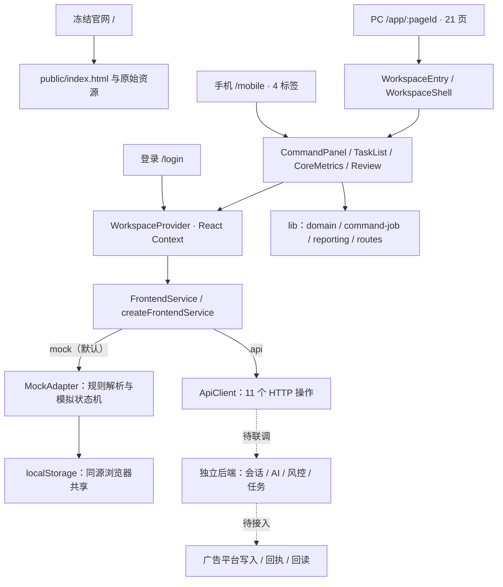
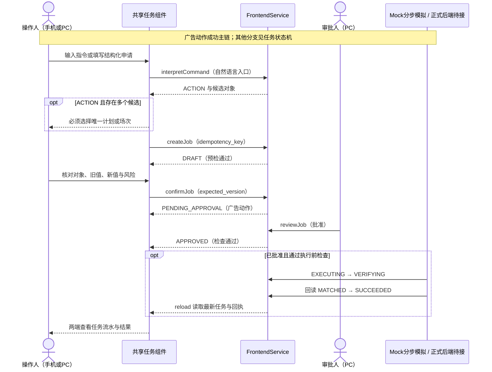
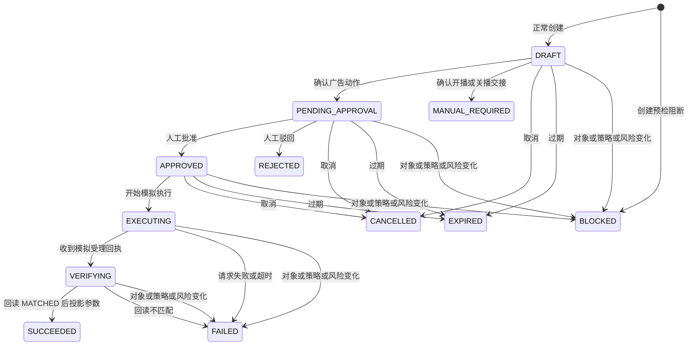
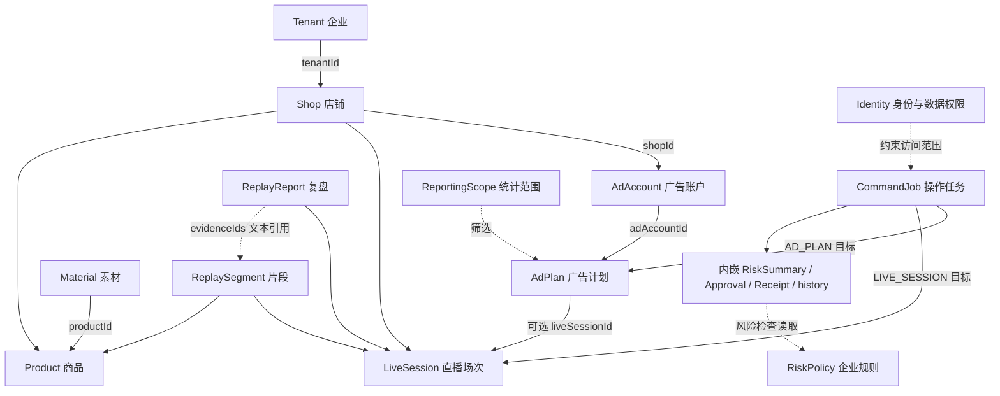

# 易致·驭量前端技术架构与业务流

- 整理日期：2026-10-22 · Asia/Shanghai
- 代码基线：`5d4b568065e432ed59b7a13cceec516dd763859e`
- 阶段：G1-B1 前端

从经营目标、直播观察到操作申请、人工审批和回读核验，梳理 PC 与手机如何共用一套任务协议，以及真实后端需要承接的职责。

由 [HTML 原文](frontend-architecture-2026-10-22.html) 转换，沿用原文的代码基线与能力边界。交互节点说明、全部流程标签和任务场景已展开；图示使用 Mermaid。

## 目录

- [01 当前架构结论](#01-当前架构结论)
- [02 技术分层与运行时数据流](#02-技术分层与运行时数据流)
- [03 页面地图与业务职责](#03-页面地图与业务职责)
- [04 核心业务流](#04-核心业务流)
- [05 command_job 状态机](#05-command_job-状态机)
- [06 共享数据模型与统计口径](#06-共享数据模型与统计口径)
- [07 前后端契约与权威边界](#07-前后端契约与权威边界)
- [08 实现边界与演进顺序](#08-实现边界与演进顺序)
- [09 代码依据与阅读入口](#09-代码依据与阅读入口)

## 当前代码规模

| 指标 | 数量 |
| --- | --- |
| PC 工作区 / 业务路由 | 4 / 21 |
| 手机标签，共用业务协议 | 4 |
| 任务状态 / 操作类型 | 12 / 7 |
| 客户端声明的 HTTP 操作 | 11 |

## 01 当前架构结论

这是一个独立的 Next.js 前端。已完成浏览器内的任务交互演示；业务服务通过统一接口隔离，真实登录、风控、AI、广告执行与核验仍依赖独立后端。

### 一套前端，两种终端

PC 负责经营管理、审批和模拟执行；手机负责指令、直播观察、任务跟踪与复盘。两端复用 Provider、Service、任务详情与统计函数。

### 一套协议，两种适配器

`FrontendService` 隔离 UI 与数据来源。MockAdapter 写入 localStorage；ApiClient 只声明独立后端调用，失败时明确报错。

### 任务是核心业务对象

PC、手机及预置 AUTOPILOT 候选统一为 `CommandJob`。批准、受理、核验成功是三个不同事实，只有核验匹配才能完成。

> **实现程度：**当前默认 `mock`。21 个路由可达不代表 21 个完整业务模块；内容生成、平台授权、真实 AI 自主投放均未落地。本文件描述现状，后续建议另行标明。

依据：[Service 工厂](https://github.com/xiansheng-Lu/yizhi-yuliang/blob/5d4b568065e432ed59b7a13cceec516dd763859e/src/services/index.ts#L4) · [业务页面分发](https://github.com/xiansheng-Lu/yizhi-yuliang/blob/5d4b568065e432ed59b7a13cceec516dd763859e/src/features/business-page.tsx#L282) · [任务协议](https://github.com/xiansheng-Lu/yizhi-yuliang/blob/5d4b568065e432ed59b7a13cceec516dd763859e/src/lib/command-job.ts#L3)

## 02 技术分层与运行时数据流

服务端路由负责入口与页面 ID 校验；业务交互集中在 Client Components。节点职责、数据流和代码位置展开如下。

### 节点职责

| 节点 | 职责与数据流 | 代码位置 |
| --- | --- | --- |
| 冻结官网 | next.config.ts 的 beforeFiles rewrite 将 / 指向 public/index.html。原始 HTML、CSS、JS 由独立静态资源提供，避免业务工作台改动影响官网。 | `next.config.ts / public/` |
| 登录与 PC 路由 | 服务端 BusinessRoute 校验 pageId 白名单，未知 ID 返回 404；WorkspaceEntry 组合 AuthGuard、WorkspaceShell、SnapshotView 与 BusinessPage。登录 next 经过白名单归一。 | `src/app/(frontend)/app/[pageId]/page.tsx / src/lib/routes.ts` |
| 手机入口 | 四标签切换保存在 MobilePage 的 useState。复用 CommandPanel、TaskList、CoreMetrics 和 Review；review=false 隐藏审批和模拟执行，允许创建、确认和取消尚未执行的申请。 | `src/features/mobile-page.tsx` |
| 页面与导航 | BusinessPage 按 pageId 分发。overview/goals/monitor/tasks 进入 ControlWorkspace；其余为展示、申请入口或骨架。WorkspaceShell 从 routes.ts 生成四组导航。 | `src/features/business-page.tsx / src/features/control-workspace.tsx` |
| 共享任务组件 | CommandPanel 区分 QUERY / ACTION / UNRECOGNIZED，处理候选消歧；TaskComposer 是结构化入口；JobDetails / TaskList 展示差异、风险、审批、回执和历史。 | `src/components/command-panel.tsx / task-controls.tsx` |
| 经营上下文与状态 | ScopeControls 更新共享范围；CoreMetrics 和 LiveSummary 复用统计纯函数。LoadingState、ErrorState、EmptyState 统一基础呈现；部分通用列表仍直接读取全快照。 | `src/components/operating-context.tsx / ui.tsx` |
| WorkspaceProvider | 挂载时读取身份，再读取统一快照。组件动作成功后 reload；Mock 存储事件触发刷新。generation 计数丢弃过时读取结果；AuthGuard 负责前端登录跳转。 | `src/components/provider.tsx` |
| 领域模型与纯函数 | domain.ts 定义组织、计划、商品、素材和快照；command-job.ts 定义任务、动作、状态和值；reporting.ts 处理范围与证据；不承载真实平台执行。 | `src/lib/domain.ts / command-job.ts / reporting.ts` |
| FrontendService | 统一 Promise 接口与 ServiceError，页面不直接访问 localStorage 或 fetch。工厂根据 NEXT_PUBLIC_DATA_MODE 选 MockAdapter 或 ApiClient，无运行时静默降级。 | `src/services/contracts.ts / index.ts` |
| MockAdapter | 在浏览器演示身份、快照、规则解析、风险预检、人工审批与分步模拟回执。默认申请 15 分钟有效、成功动作冷却 5 分钟；读快照时检查未执行申请过期。 | `src/services/mock-adapter.ts / mock-command.ts / mock-data.ts` |
| ApiClient | 11 个待联调 HTTP 操作，Cookie credentials:include、no-store、15 秒超时。验证 envelope 和部分实体约束；subscribe 为空，正式执行推进由后端负责。 | `src/services/api-client.ts` |
| 独立后端与平台（待接入） | 会话与权限、CSRF、任务持久化、幂等、AI、策略风控、平台执行和回读核验须由独立后端提供。当前仓库无数据库、业务 Route Handler、广告 SDK、执行 Worker。 | `README.md / docs/代码复用与边界.md` |

图中向下表示依赖与调用；快照读取与操作结果向上返回。官网由 beforeFiles rewrite 单独返回静态文件，不经过业务 Provider 页面树。

| 层面 | 当前选型 | 实现含义 |
| --- | --- | --- |
| 运行框架 | Next.js 16.2.6 · App Router | React Strict Mode；动态页面校验白名单；无 Next 业务 Route Handler。 |
| 界面与语言 | React 19.2.6 · TypeScript 5.9.3 | strict 类型检查；业务交互以 Client Components 为主；`@/*` 映射 `src/*`。 |
| 状态管理 | React Context + useState / useRef | 共享全量快照；表单、标签、筛选控件的临时状态在各组件内。无 Redux、Zustand、查询缓存库。 |
| 样式与图标 | CSS Tokens + workspace.css · Phosphor 2.1.10 | 业务样式由 (frontend)/layout 导入；官网保留独立原始资源。未使用 Tailwind 或通用组件库。 |
| 本地工程 | 项目 Node 24.19.0 · ESLint 9.39.4 · tsx | scripts/run.mjs 优先选择 .runtime；测试基于 Node test runner，构建显式使用 webpack。 |

| 阶段 / 角色 | 行为 |
| --- | --- |
| ① 读取身份 | getIdentity → identity / 未登录跳转 |
| ② 读取快照 | getSnapshot → Resource.ready → 页面渲染 |
| ③ 操作后重读 | 页面调用 service → reload → 最新快照 |

> **刷新边界：**Mock 同页通过自定义事件刷新，其他同源标签页通过 storage 事件刷新。ApiClient.subscribe 当前为空实现；尚无轮询、SSE 或 WebSocket。API 模式下其他客户端的变化不会自动推送到当前页面。

## 03 页面地图与业务职责

按当前 `routes.ts` 分组，保留现有导航命名。下列“核心交互 / 展示与申请 / 骨架”是本文对源码行为的归类，不代表正式产品验收状态。

- 4 页 · 核心 Mock 交互
- 10 页 · 展示与申请入口
- 7 页 · 骨架待实现

### 经营总控 / 4 页

| 页面 | 路径 | 实现程度 | 职责 |
| --- | --- | --- | --- |
| AI总控台 | `/app/overview` | 核心交互 | 范围内经营 KPI、任务待办、共享计划与工作模式。 |
| 经营目标 | `/app/goals` | 核心交互 | 经营目标表单、预算上限、变化幅度、冷却与规则版本。 |
| AI直播作战室 | `/app/monitor` | 核心交互 | 直播状态与指标、自然语言指令、计划、货盘与回放证据。 |
| AI任务与审批 | `/app/tasks` | 核心交互 | 任务创建、对象确认、人工审批、Mock 执行与核验。 |

### 内容中心 / 7 页

| 页面 | 路径 | 实现程度 | 职责 |
| --- | --- | --- | --- |
| 内容策划 | `/app/planning` | 骨架 | 商品、人群、Brief 步骤占位；策划保存与生成待接。 |
| 脚本工厂 | `/app/scripts` | 骨架 | 脚本编辑、审核、版本关系占位；未实现保存与生成。 |
| 视频工厂 | `/app/videos` | 骨架 | 生产任务、成片回收步骤占位；NEXORA API 待接。 |
| 图片图文 | `/app/graphics` | 骨架 | 生成需求、审核、入库步骤占位；生成与上传待接。 |
| 智能剪辑 | `/app/editing` | 骨架 | 素材、字幕、剪辑需求与结果步骤占位；未运行渲染服务。 |
| 素材资产库 | `/app/assets` | 展示与申请 | 素材样例、类型、版本、状态与商品关联；无上传管理流程。 |
| 素材测试 | `/app/experiments` | 骨架 | 实验假设、预算归因、观察步骤占位；无真实实验样本。 |

### 投放中心 / 5 页

| 页面 | 路径 | 实现程度 | 职责 |
| --- | --- | --- | --- |
| 投放计划 | `/app/plans` | 展示与申请 | 计划列表 + 结构化操作任务入口；不是直接修改广告。 |
| AI投手决策 | `/app/decisions` | 展示与申请 | 共享候选任务列表 + 结构化申请；无真实 AI 决策引擎。 |
| 执行记录 | `/app/executions` | 展示与申请 | 受理 / 核验回执 + 共享任务流水；无真实平台回执。 |
| 商品与货盘 | `/app/products` | 展示与申请 | 商品、SKU、库存、点击支付率与讲品片段样例。 |
| 跨平台预算 | `/app/budgets` | 展示与申请 | 企业预算与工作模式展示 + 预算相关任务入口；无分配算法。 |

### 经营与系统中心 / 5 页

| 页面 | 路径 | 实现程度 | 职责 |
| --- | --- | --- | --- |
| 经营分析 | `/app/analytics` | 展示与申请 | 核心指标 + 计划归因窗口与更新时间；无真实经营趋势。 |
| 完整复盘 | `/app/reports` | 展示与申请 | 8 类经营复盘章节占位 + 直播复盘样例；无报告生成服务。 |
| AI岗位管理 | `/app/agents` | 骨架 | 岗位职责与来源步骤占位；无策略调度、岗位启停。 |
| 平台连接 | `/app/connections` | 展示与申请 | 8 类连接器与待核验状态展示；无真实授权接入。 |
| 企业和权限设置 | `/app/settings` | 展示与申请 | 企业、身份与权限边界说明 + 基础状态预览；无成员角色管理。 |

### 手机 /mobile

**AI指挥：**指令解析、对象选择、草稿确认。

**直播数据：**场次、指标、商品与讲解建议。

**执行流水：**共享任务、回执与历史。

**直播复盘：**复盘章节与证据。

标签切换是组件内状态，不是四条独立 URL。

### 入口兼容与访问控制

`/login.html` → /login；`/mobile.html` → /mobile；`/app.html#...` → /legacy → 白名单页面；`campaigns` → plans。非法 pageId 返回 404；非法 next 回到 overview。AuthGuard 是前端访问体验，正式数据权限由服务端执行。

依据：[路由白名单](https://github.com/xiansheng-Lu/yizhi-yuliang/blob/5d4b568065e432ed59b7a13cceec516dd763859e/src/lib/routes.ts#L1) · [BusinessPage](https://github.com/xiansheng-Lu/yizhi-yuliang/blob/5d4b568065e432ed59b7a13cceec516dd763859e/src/features/business-page.tsx#L282) · [MobilePage](https://github.com/xiansheng-Lu/yizhi-yuliang/blob/5d4b568065e432ed59b7a13cceec516dd763859e/src/features/mobile-page.tsx#L23)。未将未提交的《后台页面规划》作为当前实现依据。

## 04 核心业务流

当前最完整的链路围绕操作任务展开。以下展开各流程跨页面、跨终端和服务调用的对应关系。

### 双端操作任务

#### “把千川 A 计划日预算调到 5000”

1. **手机或 PC 输入指令**

   CommandPanel 调用 interpretCommand。QUERY 只读直播情况；UNRECOGNIZED 显示原因；ACTION 返回动作、目标值和候选对象。

   责任 / 入口：手机 AI指挥 / PC 直播作战室

2. **锁定唯一广告计划**

   范围约束候选；多对象必须选择。改店铺、场次或平台后需重新解析。PC 也可通过 TaskComposer 结构化填写。

   责任 / 入口：CommandPanel / TaskComposer

3. **创建标准任务并确认**

   createJob 携带幂等键；Mock 预检不通过直接 BLOCKED。查看 old/new、差额和风险，confirmJob 后进入待审批。

   责任 / 入口：手机与 PC · task.create

4. **PC 批准或驳回**

   reviewJob 携带 expected_version。批准只进入 APPROVED；Mock 再检查对象旧值、规则版本与当前风险。

   责任 / 入口：PC · task.approve

5. **逐步模拟，核验后完成**

   PC 点击开始模拟执行、接收模拟回执、运行模拟核验。回读 MATCHED 才更新演示计划值；失败不会投影新值。

   责任 / 入口：Mock：PC · task.execute / 正式：后端

6. **双端查看流水和结果**

   TaskList / JobDetails 展示任务历史与回执。手机不显示审批和模拟执行按钮，可创建、确认、取消尚未执行的申请。

   责任 / 入口：统一 snapshot.tasks

#### 双端职责

| 角色 / 终端 | 职责 |
| --- | --- |
| 操作人 / 手机 | 指令 → 选择计划 → 查看差异 → **确认对象与风险** → 跟踪任务；当前手机组件 `review=false`。 |
| 审批人 / PC | 读取同一任务 → **批准 / 驳回** → 在 Mock 模式逐步模拟；角色身份的权限字段控制按钮显示。 |
| 共享业务服务 | `interpretCommand → createJob → confirmJob → reviewJob`；状态变化后重读快照。 |
| 正式后端 / 待接 | 权威鉴权、真实 AI、风控、平台写入与回读核验。API 模式拒绝 `advanceMockJob` 与手工过期。 |

> **同屏联动 ≠ 跨设备：**当前可在同源、同浏览器配置的 PC/手机页面间演示共享任务。不同手机或浏览器设备需要正式会话、后端存储与同步机制。

### 经营目标与观察

#### 先约束经营边界，再观察、申请与核验

1. **设置经营目标**

   /app/goals 保存企业日预算上限、经营 ROI、单次预算/出价变化上限、冷却期与工作模式。

   责任 / 入口：GoalsForm → updatePolicy

2. **规则版本递增**

   Mock 更新 policy.version。已有申请在确认、批准或推进时再次核对版本；规则变更后不能沿用旧申请继续执行。

   责任 / 入口：MockAdapter.fresh

3. **选择统计范围**

   店铺 / 场次 / 连接器；修改店铺重置场次。时间口径为 Asia/Shanghai；Mock 只支持当前快照日期。

   责任 / 入口：ScopeControls → setScope

4. **观察经营与直播证据**

   总控、直播页共用消耗、支付 GMV、ROI 函数。回放、货盘、话术均是固定 Mock 数据。

   责任 / 入口：CoreMetrics / LiveSummary

5. **提出单个动作任务**

   预算、出价、ROI 目标与启停分别申请。AUTOPILOT 当前只有预置候选，不存在真实后台策略调度。

   责任 / 入口：统一 command_job

6. **审批、核验与重新观察**

   核验匹配才变更演示参数；暂停计划仍保留历史消耗。当前没有真实平台效果回流或自动归因。

   责任 / 入口：TaskList → 回执 → 指标观察

> **三个 ROI 不能混用：**经营目标 ROI 是企业配置；计划 targetRoi 是单计划设置；指标 ROI 是支付 GMV / 消耗的计算值。修改企业目标不会直接修改每个计划，也不会修改出价。

### 内容与复盘

#### 内容生产链路：页面骨架已建，持久化与生成待接入

1. **商品 → 内容策划**：商品、人群、渠道与 Brief
2. **策划 → 脚本**：脚本编写、审核与版本
3. **脚本 → 成片 / 图文**：视频、图文、剪辑任务
4. **资产 → 测试**：素材版本、实验与效果

虚线表示计划中的业务关系。当前这些页面主要呈现步骤与接入说明，不能保存 Brief、生成脚本、提交渲染或运行素材实验。NEXORA 仅为后续 API 接入位置。

### 现有可浏览的复盘

商品 / 直播场次 → ReplaySegment（时间段、话术、建议）→ ReplayReport.sections（evidenceIds）。手机与 PC 共用 Review；reports 保留八类经营章节。

### 下一轮业务衔接

正式的“证据 → 复盘结论 → 新策划 / 新操作”尚未自动打通。当前 evidenceIds 主要是文本呈现；没有完整证据跳转、报告生成、版本固定与导出服务。

### 登录与会话

#### 业务访问统一经过 Provider 与 AuthGuard

1. **访问受保护页面**

   Provider.reload 先读取身份。未登录时 AuthGuard 将当前 pathname 编码进 /login?next=...

2. **验证登录**

   MockIdentityAdapter 仅验证演示身份；API 模式调用 /v1/auth/login，以 credentials:include 参与 Cookie 会话。

3. **恢复白名单目标**

   登录成功 reload 后跳转。loginTarget 只接受已知业务 pageId 或 mobile，避免 next 外跳。

4. **加载共享快照**

   会话有效后 getSnapshot。Resource 区分 loading / ready / error；接口错误提供重试，Mock 可恢复演示数据。

5. **按权限显示操作**

   snapshot.read、task.create、task.approve、task.execute、policy.edit。正式后端仍须校验企业、店铺与操作权限。

6. **退出会话**

   logout 后清空当前 identity 并 reload；Mock 退出删除身份键，保留演示快照。

依据：[CommandPanel](https://github.com/xiansheng-Lu/yizhi-yuliang/blob/5d4b568065e432ed59b7a13cceec516dd763859e/src/components/command-panel.tsx#L13) · [任务组件](https://github.com/xiansheng-Lu/yizhi-yuliang/blob/5d4b568065e432ed59b7a13cceec516dd763859e/src/components/task-controls.tsx#L52) · [经营工作区](https://github.com/xiansheng-Lu/yizhi-yuliang/blob/5d4b568065e432ed59b7a13cceec516dd763859e/src/features/control-workspace.tsx#L17) · [Provider](https://github.com/xiansheng-Lu/yizhi-yuliang/blob/5d4b568065e432ed59b7a13cceec516dd763859e/src/components/provider.tsx#L30)

## 05 command_job 状态机

下面主链和分支取自当前 MockAdapter 的实现；正式状态由后端返回。七类动作共享这 12 个状态，前端不能把“批准”显示成“执行成功”。

| 状态 | 业务含义 | 进入条件 |
| --- | --- | --- |
| `DRAFT` | 对象与风险确认 | createJob 正常创建 |
| `PENDING_APPROVAL` | 等待审批 | confirmJob |
| `APPROVED` | 已批准，未执行 | reviewJob / APPROVE |
| `EXECUTING` | 执行中 | 开始模拟执行 |
| `VERIFYING` | 待回读核验 | 模拟受理回执 |
| `SUCCEEDED` | 已核验完成 | MATCHED 后投影 |

| 分支终态 | 来自哪里 | 触发条件与业务结果 |
| --- | --- | --- |
| BLOCKED · 风控阻断 | 创建阶段；DRAFT / PENDING_APPROVAL / APPROVED | 创建时风险不通过；或后续检查发现旧值、策略版本、风险条件变化。执行前停止，不能继续沿用申请。 |
| MANUAL_REQUIRED · 人工交接 | DRAFT → confirmJob | 请求开播 / 关播，仅生成交接任务。当前没有交接完成迁移；不会控制推流，也不会自动暂停广告。 |
| REJECTED · 已驳回 | PENDING_APPROVAL | 审批人拒绝。记录审批人与历史，不写计划参数。 |
| CANCELLED · 已取消 | DRAFT / PENDING_APPROVAL / APPROVED | 创建权限用户取消尚未执行的申请；执行中不能取消。 |
| EXPIRED · 已过期 | DRAFT / PENDING_APPROVAL / APPROVED | Mock 默认 15 分钟，读取快照时检查，或 PC 手工模拟；执行中、核验中不因该期限直接过期。 |
| FAILED · 失败 | EXECUTING / VERIFYING | 请求失败、超时、回读不匹配；或执行阶段对象/策略/风险变化。超时结果标为未知，不自动重试。 |

### 任务场景与分支

| 场景 | 状态路径 | 结果与限制 |
| --- | --- | --- |
| 正常核验成功 | `DRAFT → PENDING_APPROVAL → APPROVED → EXECUTING → VERIFYING → SUCCEEDED` | 仅在模拟回读 MATCHED 后投影新参数；回执来源始终是 MOCK，无真实平台写入。 |
| 创建时预算 / 幅度 / 冷却阻断 | `BLOCKED` | 创建时预检发现预算硬上限、变化幅度或冷却期不满足；任务直接阻断。history 仍保留 DRAFT 创建记录。 |
| 模拟请求失败 | `DRAFT → PENDING_APPROVAL → APPROVED → EXECUTING → FAILED` | 模拟请求失败：accepted=false、verification=UNKNOWN，计划保持旧值。 |
| 模拟请求超时 | `DRAFT → PENDING_APPROVAL → APPROVED → EXECUTING → FAILED` | 模拟请求超时：accepted=null、verification=UNKNOWN；结果未知，不自动重试，不投影目标值。 |
| 模拟核验失败 | `DRAFT → PENDING_APPROVAL → APPROVED → EXECUTING → VERIFYING → FAILED` | 模拟受理后回读不匹配：verification=MISMATCH；不能显示成功，计划保持旧值。 |
| 人工驳回 | `DRAFT → PENDING_APPROVAL → REJECTED` | 审批人拒绝；approval.state=REJECTED，不进入执行。 |
| 执行前取消 | `DRAFT → PENDING_APPROVAL → APPROVED → CANCELLED` | 此处示意批准后取消；也允许在 DRAFT 或 PENDING_APPROVAL 取消。EXECUTING / VERIFYING 不允许取消。 |
| 申请到期 | `DRAFT → PENDING_APPROVAL → EXPIRED` | 此处示意待审批时过期；DRAFT / APPROVED 也可过期。读取快照时检查默认 15 分钟期限，执行和核验阶段除外。 |
| 开播 / 关播人工交接 | `DRAFT → MANUAL_REQUIRED` | 开播 / 关播请求确认后进入人工交接终态；当前没有自动控制推流或交接完成迁移。 |
| 批准后策略变更 | `DRAFT → PENDING_APPROVAL → APPROVED → BLOCKED` | 批准后、执行前发现策略版本变化，停止推进并要求重新申请；若已处于 EXECUTING / VERIFYING，则转 FAILED。 |

### 7 类动作与 4 类值

`CHANGE_DAILY_BUDGET / CHANGE_BID` → MONEY（CNY 整数分）

`SET_ROI_TARGET` → RATIO（无单位）

`PAUSE_AD_PLAN / RESUME_AD_PLAN` → BOOLEAN

`REQUEST_LIVE_START / REQUEST_LIVE_END` → HANDOFF

### 并发与重复请求

创建携带 idempotency_key，相同键不能复用给不同申请。修改任务携带 expected_version；Mock 同时检查 snapshot.revision。localStorage 的检查与写入并非服务端事务，正式幂等与并发控制必须在后端实现。

依据：[状态 / 动作 / 值类型](https://github.com/xiansheng-Lu/yizhi-yuliang/blob/5d4b568065e432ed59b7a13cceec516dd763859e/src/lib/command-job.ts#L3) · [MockAdapter](https://github.com/xiansheng-Lu/yizhi-yuliang/blob/5d4b568065e432ed59b7a13cceec516dd763859e/src/services/mock-adapter.ts#L40) · [mockRisk](https://github.com/xiansheng-Lu/yizhi-yuliang/blob/5d4b568065e432ed59b7a13cceec516dd763859e/src/services/mock-command.ts#L144)

## 06 共享数据模型与统计口径

FrontendSnapshot 聚合业务实体。下图是前端引用关系示意，基于实体 ID 字段与筛选代码推导；项目没有数据库，也没有已实现的外键约束。

### 组织与投放对象

| 实体 | 关联与职责 |
| --- | --- |
| Tenant · 企业 | tenantId 约束归属 |
| Shop · 店铺 | 关联连接器与授权范围 |
| AdAccount · 广告账户 | shopId + connectorId |
| AdPlan · 广告计划 | 账户、可选场次、预算/出价/ROI/启停 |

### 统一操作与风险

| 实体 | 关联与职责 |
| --- | --- |
| CommandJob · 操作任务 | tenant / shop / account / live_session target_type + target_id AD_PLAN 或 LIVE_SESSION |
| RiskSummary / Approval / Receipt | policy_version · approved_version accepted · verification · observed_value |
| RiskPolicy · 企业规则 | 预算上限、经营 ROI、变化幅度、冷却与模式 |
| Identity · 当前身份 | tenantId · shopIds · permissions |

### 直播、商品与证据

| 实体 | 关联与职责 |
| --- | --- |
| LiveSession · 直播场次 | 属于店铺；通过 liveSessionId 关联计划 |
| Product / Material | 商品属于店铺；素材通过 productId 关联商品与版本 |
| ReplaySegment / ReplayReport | 片段关联场次与商品；章节包含 evidenceIds。证据 ID 当前主要为文本引用。 |
| ReportingScope | shop / live_session / connector / date timezone = Asia/Shanghai |

### 金额与 ROI

预算、出价、消耗、GMV 均按整数分保存，界面除以 100 显示元。ROI 单独保存比值；消费为 0 或数据缺失时不生成 ROI。

### 指标汇总

businessTotals 要求范围内每个计划的 spend / GMV 都非 null；否则总额与 ROI 均为空。暂停计划不从历史指标剔除；广告归因不能代替利润。

### 范围应用的现状

scopedPlans / scopedJobs 按店铺、场次、连接器过滤。核心经营区和手机使用共享范围；plans、products、executions 等部分通用页面仍直接展示全快照，并非所有列表都统一筛选。

### 日期与证据过滤

Mock 仅接受快照既有日期，scopedPlans 不对 date 做独立时间过滤。scopedEvidence 按店铺/场次处理商品与复盘证据，不按 connector 过滤所有证据。

### 浏览器演示存储

| 存储键 / 机制 | 职责与限制 |
| --- | --- |
| `yuliang:g1a:mock-identity` | Mock 身份与权限。不是正式登录凭证。 |
| `yuliang:command-jobs:v1` | 统一演示快照、任务与统计范围；revision 递增。 |
| `yuliang:g1a:mock-snapshot` | G1-A 原存储只读迁移、保留备份；旧审批不继承，任务重新确认。 |
| `yuliang:g1a:changed` + storage 事件 | 当前页自定义事件 + 其他同源标签页 storage 事件；不能实现真实跨设备同步。 |

### 8 类连接器保持独立

腾讯广告 ADQ（adq） · 微信小店推广（wxpromo） · 微信豆（beans） · 微信小店经营（wxshop） · 巨量千川（qianchuan） · 抖店经营（douyinshop） · 小红书聚光（juguang） · 小红书电商（redshop）。当前是领域标识和状态展示，未集成平台 SDK 或完成真实授权核验。

依据：[domain](https://github.com/xiansheng-Lu/yizhi-yuliang/blob/5d4b568065e432ed59b7a13cceec516dd763859e/src/lib/domain.ts#L2) · [reporting](https://github.com/xiansheng-Lu/yizhi-yuliang/blob/5d4b568065e432ed59b7a13cceec516dd763859e/src/lib/reporting.ts#L3) · [迁移逻辑](https://github.com/xiansheng-Lu/yizhi-yuliang/blob/5d4b568065e432ed59b7a13cceec516dd763859e/src/services/mock-migration.ts#L11)

## 07 前后端契约与权威边界

下列 11 个操作来自 ApiClient 和既有 OpenAPI 对接包，是前端声明的待联调契约。当前仓库没有实现这些服务端端点。

| 阶段 / 角色 | 行为 |
| --- | --- |
| 浏览器前端 | 输入、对象选择、差异展示、权限按钮与错误呈现 |
| 独立后端 · 待接入 | 会话、数据隔离、策略风控、AI、幂等、任务持久化 |
| 平台 / 业务服务 · 待接入 | 独立连接授权、广告写入、回执、回读、真实经营数据 |

| HTTP | 路径 | Service 方法 / 用途 |
| --- | --- | --- |
| GET | /v1/auth/session | `getIdentity` 获取当前会话 |
| POST | /v1/auth/login | `login` 登录 |
| POST | /v1/auth/logout | `logout` 退出登录 |
| GET | /v1/frontend/snapshot | `getSnapshot` 读取全量前端快照 |
| POST | /v1/command-interpretations | `interpretCommand` 解析自然语言指令 |
| POST | /v1/command-jobs | `createJob` 创建标准任务 |
| POST | /v1/command-jobs/{job_id}/confirm | `confirmJob` 确认对象与风险并提交审批 |
| POST | /v1/command-jobs/{job_id}/approvals | `reviewJob` 批准或驳回任务 |
| POST | /v1/command-jobs/{job_id}/cancel | `cancelJob` 取消未执行任务 |
| PUT | /v1/risk-policies/{id} | `updatePolicy` 更新经营目标与风控配置 |
| PUT | /v1/frontend/reporting-scope | `setScope` 更新共享统计范围 |

### 请求与响应

fetch 使用 `credentials: include`、`cache: no-store`，15 秒超时。成功 envelope 为 `{data, requestId, schemaVersion}`，版本为 `command-job-v1.0`。401 返回未登录；403、404、409、400/422 等映射 ServiceError。

### 任务的权威来源

API 任务必须 `mode=API`、风险来源 SERVER、回执来源 PLATFORM；SUCCEEDED 要求 accepted 且 verification=MATCHED。前端验证只覆盖部分结构，完整数据与权限校验仍须后端完成。

### 模式切换

`NEXT_PUBLIC_DATA_MODE=api` + `NEXT_PUBLIC_API_BASE_URL`。NEXT_PUBLIC 在构建时注入；开发重启，生产需重建。地址缺失、错误模式、网络失败都不会静默回退 Mock。

### 前端不能推进正式执行

advanceMockJob / expireMockJob 在 API 模式抛出 FORBIDDEN。AUTOPILOT 不能由浏览器 ApiClient.createJob 创建，须由后端策略授权生成。

> **联调缺项：**正式 Cookie 与 CSRF 协议、CORS、服务端授权、实时刷新、分页、生产直播状态枚举、真实执行与回读尚需确认；当前没有自动重试和后台任务追踪协议。

已有交接资料：[完整接口文档](api-handoff-2026-10-22/易致驭量前端RESTfulAPI全量接口文档V1.0.md) · [OpenAPI](api-handoff-2026-10-22/openapi.json) · [Postman 集合](api-handoff-2026-10-22/postman_collection.json) · [任务契约草案](command_job前后端契约V1.0.md)

## 08 实现边界与演进顺序

以下先列可直接从代码核实的边界，再列本文建议。建议不代表已经批准的开发计划。

| 当前已有 | 仍需补齐 | 业务影响 |
| --- | --- | --- |
| Mock 登录、前端路由守卫与按钮权限 | 服务端会话、租户/店铺授权与审计 | 浏览器身份与按钮显示不能承担生产访问控制。 |
| 统一快照与同源标签页联动 | 后端持久化、跨设备同步、任务更新订阅 | 正式两端不能依靠 localStorage 联动。 |
| 规则解析与人工确认链路 | 真实 AI 解析、策略调度、候选任务产生 | AUTOPILOT 当前只有演示候选，不会自主投放。 |
| Mock 风控、分步执行、模拟核验 | 真实预算额度、白名单、平台连接器与回读 | 当前不产生真实平台写入与执行成功。 |
| 21 页导航、内容模块步骤与实体 | 策划/脚本持久化、生成、上传、渲染与实验 | 页面骨架不能作为内容生产系统使用。 |
| 经营指标函数与复盘样例 | 统一全页筛选、真实时间范围、归因、利润与报告生成 | 部分列表不使用全局范围；固定样例不能推断实际经营结果。 |

1. **① 服务端权威基础**：会话 / 数据范围 / 快照 / 幂等与并发
2. **② 单平台任务链**：风险 → 审批 → 执行 → 回读；覆盖失败与未知
3. **③ 真实双端与经营数据**：订阅 / 刷新、统一筛选、实时性与归因口径
4. **④ 内容与复盘扩展**：对象持久化、生成任务、证据与行动关联

### 验收时应优先看的证据

任务成功必须有相应模式的回执来源与 MATCHED 核验。覆盖多对象消歧、预算阻断、重复提交、旧版本冲突、规则变更、审批驳回、执行超时与回读不一致。现有 tests/frontend.test.ts 已包含相应 Mock / API 防误用场景。

工程检查通过 scripts/run.mjs 执行 typecheck、lint、test、build；实际 HTTP 路由检查针对正在运行的服务，首页另有冻结哈希校验。本次仅整理文档，不把既有验收记录当成本次重新执行结果。

## 09 代码依据与阅读入口

分析基线为本地提交 `5d4b568065e432ed59b7a13cceec516dd763859e`。源码链接采用固定提交与起始行；“本地”链接要求保留本文件与仓库的相对位置。来源摘要与 SHA-256 见 [来源清单](frontend-architecture-sources-2026-10-22.json)；交互、响应布局与复跑测试见 [本次验证记录](frontend-architecture-validation-2026-10-22.json)。

| 依据 | 本地文件与起始行 | 固定提交源码 |
| --- | --- | --- |
| 依赖与版本 | [`package.json:19`](../../../package.json) | [查看](https://github.com/xiansheng-Lu/yizhi-yuliang/blob/5d4b568065e432ed59b7a13cceec516dd763859e/package.json#L19) |
| 官网隔离与旧路径兼容 | [`next.config.ts:3`](../../../next.config.ts) | [查看](https://github.com/xiansheng-Lu/yizhi-yuliang/blob/5d4b568065e432ed59b7a13cceec516dd763859e/next.config.ts#L3) |
| 四工作区、21 路由、next 白名单 | [`src/lib/routes.ts:1`](../../../src/lib/routes.ts) | [查看](https://github.com/xiansheng-Lu/yizhi-yuliang/blob/5d4b568065e432ed59b7a13cceec516dd763859e/src/lib/routes.ts#L1) |
| 服务端 pageId 校验 | [`src/app/(frontend)/app/[pageId]/page.tsx:4`](../../../src/app/%28frontend%29/app/%5BpageId%5D/page.tsx) | [查看](https://github.com/xiansheng-Lu/yizhi-yuliang/blob/5d4b568065e432ed59b7a13cceec516dd763859e/src/app/%28frontend%29/app/%5BpageId%5D/page.tsx#L4) |
| 业务 Provider 与 CSS 入口 | [`src/app/(frontend)/layout.tsx:5`](../../../src/app/%28frontend%29/layout.tsx) | [查看](https://github.com/xiansheng-Lu/yizhi-yuliang/blob/5d4b568065e432ed59b7a13cceec516dd763859e/src/app/%28frontend%29/layout.tsx#L5) |
| 共享状态、读取、守卫与错误边界 | [`src/components/provider.tsx:30`](../../../src/components/provider.tsx) | [查看](https://github.com/xiansheng-Lu/yizhi-yuliang/blob/5d4b568065e432ed59b7a13cceec516dd763859e/src/components/provider.tsx#L30) |
| PC 工作台导航与框架 | [`src/components/workspace-shell.tsx:21`](../../../src/components/workspace-shell.tsx) | [查看](https://github.com/xiansheng-Lu/yizhi-yuliang/blob/5d4b568065e432ed59b7a13cceec516dd763859e/src/components/workspace-shell.tsx#L21) |
| 页面能力、骨架与复盘 | [`src/features/business-page.tsx:282`](../../../src/features/business-page.tsx) | [查看](https://github.com/xiansheng-Lu/yizhi-yuliang/blob/5d4b568065e432ed59b7a13cceec516dd763859e/src/features/business-page.tsx#L282) |
| 经营目标与核心四页 | [`src/features/control-workspace.tsx:17`](../../../src/features/control-workspace.tsx) | [查看](https://github.com/xiansheng-Lu/yizhi-yuliang/blob/5d4b568065e432ed59b7a13cceec516dd763859e/src/features/control-workspace.tsx#L17) |
| 手机四标签与 review=false | [`src/features/mobile-page.tsx:23`](../../../src/features/mobile-page.tsx) | [查看](https://github.com/xiansheng-Lu/yizhi-yuliang/blob/5d4b568065e432ed59b7a13cceec516dd763859e/src/features/mobile-page.tsx#L23) |
| 指令、消歧与任务创建 | [`src/components/command-panel.tsx:13`](../../../src/components/command-panel.tsx) | [查看](https://github.com/xiansheng-Lu/yizhi-yuliang/blob/5d4b568065e432ed59b7a13cceec516dd763859e/src/components/command-panel.tsx#L13) |
| 任务详情、审批与执行按钮 | [`src/components/task-controls.tsx:52`](../../../src/components/task-controls.tsx) | [查看](https://github.com/xiansheng-Lu/yizhi-yuliang/blob/5d4b568065e432ed59b7a13cceec516dd763859e/src/components/task-controls.tsx#L52) |
| 统计范围、KPI 与直播观察 | [`src/components/operating-context.tsx:14`](../../../src/components/operating-context.tsx) | [查看](https://github.com/xiansheng-Lu/yizhi-yuliang/blob/5d4b568065e432ed59b7a13cceec516dd763859e/src/components/operating-context.tsx#L14) |
| 领域实体与金额 / ROI 汇总 | [`src/lib/domain.ts:2`](../../../src/lib/domain.ts) | [查看](https://github.com/xiansheng-Lu/yizhi-yuliang/blob/5d4b568065e432ed59b7a13cceec516dd763859e/src/lib/domain.ts#L2) |
| 任务、状态、动作、值类型 | [`src/lib/command-job.ts:3`](../../../src/lib/command-job.ts) | [查看](https://github.com/xiansheng-Lu/yizhi-yuliang/blob/5d4b568065e432ed59b7a13cceec516dd763859e/src/lib/command-job.ts#L3) |
| 范围筛选与证据过滤 | [`src/lib/reporting.ts:3`](../../../src/lib/reporting.ts) | [查看](https://github.com/xiansheng-Lu/yizhi-yuliang/blob/5d4b568065e432ed59b7a13cceec516dd763859e/src/lib/reporting.ts#L3) |
| Service 接口与统一错误 | [`src/services/contracts.ts:43`](../../../src/services/contracts.ts) | [查看](https://github.com/xiansheng-Lu/yizhi-yuliang/blob/5d4b568065e432ed59b7a13cceec516dd763859e/src/services/contracts.ts#L43) |
| Mock / API 适配器工厂 | [`src/services/index.ts:4`](../../../src/services/index.ts) | [查看](https://github.com/xiansheng-Lu/yizhi-yuliang/blob/5d4b568065e432ed59b7a13cceec516dd763859e/src/services/index.ts#L4) |
| 存储、任务状态机、版本与幂等 | [`src/services/mock-adapter.ts:40`](../../../src/services/mock-adapter.ts) | [查看](https://github.com/xiansheng-Lu/yizhi-yuliang/blob/5d4b568065e432ed59b7a13cceec516dd763859e/src/services/mock-adapter.ts#L40) |
| Mock 规则解析与风险检查 | [`src/services/mock-command.ts:144`](../../../src/services/mock-command.ts) | [查看](https://github.com/xiansheng-Lu/yizhi-yuliang/blob/5d4b568065e432ed59b7a13cceec516dd763859e/src/services/mock-command.ts#L144) |
| 演示身份与权限 | [`src/services/mock-identity.ts:9`](../../../src/services/mock-identity.ts) | [查看](https://github.com/xiansheng-Lu/yizhi-yuliang/blob/5d4b568065e432ed59b7a13cceec516dd763859e/src/services/mock-identity.ts#L9) |
| 只读迁移，不继承旧审批 | [`src/services/mock-migration.ts:11`](../../../src/services/mock-migration.ts) | [查看](https://github.com/xiansheng-Lu/yizhi-yuliang/blob/5d4b568065e432ed59b7a13cceec516dd763859e/src/services/mock-migration.ts#L11) |
| 初始演示数据与默认规则 | [`src/services/mock-data.ts:3`](../../../src/services/mock-data.ts) | [查看](https://github.com/xiansheng-Lu/yizhi-yuliang/blob/5d4b568065e432ed59b7a13cceec516dd763859e/src/services/mock-data.ts#L3) |
| HTTP 客户端与 API 结果约束 | [`src/services/api-client.ts:20`](../../../src/services/api-client.ts) | [查看](https://github.com/xiansheng-Lu/yizhi-yuliang/blob/5d4b568065e432ed59b7a13cceec516dd763859e/src/services/api-client.ts#L20) |
| 现有任务与边界测试 | [`tests/frontend.test.ts:48`](../../../tests/frontend.test.ts) | [查看](https://github.com/xiansheng-Lu/yizhi-yuliang/blob/5d4b568065e432ed59b7a13cceec516dd763859e/tests/frontend.test.ts#L48) |
| 固定运行时与检查命令 | [`scripts/run.mjs:7`](../../../scripts/run.mjs) | [查看](https://github.com/xiansheng-Lu/yizhi-yuliang/blob/5d4b568065e432ed59b7a13cceec516dd763859e/scripts/run.mjs#L7) |
| 既有 11 个接口与 Schema | [`docs/shared/contracts/api-handoff-2026-10-22/openapi.json:34`](../../shared/contracts/api-handoff-2026-10-22/openapi.json) | [查看](https://github.com/xiansheng-Lu/yizhi-yuliang/blob/5d4b568065e432ed59b7a13cceec516dd763859e/docs/api-handoff-2026-10-22/openapi.json#L34) |

> **阅读顺序：**产品与运营可按 01 → 03 → 04 → 05 阅读；前端接手可按 02 → 06 → 代码入口阅读；后端联调可按 05 → 07 → 08 → API 对接包阅读。

本文基于代码静态梳理，未连接真实后端、广告平台或 AI 服务。所有“已实现”均指原文代码基线下的前端行为；未来能力和演进建议已分别标记。
