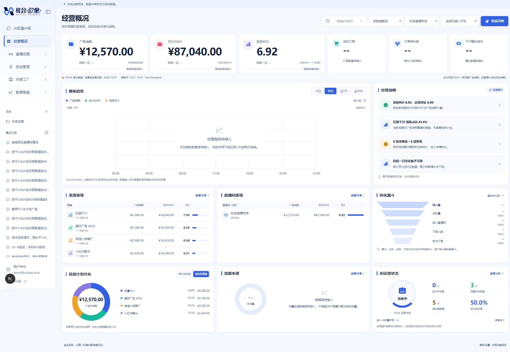
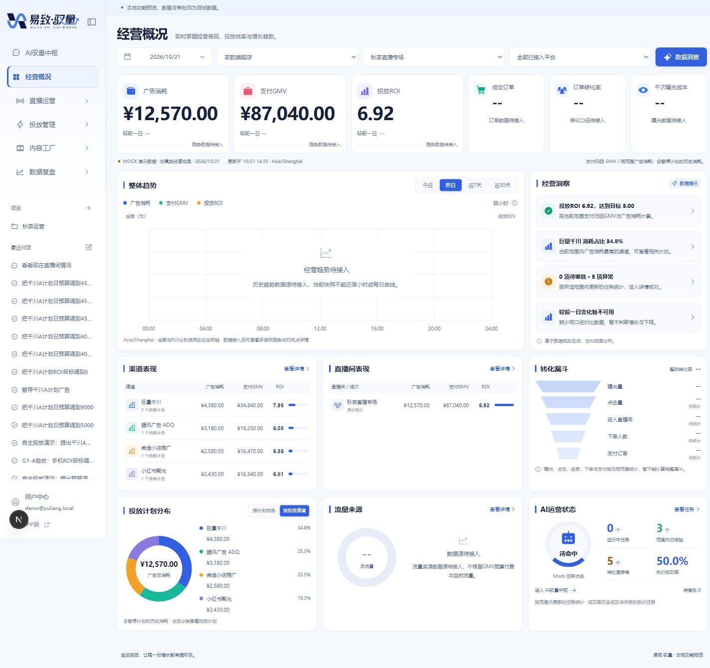

# 经营概况重构验收与接口交接

经营概况继续使用 `/app/overview`。页面改为经营数据工作区，包含统一筛选、六项指标、整体趋势、经营洞察、渠道表现、直播间表现、转化漏斗、计划分布、流量来源和紧凑 AI 运营状态。核心金额与 ROI 在验收的桌面宽度下使用 36–38px 字号。

现有日快照可供汇总，但不能还原历史曲线和完整转化链路。缺少来源的指标显示 `--`，趋势与流量来源明确显示待接入。当前浏览器验收使用已有 Mock 模式，截图中的金额、平台和任务均为演示数据，不代表真实投放成果。

## 完成的前端功能

- 日期、店铺、场次、平台共用 `OverviewFilter`，所有下方模块由一个适配层产生。
- 店铺与场次沿用现有授权和统计范围保存逻辑。API 模式仅提供有相关广告账户且连接器已核验的来源；Mock 模式只使用原有演示来源。
- 核心 KPI 复用 `businessTotals`，保留整数分、支付归因 GMV、暂停计划历史消耗和零消耗时 ROI 不可计算的定义。不同归因窗口不合计 GMV 或 ROI。
- 渠道及直播间列表包含金额、ROI 和消耗占比条。点击场次名称先保存现有统计范围，再进入原 `/app/monitor`。
- 投放计划分布支持按计划状态和投放渠道切换。金额占比来自同一筛选下的现有计划。
- 经营洞察使用明确标为“数据提示”的确定性规则，只描述 ROI 与目标、渠道占比、任务异常和数据缺口，不生成因果结论。
- AI 状态按所选范围内更新的任务统计。成功必须有匹配的核验回执；正式模式必须为平台回执。成功率分母仅含已核验成功和执行失败任务，不把驳回、过期或待审批算作失败执行。
- 趋势组件具备多指标开关、金额与 ROI 双轴、时间点 Tooltip、键盘时间滑块、空状态和错误重试。真实序列到达前不绘制曲线，不用当前快照插值造历史。
- 漏斗组件可显示真实层级、数量、环节转化和流失 Tooltip；缺少统一口径时显示待统计，不拼接商品点击、在线人数和支付订单。
- 使用原生 SVG 和现有 Phosphor 图标；没有新增图表依赖或后端服务。

## 数据与 API 状态

唯一复用的经营读取入口仍是 `FrontendService.getSnapshot()`，对应现有 `GET /v1/frontend/snapshot`。筛选保存仍使用 `PUT /v1/frontend/reporting-scope`。本次没有添加或调用新的后端路径。

| 模块 | 现有字段及适配 | 当前状态 | 需要陆文龙补充的内容 |
| --- | --- | --- | --- |
| 消耗 GMV ROI | `plans.spendMinor`、`paidGmvMinor`、`attributionWindow`，按店铺、场次、账户平台汇总 | 现有契约可接，已用 Mock 验证；真实 API 未联调 | 明确报表统计日、覆盖范围、归因窗口及是否完整返回计划 |
| 渠道表现 | `adAccounts.connectorId`、`connectors.status` 与计划关联 | 现有契约可汇总 | 平台接入及可用状态需后端真实返回 |
| 直播间表现 | `plans.liveSessionId` 与 `liveSessions` | 现有契约可汇总 | 保持场次状态、所属店铺与统计范围一致 |
| 计划分布 | `plans.enabled`、消耗及账户平台 | 按状态和渠道已完成 | 目标、类型等新维度须返回真实分类，不用计划名称猜测 |
| 较前一日对比 | 无同口径历史基线 | 待接入 | 前一统计周期的金额和 ROI，基线范围、截止时间需一致 |
| 历史趋势 | 日快照不含历史桶 | 待接入 | 小时或日的时间桶、消耗分、支付归因 GMV 分、ROI、完整度与更新时间 |
| 成交订单 转化率 CPM | 当前快照未提供同范围、同口径的完整分子分母 | 待接入 | 支付订单、转化分母及去重单位、曝光量、对应 CPM |
| 转化漏斗 | 点击、在线、商品订单字段口径不同 | 待接入 | 同一归因链的曝光、点击、进房、下单、支付，去重单位及可比性 |
| 流量来源 | 无真实流量分类统计 | 待接入 | 来源代码、名称、真实流量值、单位、统计范围及互斥性 |
| AI 任务 | `tasks`、状态、更新时间、执行与核验回执 | 现有快照可统计，截图为 Mock | 如果任务快照分页或截断，另需范围内完整聚合计数 |
| AI 分析 | 未确认可用的经营分析接口 | 当前只展示数据提示 | 若接入 AI，需返回证据、统计范围、生成时间及分析状态 |

没有真实后端响应样本，不能将上述“待接入”归类为“接口已存在但数据为空”。真实平台数据与订单系统的联调仍需后端环境。

## 日期覆盖与请求行为

现有快照只声明 `scope.date` 单日数据。只有开始日期和结束日期都等于该日，才展示其中的经营汇总。选择其他单日或近 7 天、近 30 天时，不重复显示原日数据，也不把单日快照当作区间累计。

API 模式选择另一个单日时，沿用现有 `setScope` 的 `date` 字段并重新读取快照。区间起止日期保存在本经营工作区，现有共享范围仍只有单日字段，不能伪装已保存区间查询。Mock 原有保存逻辑只接受固定演示日，日期切换因此只影响本工作区展示；回到该演示日可恢复原有演示汇总。

所有图表日期和任务归属日都使用 Asia/Shanghai。起止日期经过合法性校验，跨年范围显示年份。筛选结果按完整键匹配；旧请求在条件变化或卸载时取消，迟到结果不能覆盖新范围。数据源或回显范围不一致会进入错误状态。

## 待确认的报表读取契约

前端边界位于 `src/services/overview-adapter.ts` 的 `OverviewLoader`；规范化响应定义在 `src/lib/overview.ts` 的 `OverviewReport`。后端路径由陆文龙确认，本次不新增接口。

请求至少包含：

| 字段 | 类型 | 约束 |
| --- | --- | --- |
| `shop_id` | string | 已授权店铺或 `all` |
| `live_session_id` | string | 当前店铺已有场次或 `all` |
| `connector_id` | string | 已接入平台或 `all` |
| `start_date` `end_date` | YYYY-MM-DD | 开始不晚于结束 |
| `timezone` | string | 固定 Asia/Shanghai |
| `granularity` | hour 或 day | 单日按小时，多日按天；只开放服务端支持粒度 |

响应需回显筛选、统计覆盖区间、来源更新时间和归因定义，并包含以下数据：

1. `totals`：`spend`、`gmv`、`roi`、`orders`、`conversion`、`cpm`。金额均为 CNY 整数分；ROI 为无量纲比值；转化率为 0–1。缺失用 `null`，有完整零样本才用 `0`。
2. `previous`：与本周期相同口径、相同截止长度的前一周期统计；没有基线用 `null`。前期值为零时不计算百分比增长。
3. `trend`：`status` 与 `data`。每个时间桶为 `{ at, spend, gmv, roi }`；`at` 带时区，按时间升序，数值是桶内发生额而非累计。缺失桶用 `null`，不插值。桶必须在回显范围内，小时与日粒度不可混杂。
4. `channels` 与 `lives`：稳定 ID、名称、状态或说明、消耗分、GMV 分、ROI、消耗占比。必须与汇总使用相同归因与去重规则。
5. `distributions`：真实分类代码、名称、消耗分；分类应互斥且可与总消耗核对。
6. `funnel`：层级 ID、名称和数量，同时明确同一群组、同一周期及去重单位。只有可比环节才设为 `ready` 并允许计算相邻转化；缺少分母、单位不一致或层级不完整时用 `unavailable` 并说明原因。
7. `traffic`：互斥来源代码、名称和数量，以及统一的流量单位。不得从归因 GMV 推算流量。
8. `ai`：运行中、已核验完成、异常、待审批及执行成功率，明确计数覆盖范围和分母。

模块状态采用 `ready`、`empty`、`unavailable`、`error`。后三者携带原因；失败不应清空成零数据。整个读取失败则拒绝 Promise，前端提供重试。真实读取器需复用 API Client 的鉴权及错误约定，接受 `AbortSignal`，超时、401、403、429 和网络失败不能静默回退为 Mock。

## 修改文件

| 文件 | 作用 |
| --- | --- |
| `src/features/overview-page.tsx` | 页面、统一筛选、异步状态与业务卡片 |
| `src/components/overview-charts.tsx` | 趋势、微型折线、环形图、漏斗及缺失状态 |
| `src/lib/overview.ts` | 数据模型、日期、对比和转化辅助函数 |
| `src/services/overview-adapter.ts` | 现有快照聚合与待接报表读取边界 |
| `src/styles/overview.css` | 仅限经营概况的布局与响应式样式 |
| `src/features/business-page.tsx` | 将经营概况接入新页面，保留原路由 |
| `src/components/v12-shell.tsx` | 为经营概况添加独立样式作用域 |
| `tests/overview.test.ts` | 筛选、口径、缺失数据、取消、时区、图表状态测试 |
| `docs/evidence/overview` | 实际页面截图及四种桌面宽度检查结果 |

工作区其他并行修改保持原样；本次没有修改后端、数据库、审批或执行流程，也没有推送或部署。

## 验收记录

项目使用 `.runtime/node.exe` 的 Node 24.19.0。已执行：

```powershell
.\.runtime\node.exe scripts/run.mjs typecheck
.\.runtime\node.exe scripts/run.mjs lint
.\.runtime\node.exe scripts/run.mjs test
$env:YULIANG_BUILD_DIR = '.next/overview-check'
.\.runtime\node.exe scripts/run.mjs build
```

类型检查、ESLint、89 项全量单元测试均通过，其中经营概况新增 9 项。生产构建通过；独立构建目录不会替换正在运行的开发目录。

浏览器检查覆盖 1280、1440、1600、1920px；各宽度无页面横向溢出，核心数字未截断。1440px 和 1920px 留存实际页面截图。平台切到 ADQ 后，KPI、渠道、直播间与计划分布同步更新；切到山海好物时仅展示关联场次和投放来源；近 7 天无历史源时清空旧日汇总并提示待接入；按状态与渠道切换环形图有效。点击直播间名称成功进入现有 `/app/monitor`，并能返回经营概况。控制台未发现页面错误。

实际截图使用已有 Mock 数据，趋势、漏斗与流量来源的空状态均在截图中保留。历史序列 Tooltip、真实订单漏斗和 API 失败重试的端到端联调，须待后端提供对应数据；当前仅完成组件和自动化测试覆盖。




