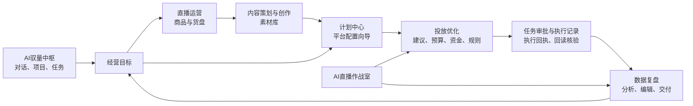
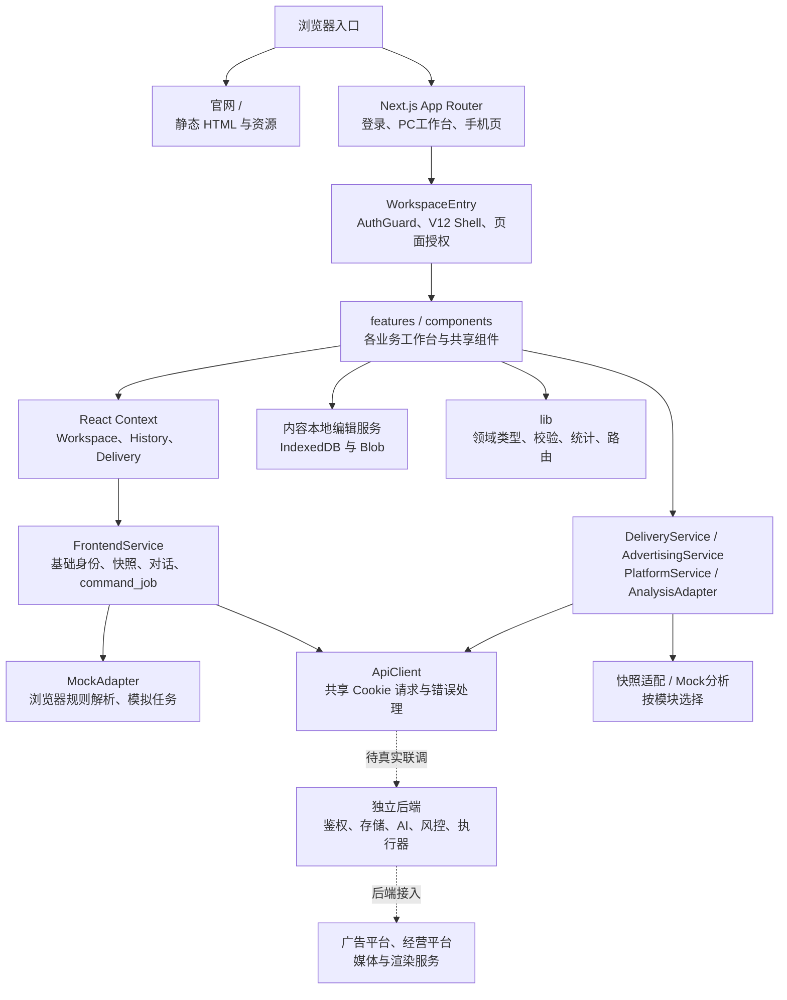
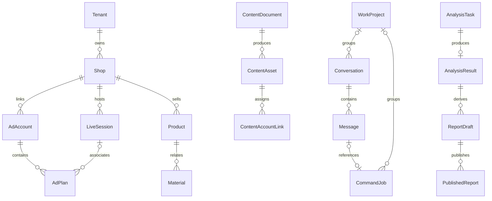
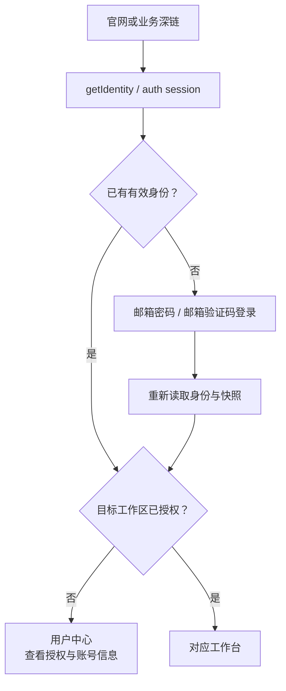
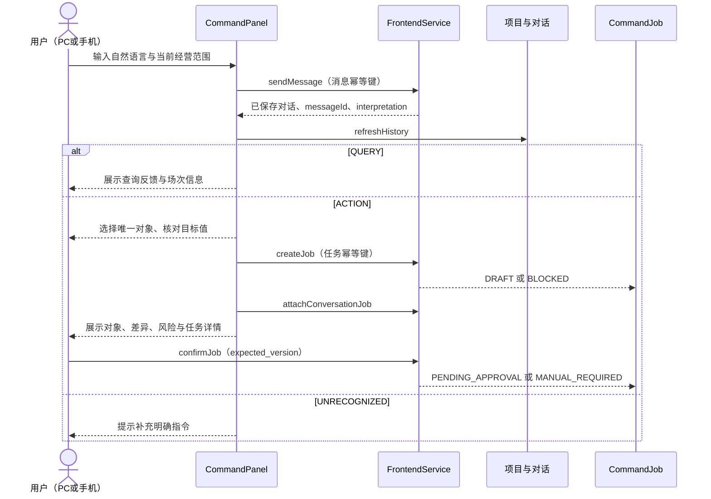
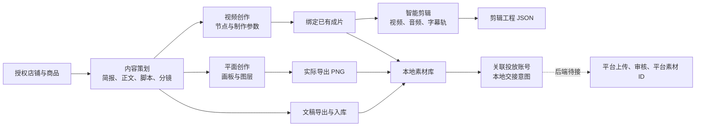
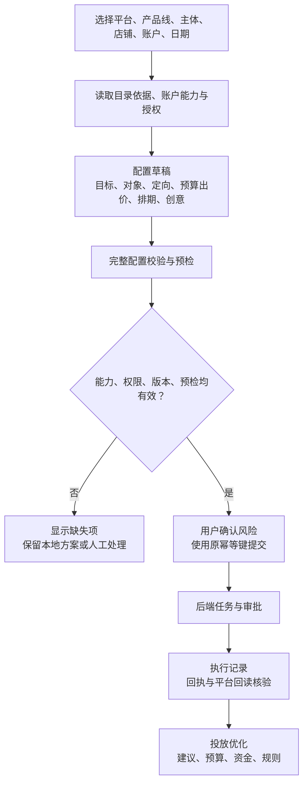
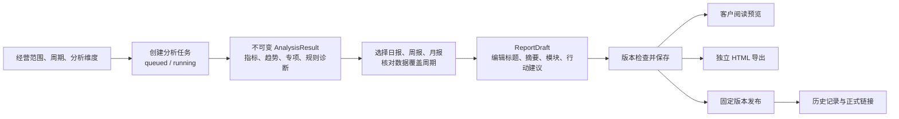
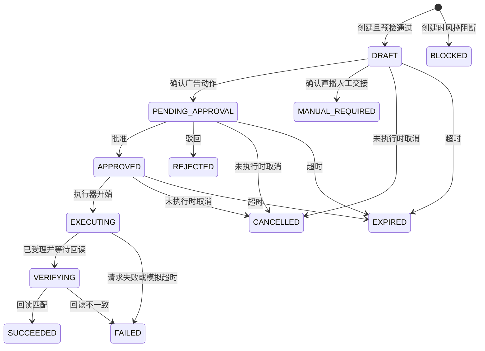

# 易致·驭量前端技术架构与业务流

整理日期：2026-10-23（Asia/Shanghai）

适用对象：前端开发、后端对接、产品及业务交接人员。

易致·驭量目前是一个独立的 Next.js 前端，围绕直播电商经营组织内容、商品、广告和数据复盘。页面和本地编辑交互已覆盖多个业务工作台；真实会话、平台授权、AI 生成、广告执行与回读核验由独立后端承接。前端已有调用契约，但不能据此认定真实业务已联调完成。

**阅读基线：**以 `D:\易致-驭量` 在整理时的源码为准，并核对远程 `main` 的 `f8dea35ef4f36bc8a198f28c9ee97548e0048682`，已包含新版经营概况。本文更新了 10 月 22 日 G1-B1 架构说明中的默认模式、导航、服务分层和模块实现范围；旧说明保留作历史记录。本次仅提交文档，不合入本地工作区的其他未提交内容。

## 目录

1. [架构总览](#1-架构总览)
2. [工程目录与技术选型](#2-工程目录与技术选型)
3. [页面地图与权限](#3-页面地图与权限)
4. [状态、范围与数据模型](#4-状态范围与数据模型)
5. [核心业务流程](#5-核心业务流程)
6. [任务状态机](#6-任务状态机)
7. [服务与 API 对接](#7-服务与-api-对接)
8. [本地存储与刷新机制](#8-本地存储与刷新机制)
9. [实现边界与后续接入](#9-实现边界与后续接入)
10. [运行、验证与源码索引](#10-运行验证与源码索引)

## 1. 架构总览

### 1.1 产品与技术的对应关系

业务意图上的闭环是“经营目标 → 商品与内容准备 → 投放计划 → 优化与审批 → 执行核验 → 数据复盘 → 下一轮调整”。当前通过页面、对象关联和任务协议衔接这些环节，尚未形成真实平台上的全自动闭环。



### 1.2 技术分层



核心约定：

- `src/app` 处理页面入口和兼容跳转；业务交互主要在 Client Components。
- `WorkspaceEntry` 是实际页面分发入口，优先进入投放、直播、货盘、内容和复盘专用工作台。`BusinessPage` 仍保留旧分支，不能只看它判断实际页面。
- 基础功能遵循 `FrontendService`；新增复杂模块使用独立服务，复用同一个 `ApiClient` 传输层。当前已不适合概括为“所有业务都经由一份基础 Service 接口”。
- `lib` 放实体、范围、校验、格式化和统计纯函数；UI 不直接调用广告平台。
- 内容工厂是一个重要例外：本地作品和媒体直接由 `content-drafts.ts` 管理 IndexedDB，API 模式下也仍是本地草稿。
- 仓库没有业务 `route.ts`、数据库、平台 SDK、执行 Worker 或后端策略调度器。

## 2. 工程目录与技术选型

### 2.1 技术栈

版本取自当前 `package.json`，用于说明项目基线，不代表外部最新版本。

| 层面 | 当前实现 | 作用 |
| --- | --- | --- |
| 框架 | Next.js `16.2.6`，App Router | 页面路由、构建、静态官网 rewrite、旧入口 redirect |
| UI | React / React DOM `19.2.6` | 客户端组件、Context、Hooks |
| 类型 | TypeScript `5.9.3`，`strict` | 领域契约与组件类型；`@/*` 对应 `src/*` |
| 样式 | 原生 CSS、CSS Variables | `tokens.css` 为视觉令牌，业务模块独立样式；无 Tailwind |
| 图标 | `@phosphor-icons/react` `2.1.10` | 导航与业务操作图标 |
| 状态 | Context + `useState/useRef/useEffect` | 共享状态与局部编辑态；无 Redux、Zustand、React Query |
| 可视化与编辑 | SVG、浏览器 Canvas、DOM、Blob | 业务图表、图文 PNG、节点画布、时间线、HTML 报告 |
| 网络 | 原生 `fetch` + `AbortController` | Cookie 会话、超时、取消、错误归一 |
| 本地持久化 | localStorage、sessionStorage、IndexedDB | 演示数据、局部草稿、媒体文件及编辑恢复 |
| 工程运行时 | 项目 Node `24.19.0` | `scripts/run.mjs` 校验版本并优先使用 `.runtime` |
| 质量工具 | ESLint `9.39.4`、tsx `4.20.6`、Node test runner | 静态检查与业务单元测试；Next 构建显式使用 webpack |

### 2.2 目录职责

```text
public/                         官网 HTML、原 CSS/JS、品牌资源
src/
  app/
    layout.tsx                  根文档与 metadata
    (frontend)/
      layout.tsx                全局 Provider 与基础样式
      app/[pageId]/page.tsx      业务 ID 白名单、旧路由迁移
      login/ mobile/ legacy/    登录、手机与历史 hash 入口
      error.tsx                 前端路由错误边界
  components/                   导航、身份、历史、指令、任务和通用 UI
  features/
    workspace-entry.tsx         实际业务分发
    delivery/                   目标、计划、优化、预算、审批、执行
    advertising/                产品线选择、创编向导、定向与资源选择
    content/                    策划、图文、视频、剪辑、素材库
    analysis/                   分析任务、结果、编辑器、历史和交付
    *-page.tsx                  登录、直播、货盘、概况等页面
    platform-workspace.tsx      平台目录与各类平台资源工作区
  lib/                          业务模型、规则、范围、路由与统计
  services/                     API/Mock 服务及快照、本地草稿适配
  data/platform-api-catalog.json 静态接口资料目录
  styles/                       令牌、外壳和业务模块 CSS
tests/                          按业务域划分的 *.test.ts
scripts/                        运行时准备、启动、校验、目录导入
docs/                           架构、契约、阶段交接与验收证据
```

内容工厂经 `next/dynamic` 延迟加载。应用样式由前端 layout 和业务组件引入；官网由 `beforeFiles` rewrite 直接返回 `public/index.html`，保留独立的静态资源体系。

## 3. 页面地图与权限

### 3.1 当前导航

白名单保留 **21 个历史 pageId + `command`、`account`，共 23 个 ID**。主导航展示 14 个业务入口，用户中心和 APP 端位于侧栏底部；多个旧 ID 已合并或仅为历史兼容，23 个 ID 不等于 23 个独立工作台。

| 导航位置 | 当前入口 | 页面职责与实际实现 |
| --- | --- | --- |
| AI驭量中枢 | `/app/command` | 对话、项目、任务归类；复用 `CommandPanel` 和任务详情 |
| 经营概况 | `/app/overview` | 日期筛选、经营指标、渠道/场次表现、分布及任务统计 |
| 直播运营 | `/app/monitor` | 直播状态、在线、经营、关联计划与任务；专用 `LiveRoomPage` |
| 直播运营 | `/app/products` | 商品、SKU、表现与场次货盘；本地讲品编排草稿 |
| 投放管理 | `/app/goals` | 目标、拆解、预算边界、风险预览和提交入口 |
| 投放管理 | `/app/plans` | 计划/推广订单、筛选下钻、配置向导与变更申请 |
| 投放管理 | `/app/decisions` | 优化建议、预算分配、账户资金、风险规则四分区 |
| 投放管理 | `/app/executions` | 审批、执行状态、回执、核验及受控重试 |
| 内容中心 | `/app/planning` | 策划、简报、正文、脚本与分镜统一编辑 |
| 内容中心 | `/app/videos` | 视频节点、连线、制作参数、已有成片绑定 |
| 内容中心 | `/app/graphics` | 多画板、文字/图片图层、真实 PNG 导出 |
| 内容中心 | `/app/editing` | 视频/音频/字幕时间线、分割、局部预览与工程导出 |
| 内容中心 | `/app/assets` | 本地素材、文件预览下载、来源与投放账号关联 |
| 数据复盘 | `/app/reports` | 分析条件 → 任务 → 结果 → 报告编辑 → 预览与交付 |
| 侧栏底部 | `/app/account`、`/mobile` | 个人资料与授权；手机四标签工作台 |
| 直接入口 | `/app/tasks` | 共享任务确认、审批和 Mock 执行；不占主导航入口 |

**经营概况：**`BusinessPage` 将 `overview` 接到 `OverviewPage`；源码位于 `overview-page.tsx`、`overview-adapter.ts`、`overview.ts` 和 `overview-charts.tsx`。适配器只消费快照单日数据；缺少历史、漏斗或流量来源时显示待接入，不通过更新时间生成曲线。

### 3.2 兼容与合并

| 旧地址/参数 | 当前处理 |
| --- | --- |
| `/` | rewrite 到 `/index.html` |
| `/app` | 跳转 `/app/command` |
| `/login.html`、`/mobile.html` | 跳转 `/login`、`/mobile` |
| `/app.html#...` | 经 `/legacy` 解析历史 hash，白名单归一 |
| `/app/campaigns` | 跳转 `/app/plans` |
| `/app/scripts` | 合并到 `/app/planning`，保留查询参数与旧文档 ID |
| `/app/experiments` | 合并到 `/app/assets` |
| `/app/analytics` | 合并到 `/app/reports`，保留查询参数 |
| `/app/budgets` | 合并到 `/app/decisions`，默认 `section=allocation`，兼容旧分区参数 |
| 登录 `next` 缺失/非法 | 归一到 `/app/command`；目标未授权时进入 `/app/account` |
| 未知 pageId | `notFound()` |

`agents`、`connections`、`settings` 保留在历史注册表，但不在客户工作区授权列表中，正常客户入口不能据此获得后台管理权限。

### 3.3 授权层次

前端分三次判断：`AuthGuard` 检查登录态；`canAccessPage` 检查 `Identity.workspacePages`；业务模块再检查动作权限、账户授权和能力有效期。API 模式缺少工作区授权不会默认全开。用户中心对已登录用户开放。

合并工作台保留原授权：复盘兼容 `reports/analytics`，策划兼容 `planning/scripts`；投放优化入口接受 `decisions/budgets` 任一授权，但建议分区仍需 `decisions`，预算和资金分区仍需 `budgets`。前端判断用于组织交互，正式租户、店铺、对象和操作鉴权必须由后端逐接口执行。

## 4. 状态、范围与数据模型

### 4.1 状态树

全局挂载顺序：

```text
WorkspaceProvider
  └─ HistoryProvider
      └─ DeliverySessionProvider
          └─ 路由页面
              ├─ WorkspaceEntry → AuthGuard → V12 WorkspaceShell
              ├─ 投放页内 DeliveryProvider
              ├─ 内容页内 FactorySession
              └─ 复盘页内工作流与编辑状态
```

| 状态域 | 管理内容 | 生命周期与保护 |
| --- | --- | --- |
| WorkspaceProvider | Service 实例、身份、全局快照、上次有效快照、侧栏状态 | 先身份后快照；请求 generation 丢弃过期结果；切换身份清空旧快照 |
| HistoryProvider | 项目、对话、任务所属项目 | 按模式、企业、用户识别 owner；未授权不加载中枢历史 |
| DeliverySessionProvider | 各工作台草稿、筛选、结果未知的幂等键 | React 内存；跨工作台导航保留，刷新不保证保留 |
| DeliveryProvider | 投放范围、工作区数据、加载、未保存保护、动作门禁 | URL 驱动；范围或身份变化后不接受旧请求覆盖 |
| FactorySession | 作品、画板、节点、片段、文件和撤销栈 | 本地状态编辑，显式保存到 IndexedDB；按模式/企业/用户/店铺隔离 |
| 复盘工作流 | 查询、任务/结果/草稿、未保存编辑和发布版本 | URL 定位对象；sessionStorage 恢复流程与编辑缓冲；分析/草稿/发布分离 |

### 4.2 三种主要范围

| 范围类型 | 字段与用途 |
| --- | --- |
| `ReportingScope` | `shop_id / live_session_id / connector_id / date / timezone`，基础快照、共享指标、任务和直播 |
| `DeliveryScope` | `platform / shopId / accountId / start / end / liveSessionId?`，投放工作台；新平台产品另带 `product / entityId / productAccountId / productShopId` 等上下文 |
| `AnalysisQuery` | `shopId / platformId / startDate / endDate / dimensions / timezone`，独立历史分析请求与报告原始条件 |

它们服务不同场景，不能把快照单日当成任意日期报表，也不能将不同产品线的账户或资源 ID 直接互换。修改范围后，指令解析结果、选中资源、预检凭据等依赖状态需要失效或重新校验。

### 4.3 业务对象



这是前端对象关系示意，不是数据库设计。基础快照用 `AdAccount.shopId` 表达店铺关联；新增平台上下文 `IntegrationContext` 另有主体、店铺、账户及多对多 `links`，不能将上图的基础账户关系推广为所有平台的唯一约束。

`FrontendSnapshot` 汇集租户、店铺、账户、场次、计划、商品、素材、任务、经营范围、风控策略、回放片段、复盘样例与连接器。投放域增加 `Campaign / PromotionOrder / Goal / Decision / Budget / Approval / Execution` 等模型；内容域使用 `ContentDocument / ContentAsset / ContentAccountLink`；正式分析域使用独立的 `AnalysisTask / AnalysisResult / ReportDraft / PublishedReport`。

### 4.4 统一口径

- CNY 预算、出价、GMV 等金额使用整数分；输入元在边界转换。微信豆使用独立 `BEAN` 单位，不能与人民币直接相加。
- ROI 为无单位比值。总体 ROI 由汇总 GMV ÷ 汇总消耗计算，不平均各计划或每日 ROI。
- 缺失、不支持、未接入与零值分别表示；缺失不能补零。没有有效分母时不计算转化率或 ROI。
- 统计日期与 `sourceUpdatedAt / fetchedAt` 分开；更新时间不代表交易归属日期。
- 店铺支付 GMV、直播 GMV、视频 GMV、广告归因 GMV 可能重叠，缺少订单级去重依据时不能直接相加。
- 聚合前核对范围、币种、归因窗口及可比较口径；暂停计划仍保留历史消耗。统计时区统一为 `Asia/Shanghai`。

## 5. 核心业务流程

### 5.1 访问、登录与工作区进入



验证码的申请、邮件发送、校验和 Cookie 签发均依赖后端。Mock 仅提供显式的本地账号演示，不发送真实邮件。个人资料通过 `updateProfile` 保存，登出通过后端或 Mock 身份服务清理会话。

### 5.2 AI中枢、手机指令与共享任务



当前 `CommandPanel` 实际通过 `sendMessage` 保存并解析对话；基础 Service 仍保留单独的 `interpretCommand` 契约。Mock 解析是预算、ROI、暂停等有限规则匹配，首页“内容创作”“经营分析”推荐提示不等于通用模型编排已经接通。

多候选对象必须先消歧，不能默认选第一条。消息发送和任务创建分别使用幂等键；创建后按 `messageId` 绑定任务，关联失败可重试关联。中枢支持项目创建、对话移动和已有任务归类。

手机 `/mobile` 的 AI指挥、直播数据、执行流水、直播复盘是四个组件内标签。它复用指令、指标、任务详情与复盘样例，任务列表设置 `review=false`，不提供 PC 审批和 Mock 执行按钮。Mock 仅同源浏览器存储共享，真实跨设备读取需要后端持久化和会话支持。

### 5.3 直播观察与商品货盘

直播页先选择授权场次，再按直播、经营、任务、计划四类数据展示。`DeliveryLiveBridge` 在直播与投放工作台之间保留场次上下文。未选择场次时不发起场次刷新；直播趋势当前没有可用历史数据源。

货盘流程为“授权店铺/场次 → 商品与 SKU → 查看当前范围指标 → 加入本场草稿 → 排序与讲解时间编排 → 本地保存/JSON 导出”。正式货盘来自后端快照；本地编排只是一份待同步方案，不修改平台商品或官方货盘。并发保存检查 `savedAt`，避免覆盖另一窗口草稿。

### 5.4 内容策划、创作与素材关联



策划与旧脚本入口现已合并。跨作品流转时先保存，携带 `parentId`、商品、简报、正文或分镜创建目标作品；不会把两个工作区当作同一文档覆盖。素材文件与元数据在 IndexedDB 同一事务提交，并校验工作区 revision。

平面页已能实际生成 PNG。视频页能组织节点、检查连线环路并绑定已有成片；剪辑页能编排、分割与局部预览。整条时间线混音、渲染与 MP4 导出，以及 AI 图片/视频生成均待服务端接入。创作对话目前保存要求和选中对象上下文，不产生真实模型结果。

素材关联账户需要核对当前模式、企业、用户、店铺、产品线及有效授权。保存 `ContentAccountLink` 只是浏览器内的关联意图；它不会上传文件、生成平台素材 ID 或创建广告。

### 5.5 目标、计划配置与投放优化

投放页由 `DeliveryWorkspace` 统一接入。ADQ、微信豆沿用投放模型；巨量营销、千川、DOU+、本地推、聚光、小店版按 `product` 进入独立产品上下文；`wxshop` 为经营数据工作区，不能当作广告钱包或广告产品。



新建向导通过 `view=create` 进入，使用产品专属字段和真实资源选择器，不按平台名称硬套统一配置。腾讯广告定向包含地域、年龄、性别、兴趣/行为/意向、人群及扩量边界；微信豆视频和直播分开配置，预算单位为豆；DOU+ 使用推广订单，不能复用项目/单元模型。

计划变更走“旧值/新值 → 版本与风险预检 → 确认 → 任务”。后端返回的预检凭据必须未过期且绑定当前版本或配置；结果未知时保留原幂等键查询，不能自动生成新请求重复投放。撤回仅针对后端明确允许的未执行任务。

投放优化统一为四个分区：

| URL 分区 | 职责 |
| --- | --- |
| `section=suggestions` | 决策证据、处置与效果关联 |
| `section=allocation` | 经营额度、预算分配矩阵、预览和审批 |
| `section=funds` | 平台同步账户资金；人民币、微信豆及店铺结算分开 |
| `section=rules` | 账户策略及预算安全边界；按原权限呈现 |

执行记录仍为独立入口，接收决策、预算、计划和审批的关联 ID。界面已有这些动作入口，正式提交仍由后端能力和权限决定；微信豆写入、千川目录归属及聚光部分创编路径等尚有接入限制。

### 5.6 审批、执行与核验

操作人确认对象后进入待审批，审批人批准只表示允许执行。正式执行由后端发起，前端显示受理、执行、核验和最终回执。`SUCCEEDED` 必须有匹配的核验结果；未知、超时或回读不一致不能显示成功。

Mock 中由 PC 手工分步推进：批准 → “开始模拟执行” → “接收模拟执行回执” → “运行模拟核验”。只有核验匹配后才投影演示计划参数；回执始终为 `MOCK`，没有真实平台回执 ID。开播/关播指令进入人工交接，不控制推流。

### 5.7 数据分析、复盘编辑与交付



唯一工作台为 `/app/reports`，用 `?task= / ?result= / ?draft= / ?preview= / ?published=` 定位过程和对象。分析维度为店铺经营、直播、投流、短视频，可单选或多选。

前端每秒查询分析任务，最多持续约 120 秒；超时暂停轮询，可继续查询同一任务。分析结果、可编辑草稿、发布快照分别保存，编辑结论不改写原始指标；同一草稿版本重复发布使用相同幂等键。

日报要求 1 天、周报要求连续 7 天、月报要求完整自然月，不允许用 7 天数据直接生成月报。趋势按分子分母重新汇总比率。当前诊断为可解释的基础规则；正式 AI 诊断待后端返回。

Mock 分析用固定测试样本，覆盖 `2026-09-01—2026-10-21`，超范围不扩展伪造历史。Mock 发布只生成当前浏览器的固定版本，不提供正式公网客户链接；独立 HTML 已可导出。API 模式由后端返回正式发布地址，前端不自行拼接。

## 6. 任务状态机

### 6.1 `command_job` 的 12 个状态



这是协议主干及当前 Mock 流程；对象或策略在确认、审批、执行前变化时，还会重新阻断或失败。正式端的合法流转、过期和重试规则由后端裁决，不能以图示替代服务端状态校验。

| 状态 | 含义 |
| --- | --- |
| `DRAFT` | 待用户确认具体对象、变更和风险 |
| `PENDING_APPROVAL` | 已确认，等待审批 |
| `APPROVED` | 已批准，尚未执行 |
| `EXECUTING` | 正在提交或执行 |
| `VERIFYING` | 已有执行信息，等待平台回读 |
| `SUCCEEDED` | 回读匹配，任务完成 |
| `FAILED` | 请求、执行或核验失败 |
| `REJECTED` | 审批驳回 |
| `CANCELLED` | 尚未执行的申请已取消 |
| `EXPIRED` | 有效期届满 |
| `BLOCKED` | 风险或条件阻断 |
| `MANUAL_REQUIRED` | 必须人工交接 |

动作共 7 类：日预算、出价、ROI 目标、暂停计划、恢复计划、请求开播、请求关播。对应值分别使用 `MONEY / RATIO / BOOLEAN / HANDOFF`，避免把 ROI 当金额或把交接当执行成功。

### 6.2 并发、幂等与证据

`CommandJob` 保留企业、店铺、账户、场次、对象、旧新值、来源、意图、风险摘要、审批、回执、错误、版本、幂等键和历史。来源为 `PC_MANUAL / MOBILE_COMMAND / AUTOPILOT`；API 客户端禁止浏览器自行创建 `AUTOPILOT` 任务。

- 创建使用 `idempotency_key`，同键不能绑定不同请求。
- 确认、审批、取消使用 `expected_version`，避免在过期页面上操作新版本。
- 回执明确 `MOCK / PLATFORM`、平台回执 ID、受理情况、观察值及 `PENDING / MATCHED / MISMATCH / UNKNOWN` 核验结果。
- Mock 默认申请有效期 15 分钟；冷却期来自经营策略，默认成功动作冷却 5 分钟。正式过期和风控以服务端为准。

投放创编任务、平台命令任务和经营分析任务另有各自模型与状态；其中分析使用 `queued/running/succeeded/failed`。它们与 `command_job` 有关联，但不能统一当作同一个状态枚举。

## 7. 服务与 API 对接

### 7.1 服务分工

| 服务/适配器 | 职责 | 传输或存储 |
| --- | --- | --- |
| `FrontendService` | 身份、验证码、资料、快照、项目对话、指令、基础任务、策略与范围 | `MockAdapter` 或 `ApiClient` |
| `DeliveryService` | 投放工作区、目标、计划变更、预算、分析申请、审批、核验和安全重试 | `/v1/delivery/*`；部分只读快照适配 |
| `AdvertisingService` | 产品目录、账户能力、定向/素材资源、覆盖估算、完整配置校验、提交与查询 | `/v1/delivery/configuration/*` |
| `PlatformService` | 主体/店铺/账户关系、目录资源查询、变更预览、命令提交、结果查询和撤回 | `/v1/delivery/integrations/*` |
| `AnalysisAdapter` | 分析任务、不可变结果、草稿、发布及历史 | Mock 本地存储或 `/v1/business-analysis/*` |
| `content-drafts.ts` | 内容作品、媒体元数据与 Blob | IndexedDB；当前没有云端内容 Service |
| `products-adapter.ts` | 归一授权商品、SKU 表现、官方货盘与 Mock 商品样本 | 既有快照，不调用推测接口 |
| `overview-adapter.ts` | 经营概况的单日聚合与缺失状态 | 既有快照；不构造历史报表接口 |

`ApiClient.deliveryRequest` 与 `analysisRequest` 分别限制命名空间，共用 Cookie、错误与响应校验。静态 `platform-api-catalog.json` 来自资料导入，只表示接口目录和资料状态，不表示账户已授权或平台接口已可调用。

### 7.2 主要前后端契约

下列为当前前端调用的驭量应用后端路径，不是浏览器直连平台的地址。

| 范围 | 代表接口 |
| --- | --- |
| 认证与资料 | `GET /v1/auth/session`；`POST /v1/auth/login`、`/v1/auth/email-codes`、`/v1/auth/logout`；`PATCH /v1/users/me` |
| 快照与范围 | `GET /v1/frontend/snapshot`；`PUT /v1/frontend/reporting-scope` |
| 中枢与历史 | `GET /v1/workspace/history`；`POST /v1/projects`、`/v1/conversation-messages`；对话移动、任务绑定与归类接口 |
| 基础任务 | `POST /v1/command-jobs`、`/:id/confirm`、`/:id/approvals`、`/:id/cancel`；`POST /v1/command-interpretations` |
| 策略 | `PUT /v1/risk-policies/:id` |
| 投放工作区 | `GET /v1/delivery/workspace`；目标、预算、计划变更预检/提交、审批、执行核验与安全重试等子接口 |
| 创编与平台资源 | `/v1/delivery/configuration/*`、`/v1/delivery/integrations/*` |
| 经营分析 | `POST /v1/business-analysis/tasks`；`GET /tasks/:id`、`/results`、`/results/:id` |
| 复盘交付 | `GET/PUT /v1/business-analysis/drafts/:id`；`POST /drafts/:id/publications`；草稿与发布历史读取 |

既有全量 OpenAPI 对接包是阶段快照。新增投放、平台、复盘协议应同时参考对应 TypeScript Service 和模块契约，不应仅凭旧 OpenAPI 判定当前接口全集。

### 7.3 请求、错误与模式选择

默认 `NEXT_PUBLIC_DATA_MODE=api`；只有显式配置 `mock` 才创建 MockAdapter。`NEXT_PUBLIC_API_BASE_URL` 为空时抛出 `API_NOT_CONFIGURED`，不会自动切换演示数据。`NEXT_PUBLIC_*` 是构建时注入的浏览器配置，不存放平台密钥。

共享请求使用 `credentials: include`、`cache: no-store`、15 秒超时；写请求带 `X-Yuliang-Client: web`。JSON 和 FormData 分别处理，FormData 不手工指定 multipart 边界。成功响应要求：

```json
{
  "schemaVersion": "command-job-v1.0",
  "requestId": "后端生成的请求标识",
  "data": {}
}
```

传输层映射 401、403、404、409、429、400/422、网络失败和超时为 `ServiceError`；429 读取 `Retry-After`。401 可触发身份重读；超时提示结果未知，需要查询核对。

**只读适配的例外：**API 模式下，`DeliveryService.load` 遇到新增投放工作区接口 `NO_DATA / API_NOT_CONFIGURED` 时，会返回已有 API 快照的受限适配结果，缺失能力不开放正式写入。这不等于切换 Mock；网络错误、权限错误等也不应当作成功空数据隐藏。

## 8. 本地存储与刷新机制

### 8.1 持久化边界

| 位置 | 数据 | 边界 |
| --- | --- | --- |
| localStorage `yuliang:command-jobs:v1` | Mock 全局快照、任务与演示参数 | 旧 G1-A 数据只读迁移，保留备份，不继承旧审批 |
| localStorage `yuliang:g1a:mock-identity` | Mock 身份 | 演示身份，不是正式会话 |
| localStorage `yuliang:history:v1:*` | Mock 项目、对话、任务归类 | 按企业/用户隔离；API 历史由后端保存 |
| localStorage `yuliang:advertising:v1:*` | 广告配置草稿和本地定向模板 | 模式/企业/用户隔离，产品与场景分别保留；不代表平台创建 |
| localStorage `yuliang:product-lineup:v1:*` | 本场讲品编排草稿 | owner 含业务范围；未同步官方货盘 |
| localStorage `yuliang:analysis:v1:*` | Mock 分析、报告草稿、发布快照 | 当前浏览器演示数据 |
| sessionStorage `review-flow / review-unsaved / analysis-pending` 相关键 | 复盘工作流、编辑缓冲、待确认提交幂等键 | 页面会话恢复，不是正式数据持久层 |
| IndexedDB `yuliang-content-v1` | `drafts` 作品与 `files` 媒体 Blob | 按模式/企业/用户/店铺分区，事务与 revision 检查 |
| React 内存 | 投放会话草稿、筛选、未知提交键、临时 UI | 页面刷新后可能丢失 |

localStorage 和 IndexedDB 都不提供真实跨设备同步。内容/投放/货盘本地草稿即使在 API 模式中存在，也不会冒充后端业务记录。

### 8.2 读取、同步与新鲜度

基础读取流程为“身份 → 快照 → 渲染；动作完成 → reload”。`readSnapshot` 按 Service 实例合并并发请求，支持取消、范围 epoch 失效、API 最小请求间隔和限流退避，避免 Provider 与直播页重复发起重叠快照读取。

Mock 同页用自定义事件、同源其他标签页用 `storage` 事件通知。API 订阅目前监听窗口 `focus` 和认证失效；没有 SSE/WebSocket 业务推送，不能假设后台变化实时到达所有页面。

直播页 `LiveRoomController` 在确认场次后按模块调度，同一轮共享一个快照请求。API 自动刷新仅在明确配置 `NEXT_PUBLIC_SNAPSHOT_MIN_INTERVAL_MS > 0` 时启用；未配置时以手动刷新为主。隐藏页面、未开播/已结束场次停止自动轮询，失败采用退避，并保留上次可用内容及错误提示。

模块目标间隔为直播 15 秒、经营 30 秒、任务 10 秒、计划 30 秒，实际不会突破后端最小间隔。`trends` 虽有类型与配置，当前控制器不请求独立趋势接口。平台数据新鲜度按来源时间另行判断，默认直播 45 秒、经营 120 秒、任务 30 秒、计划 120 秒；刷新成功不等于源数据一定新鲜。

## 9. 实现边界与后续接入

| 业务域 | 当前已实现 | 后端或外部依赖 |
| --- | --- | --- |
| 身份与工作区 | 登录表单、验证码申请、资料保存、授权导航 | 真实邮件、会话、Cookie、CSRF、逐接口权限 |
| AI中枢 | 项目对话、幂等、规则解析、关联任务 | 真实模型、工具编排、长期上下文 |
| 直播与货盘 | 授权数据展示、刷新控制、本地编排 | 实时平台数据、趋势、官方货盘同步 |
| 内容 | 编辑、PNG 导出、媒体导入、本地版本与账号关联 | 云端存储、模型生成、审核、上传、渲染和平台素材 ID |
| 广告配置 | 产品专属字段、资源选择、能力校验、预检与提交契约 | 实际账户授权、合法资源、平台参数及写接口验证 |
| 优化与资金 | 四分区、指标、预算方案、规则及审批入口 | 真正决策、资金同步、预算执行与自动策略 |
| 任务执行 | 状态、人工审批、Mock 分步核验与回执展示 | 后端执行器、平台回执、回读、审计及安全重试 |
| 复盘交付 | 分析工作流、规则诊断、编辑器、版本、HTML 导出 | 历史聚合、订单去重、真实 AI 诊断、永久客户链接与访问控制 |

接入顺序建议：先落实身份/租户/店铺/账户及源数据口径，再补只读工作区与能力声明；随后联调预检、审批、幂等与执行回读；最后扩展 AI 生成、预算自动化、云端内容和客户报告交付。平台接口目录的资料完整度、路径核验、账户 scope 和后端可执行能力应分别验收。

## 10. 运行、验证与源码索引

### 10.1 本地工程命令

```powershell
cd D:\易致-驭量
powershell -File scripts/setup-runtime.ps1
npm run setup
npm run dev
```

开发地址为 `http://127.0.0.1:3000`。启动器固定项目级 Node，开发和构建均使用 webpack；`YULIANG_BUILD_DIR` 可隔离构建输出。默认 API 配置示例见 `.env.example`，本地 Mock 预览需显式设置模式，修改构建时环境变量后重启或重新构建。

| 命令 | 检查内容 |
| --- | --- |
| `npm run typecheck` | TypeScript 类型 |
| `npm run lint` | ESLint，零 warning |
| `npm test` | 任务、权限、范围、投放、内容、直播、货盘和复盘等业务规则 |
| `npm run build` | Next.js 生产构建，不执行部署 |
| `npm run test:routes` | 运行中服务的页面、历史跳转、404 与官网回归 |
| `npm run verify:homepage` | 冻结官网与品牌资源基线哈希 |

本次仅整理 Markdown，核对源码、目录、文档链接与格式，不改动运行逻辑，也不将历史模块验收记录当作本次重新执行的检查结果。

### 10.2 关键源码入口

| 主题 | 阅读入口 |
| --- | --- |
| 页面、导航、兼容 | [routes.ts](../src/lib/routes.ts)、[access.ts](../src/lib/access.ts)、[workspace-entry.tsx](../src/features/workspace-entry.tsx)、[next.config.ts](../next.config.ts) |
| 全局状态与外壳 | [provider.tsx](../src/components/provider.tsx)、[history-provider.tsx](../src/components/history-provider.tsx)、[v12-shell.tsx](../src/components/v12-shell.tsx) |
| 领域、任务、统计 | [domain.ts](../src/lib/domain.ts)、[command-job.ts](../src/lib/command-job.ts)、[reporting.ts](../src/lib/reporting.ts) |
| 基础服务与传输 | [contracts.ts](../src/services/contracts.ts)、[index.ts](../src/services/index.ts)、[api-client.ts](../src/services/api-client.ts)、[snapshot-reader.ts](../src/services/snapshot-reader.ts) |
| 对话和共享任务 | [command-desk.tsx](../src/features/command-desk.tsx)、[command-panel.tsx](../src/components/command-panel.tsx)、[task-controls.tsx](../src/components/task-controls.tsx)、[workspace-history.ts](../src/lib/workspace-history.ts) |
| 手机 | [mobile-page.tsx](../src/features/mobile-page.tsx) |
| 直播与商品 | [live-room-page.tsx](../src/features/live-room-page.tsx)、[live-room-controller.ts](../src/services/live-room-controller.ts)、[products-page.tsx](../src/features/products-page.tsx)、[products-adapter.ts](../src/services/products-adapter.ts) |
| 投放工作台 | [delivery-workspace.tsx](../src/features/delivery-workspace.tsx)、[delivery.ts](../src/lib/delivery.ts)、[delivery/context.tsx](../src/features/delivery/context.tsx)、[delivery-service.ts](../src/services/delivery-service.ts) |
| 创编与平台 | [advertising/wizard.tsx](../src/features/advertising/wizard.tsx)、[advertising.ts](../src/lib/advertising.ts)、[advertising-service.ts](../src/services/advertising-service.ts)、[platform-service.ts](../src/services/platform-service.ts)、[platform-catalog.ts](../src/lib/platform-catalog.ts) |
| 内容与草稿 | [content/factory.tsx](../src/features/content/factory.tsx)、[content-factory.ts](../src/lib/content-factory.ts)、[content-drafts.ts](../src/services/content-drafts.ts)、[content-delivery.ts](../src/lib/content-delivery.ts) |
| 数据分析与交付 | [analysis/workspace.tsx](../src/features/analysis/workspace.tsx)、[business-analysis.ts](../src/lib/business-analysis.ts)、[analysis-draft.ts](../src/lib/analysis-draft.ts)、[analysis-service.ts](../src/services/analysis-service.ts) |
| 经营概况 | [overview-page.tsx](../src/features/overview-page.tsx)、[overview-adapter.ts](../src/services/overview-adapter.ts)、[overview.ts](../src/lib/overview.ts)、[overview-charts.tsx](../src/components/overview-charts.tsx) |

### 10.3 继续阅读的契约与交接文档

- [command_job 前后端契约 V1.0](command_job前后端契约V1.0.md)
- [基础 API 对接包说明](api-handoff-2026-10-22/README.md)
- [V12 账号及工作区 API 补充](v12/API契约补充清单-R1.md)
- [平台 V9 API 契约](platform-v9-api-contract.md)
- [平台 V9 功能审计与交付](platform-v9-audit-and-handoff-2026-10-23.md)
- [投放优化合并说明](optimization-workspace-2026-10-23.md)
- [内容工厂交接](content-factory-handoff-2026-10-23.md)
- [内容画布与创作对话](content-workspace-v2-2026-10-23.md)
- [素材与投放账户关联](content-delivery-accounts-2026-10-23.md)
- [数据复盘工作台交接](data-review-workbench-2026-10-23.md)
- [直播作战室交接](live-room-handoff-2026-10-22.md)
- [商品与货盘交接](products-handoff-2026-10-22.md)

历史文档保留当时的路由和实现范围；发生冲突时，以本文注明的代码基线及对应源码为准。
